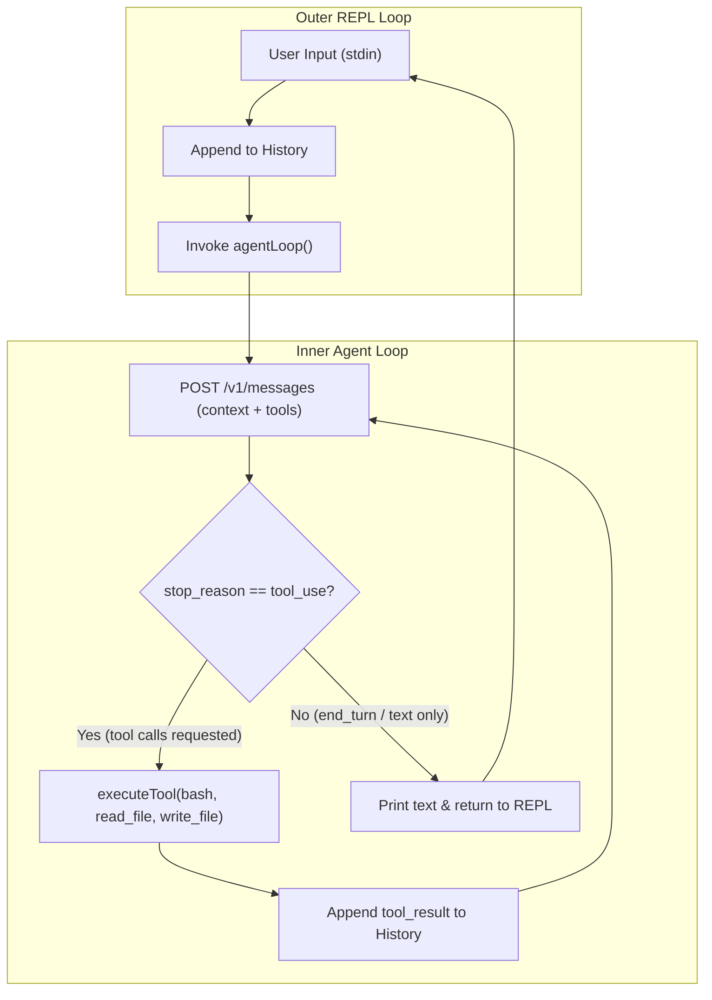

# Step 01: The Minimal Loop

## 1. Architectural Overview

At its fundamental level, every AI coding assistant (Claude Code, Aider, OpenCode) is built around two concentric loops:

1. **The Outer Loop (REPL)**: Reads user input from standard input, appends it to the conversation history, and invokes the inner agent engine.
2. **The Inner Loop (Agent Loop)**: A continuous execution cycle that sends the dialogue context and available tools to the LLM. If the model responds with tool requests (`tool_use`), the harness executes them on the host system, returns the results (`tool_result`), and continues the loop until the model decides to respond with conversational text (`end_turn`).



## 2. Key Design Principles

- **Errors as Tool Results (Not Exceptions)**: When a tool fails (e.g. file not found, syntax error), the harness must never panic or crash. The error must be formatted as a string with `is_error=true` and returned to the model. This allows the LLM to observe the failure and attempt self-correction.
- **Cross-Platform Execution**: Command execution (`bash` tool) must account for OS differences (Windows `sh.exe`/`cmd.exe` vs POSIX `sh`).

## 3. Implementation Requirements

- A single Go file (`main.go`) importing the Anthropic SDK.
- Three initial tools defined via JSON Schema:
  - `bash`: runs shell commands and captures combined stdout/stderr.
  - `read_file`: reads file contents from disk.
  - `write_file`: creates or overwrites files.
- An `executeTool` dispatcher returning `(string, bool)`.

## 4. Verification & Exercises

### Test 1: Conversational Turn (No Tools)
Verify that the model replies directly without entering tool execution.

**User Prompt:**
```text
> Hello!
```

**Expected Behavior & Output:**
- `len(messages)` starts at 1.
- `stop_reason` is `end_turn`.
- The terminal displays a polite greeting.
- Control returns immediately to the `> ` prompt (`len(messages)` becomes 2).

---

### Test 2: Autonomous Tool Execution
Verify that the model invokes a tool, receives its output, and responds with the computed answer.

**User Prompt:**
```text
> How many files are in this folder?
```

**Expected Behavior & Output:**
- The model requests the `bash` tool with a directory listing command (`ls` or `dir`).
- The harness logs: `[tool execute] bash ...`
- The harness returns the directory output to the model.
- The model parses the output and prints the count in plain text.
- `stop_reason` transitions to `end_turn` and returns to `> `.

---

### Test 3: Self-Correction on Error
Verify that if a tool execution encounters an error, the model does not crash the program and attempts to explain or rectify the issue.

**User Prompt:**
```text
> Read the contents of non_existent_file.xyz
```

**Expected Behavior & Output:**
- The model invokes `read_file` with `path: "non_existent_file.xyz"`.
- `executeTool` returns an OS error (`The system cannot find the file specified`).
- The harness appends the error with `is_error=true`.
- The model receives the error and explains to the user that the file does not exist.

