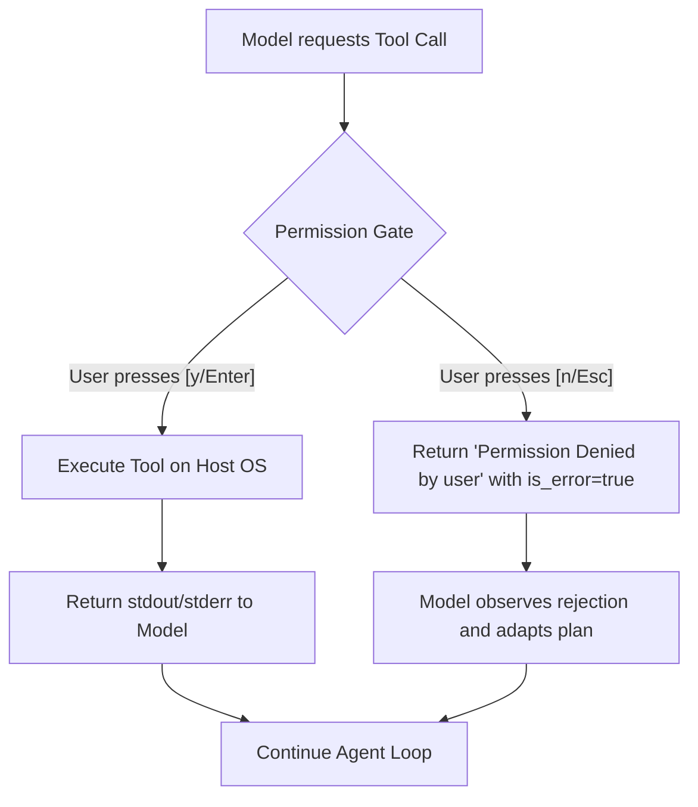

# Step 02: The Permission Gate

## 1. Architectural Overview

In Step 01, the agent executes every tool requested by the model automatically and unconditionally. While convenient, giving an autonomous agent unrestricted write and shell access to your machine is a critical safety risk (e.g. `rm -rf`, overwriting critical files, running destructive commands).

**The Permission Gate** introduces an interception layer between the model's intent (`tool_use`) and physical execution. The harness becomes the security supervisor:



## 2. Key Design Principles

- **The Human in the Loop (HITL)**: Before any irreversible or side-effecting action occurs, the user must inspect the tool name and exact parameters.
- **Rejection as a Valid Tool Result**: If the user denies execution, we do NOT terminate the program. We return a tool result stating `"execution rejected by user"` marked as `is_error=true`.
- **Preserving Loop Continuity**: The model must see the denial in its conversation history so it can apologize, ask for alternative instructions, or proceed with a different approach.

## 3. Implementation Requirements

1. Create a prompt helper (e.g. `confirm(toolName, rawInput string) bool`).
2. Before calling `executeTool`, display the pending command/file path.
3. If confirmed: proceed with `executeTool`.
4. If rejected: return `"Permission denied by user"`, `isError: true`.

## 4. Verification & Exercises

### Test 1: Approving Safe Execution
Verify that approving a command allows normal execution.

**User Prompt:**
```text
> Check current working directory
```

**Expected Interaction & Output:**
```text
[permission required] bash {"command":"pwd"} (or equivalent)
Allow execution? [y/N]: y
[tool execute] bash ...
Output returned to model.
Model responds with current directory path.
```

---

### Test 2: Rejecting a Destructive or Unwanted Action
Verify that rejecting an action keeps the system safe and allows the model to adjust.

**User Prompt:**
```text
> Delete the file hello.txt
```

**Expected Interaction & Output:**
```text
[permission required] bash {"command":"rm hello.txt"} (or write_file)
Allow execution? [y/N]: n
[tool] execution rejected by user.
```

**Model Expected Follow-up:**
- The model should output something like:
  *"I see you declined the deletion. The file remains untouched. Let me know if you would like to do something else."*
- Program remains active and ready for the next prompt.

