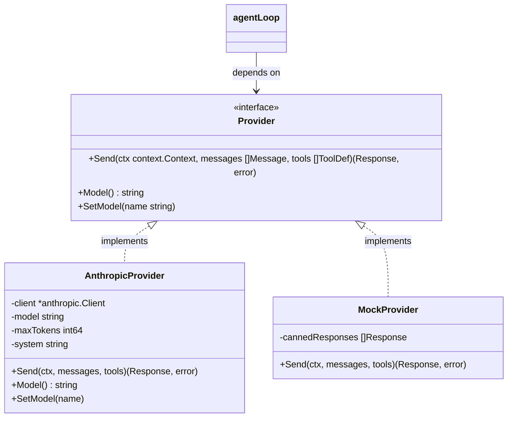

# Step 03: Provider Abstraction

## 1. Architectural Overview & Motivation

Up to this point, our harness was tightly coupled to the `github.com/anthropics/anthropic-sdk-go` library. Vendor-specific types like `anthropic.MessageParam`, `anthropic.ToolUnionParam`, and `anthropic.Client` leaked across our entire codebase—including `main()` and the inner `agentLoop`.

If we wanted to support OpenAI, Ollama, Gemini, or mock providers for testing, we would have had to rewrite the agent loop from scratch.

To solve this, we applied the **Dependency Inversion Principle (DIP)**:
1. **High-level modules** (`agentLoop`) must not depend on low-level modules (`anthropic-sdk-go`). Both must depend on abstractions (`Provider`).
2. **Abstractions** must not depend on details; details (`AnthropicProvider`) must depend on abstractions.
3. **Agnostic Domain Types**: The harness defines its own canonical vocabulary (`Message`, `Block`, `Role`, `ToolDef`, `Response`). Regardless of whether a vendor calls payloads "blocks", "parts", or "deltas", our harness core speaks one language.



---

## 2. Evolutionary Architecture: "Concepts > Code"

> [!NOTE] Architectural Scope & Early Design Tradeoffs
> In this milestone, all domain types and the `AnthropicProvider` adapter reside directly inside `package main` in [`provider.go`](../../provider.go) alongside [`main.go`](../../main.go).
>
> In an enterprise Go production codebase, you would typically expect dedicated packages such as `internal/provider`, `internal/domain`, or an engine registry with reflection-free dependency injection.
>
> However, this repository follows an **Evolutionary Design** philosophy: **CONCEPTS > CODE**.
> 
> Introducing deep package hierarchies or complex abstractions prematurely creates unnecessary cognitive friction while learning how an agent loop functions. We deliberately keep code colocated in `package main` during Phase 1 until [Step 10: Internal Architecture](./10-internal-architecture.md), where modularization is addressed as its own dedicated learning milestone.

---

## 3. What Was Implemented

### A. Vendor-Agnostic Domain Types
In [`provider.go`](../../provider.go):
- **`BlockType` & `Block`**: Employs the **tagged struct pattern** to represent text chunks, tool execution requests (`tool_use`), and tool output results (`tool_result`) without requiring runtime reflection or interface boxing.
- **`Role`**: Distinguishes `RoleUser`, `RoleAssistant`, and `RoleTool`.
- **`Message`**: Represents a single conversational turn composed of discrete `[]Block` items.
- **`ToolDef`**: Defines a vendor-neutral schema (`Name`, `Description`, `InputSchema map[string]any`, `Required []string`).
- **`Response`**: Normalizes the model's output and stop reason (`"tool_use"`, `"end_turn"`).

### B. The `Provider` Interface Contract
```go
type Provider interface {
	Send(ctx context.Context, messages []Message, tools []ToolDef) (Response, error)
	Model() string
	SetModel(name string)
}
```

### C. The `AnthropicProvider` Adapter & SDK Nuances
The concrete adapter in [`provider.go`](../../provider.go) encapsulates all wire-format translation:

1. **SDK Constructor & Memory Semantics**:
   - `anthropic.NewClient()` returns `anthropic.Client` by value.
   - Instantiating `&anthropic.Client{}` directly is dangerous because internal service structs (`Messages`, `Options`, `Beta`, HTTP transports) remain nil/zero-valued, causing runtime panics.
   - Because Go forbids taking the memory address of an rvalue call directly (`&anthropic.NewClient()`), the caller assigns it to an intermediate variable:
     ```go
     client := anthropic.NewClient()
     provider := NewAnthropicProvider(&client, string(anthropic.ModelClaudeHaiku5_5), 8192, systemPrompt)
     ```
2. **Wire Role Asymmetry**:
   - Anthropic's wire API only accepts two top-level message roles: `"user"` and `"assistant"`.
   - Tool execution results cannot be submitted with a `"tool"` role; they must be packaged inside a `RoleUser` turn using `anthropic.NewToolResultBlock`.
3. **Bi-directional Translation**:
   - `toAnthropicMessages()` transforms agnostic `[]Message` into `[]anthropic.MessageParam`.
   - `toAnthropicTools()` transforms agnostic `[]ToolDef` into `[]anthropic.ToolUnionParam`.
   - `Send()` translates the SDK's `anthropic.Message` back into our agnostic `Response`.

### D. Agnostic Agent Loop
In [`main.go`](../../main.go):
- The `agentLoop` signature now accepts `(ctx context.Context, provider Provider, messages []Message) []Message`.
- Zero Anthropic SDK imports are referenced inside `agentLoop` or `executeTool`.
- Tool calls are inspected via simple `switch block.Type` instead of SDK type assertions.

---

## 4. Message Flow Sequence

```mermaid
sequenceDiagram
    autonumber
    actor User
    participant Main as main()
    participant Loop as agentLoop()
    participant Provider as AnthropicProvider
    participant SDK as Anthropic SDK

    User->>Main: Prompt input
    Main->>Main: Append Message(RoleUser, BlockText)
    Main->>Loop: agentLoop(ctx, provider, messages)
    Loop->>Provider: Send(ctx, messages, tools)
    Provider->>SDK: Messages.New(toAnthropicMessages, toAnthropicTools)
    SDK-->>Provider: anthropic.Message
    Provider-->>Loop: Response(Content, StopReason)
    Loop->>Loop: Append Message(RoleAssistant)
    alt StopReason == "tool_use"
        Loop->>Loop: executeTool(name, input)
        Loop->>Loop: Append Message(RoleUser, BlockToolResult)
        Loop->>Provider: Send(ctx, messages, tools)
    else StopReason == "end_turn"
        Loop-->>Main: Return updated messages
    end
```

---

## 5. Verification Scenarios

### Test 1: Sanity Build & Static Analysis
```powershell
go vet ./...
go build ./...
```
*Expected Result*: Clean execution with 0 errors and 0 warnings.

### Test 2: End-to-End Calculation & Tool Use
Run the harness:
```powershell
go run .
```

**Scenario A: Plain Text Query**
```text
> What is 15 * 6?
```
*Expected Output*: The model responds directly with `90` without invoking tools.

**Scenario B: Tool Invocation with Permission Gate**
```text
> Read the first 5 lines of go.mod
```
*Expected Output*:
1. Harness prompts: `[permission required] read_file {"path":"go.mod"}`
2. Harness prompts: `Allow execution? [y/N]`
3. Upon entering `y`, `read_file` executes and returns content to the model.
4. Model displays the requested lines and terminates its turn cleanly.
