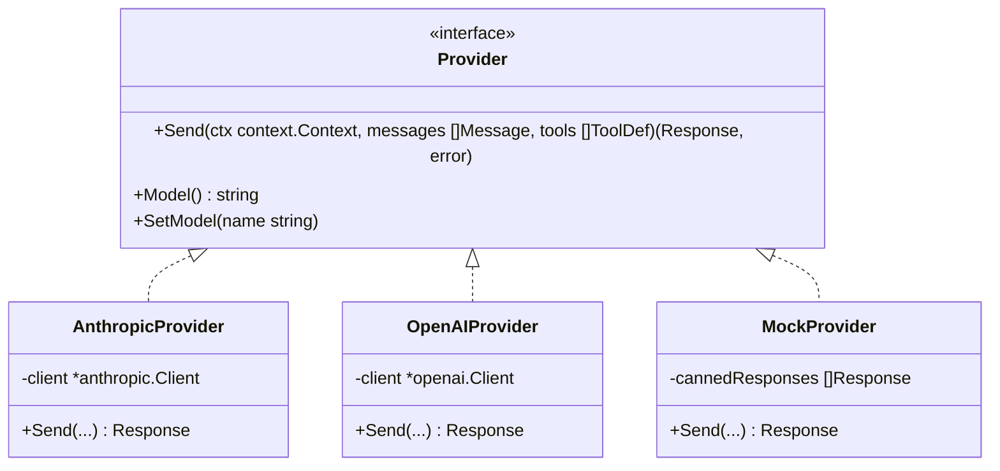

# Step 03: Provider Abstraction

## 1. Architectural Overview

Up to this point, our harness has been tightly coupled to the `github.com/anthropics/anthropic-sdk-go` package. Types like `anthropic.MessageParam` and `anthropic.ToolUnionParam` leak across our entire codebase.

If we want to support OpenAI, Ollama, Google Gemini, or local models, we must extract an **agnostic Provider abstraction**:



## 2. Key Design Principles

- **Zero SDK Leaks**: No Anthropic or OpenAI types outside their specific adapter files. The harness core operates solely on our custom domain types (`api.Message`, `api.ToolDef`, `api.Response`).
- **Normalized Message Structure**: Unify how different providers represent user, assistant, and tool result blocks.
- **Interchangeability**: Switching from Claude 3.7 to GPT-4o or Ollama should be a one-line change at harness initialization.

## 3. Implementation Requirements

1. Define common types:
   - `Message` (Role: User, Assistant; Content blocks).
   - `ToolDef` (Name, Description, InputSchema).
   - `Response` (Content blocks, StopReason).
2. Create the `Provider` interface.
3. Implement `AnthropicProvider` wrapping the Anthropic SDK.
4. Refactor `agentLoop` to consume `Provider` instead of `client.Messages.New`.

## 4. Verification & Exercises

### Test 1: Sanity Check with Generic Provider
Verify that the refactored loop works identically when sending messages through the interface.

**User Prompt:**
```text
> What is 15 * 6?
```

**Expected Interaction & Output:**
- `AnthropicProvider.Send()` translates internal messages to Anthropic SDK format.
- SDK receives and parses response.
- Response is normalized into internal `Response` struct.
- The model outputs: `90`.

