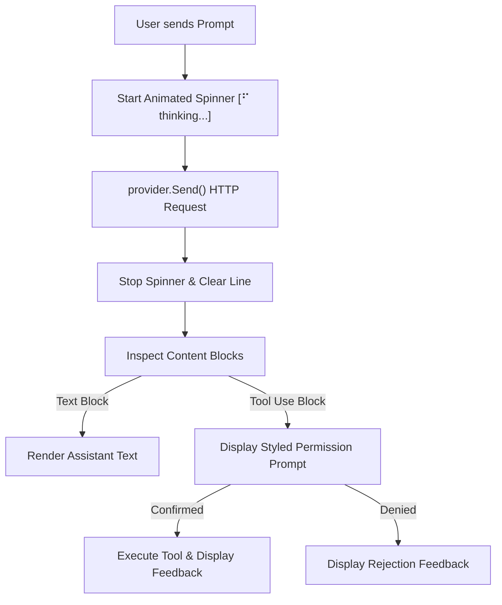

# Step 04: Terminal Polish & UX

## 1. Architectural Overview & Motivation

Developer experience in terminal coding agents relies heavily on clear, continuous visual feedback. When an agent is waiting on remote LLM latency or executing local disk/shell operations, an uncommunicative terminal feels completely frozen.

In this step, we introduced three critical terminal UX pillars:
1. **Startup Session Banner**: Clearly communicating the active model (via `provider.Model()`), working directory, and basic control instructions.
2. **Concurrent ANSI Spinner**: Running a non-blocking animated braille spinner during `provider.Send()` API latency that cleanly erases itself before model tokens or errors render.
3. **Styled Tool Execution & Permission Gate**: Distinct ANSI color formatting that elevates the visibility of the security boundary (`Permission Required:`), user confirmations (`[y/N]`), and execution notices.



---

## 2. Evolutionary Architecture: "Concepts > Code"

> [!NOTE] Architectural Scope & Early Design Tradeoffs
> In this milestone, the UI presentation logic and animation primitives are colocated directly within `package main` in [`spinner.go`](../../spinner.go) and [`ui.go`](../../ui.go) alongside [`main.go`](../../main.go).
>
> While a mature production harness would isolate terminal styling inside a dedicated `internal/ui` or `internal/tui` package, our roadmap intentionally adheres to **Evolutionary Design**: **CONCEPTS > CODE**.
>
> We introduce UI concepts first—channel-synchronized goroutines, carriage returns (`\r`), ANSI escape sequences, and terminal metadata querying—without adding premature package boundaries until [Step 10: Internal Architecture](./10-internal-architecture.md).

---

## 3. What Was Implemented

### A. The Non-Blocking Braille Spinner (`spinner.go`)
In [`spinner.go`](../../spinner.go):
- **Concurrency & Synchronization**: Implemented `startSpinner(label string) *Spinner` which spawns a background goroutine and a `time.Ticker` (80ms).
- **Two-Channel Lifecycle**:
  - `stop chan struct{}`: Closed by `Stop()` to signal termination to the background loop.
  - `done chan struct{}`: Closed by the goroutine upon line cleanup; `Stop()` blocks on `<-s.done` to guarantee that the animation has finished and erased before the main thread prints anything else.
- **Terminal Escapes**:
  - `\r`: Returns the cursor to column 0.
  - `\033[K`: Erases from the cursor to the end of the current line.
  - `[]rune("⠋⠙⠹⠸⠼⠴⠦⠧⠇⠏")`: Multi-byte braille runes indexed safely.

### B. Startup Session Banner & ANSI Palette (`ui.go`)
In [`ui.go`](../../ui.go):
- Defined reusable standard ANSI escape constants (`colorReset`, `colorBold`, `colorCyan`, `colorYellow`, `colorRed`, `colorGray`).
- `printBanner(provider Provider)`: Dynamically inspects `provider.Model()` and `os.Getwd()` to print an unambiguous session overview on harness boot.

### C. Styled Permission Gate & Clean Loop (`main.go`)
In [`main.go`](../../main.go):
- Removed raw `log.Printf` statements that previously cluttered the terminal output.
- Wrapped `provider.Send` with `sp := startSpinner("thinking...")` and `sp.Stop()`.
- Enhanced `executeTool` with bold yellow warnings for permission requests and clear red/cyan indicators for user denial and tool execution.

---

## 4. Message Flow Sequence

```mermaid
sequenceDiagram
    autonumber
    actor User
    participant Main as main()
    participant Loop as agentLoop()
    participant Spinner as startSpinner()
    participant Provider as Provider

    Main->>Main: printBanner(provider)
    User->>Main: Prompt Input
    Main->>Loop: agentLoop(ctx, provider, messages)
    Loop->>Spinner: startSpinner("thinking...")
    Note over Spinner: Background goroutine animates ⠋, ⠙, ⠹...
    Loop->>Provider: provider.Send(ctx, messages, tools)
    Provider-->>Loop: Response
    Loop->>Spinner: sp.Stop()
    Note over Spinner: Clears line (\r\033[K) and closes done channel
    alt Tool Requested
        Loop->>User: Styled Permission Prompt (Yellow)
        User->>Loop: Confirmation [y/N]
        Loop->>User: Styled Executing notice (Cyan)
    else Plain Text Response
        Loop->>User: Assistant Response Text
    end
```

---

## 5. Verification & Testing

### Test 1: Sanity Build & Static Analysis
```powershell
go vet ./...
go build ./...
```
*Expected Result*: 0 errors and 0 warnings.

### Test 2: Piped Non-Interactive Execution
Verify that the harness initializes the banner, runs the spinner during calculation, and outputs the result:
```powershell
powershell -Command "'What is 12 + 15?' | go run ."
```
*Expected Output*:
```text
━━━ Phi Agent Code ━━━
Model:     claude-haiku-5-5
Directory: ...
Commands:  Type your prompt or press Ctrl+C to exit.

> ⠋ thinking...12 + 15 = **27**
```

### Test 3: Tool Execution with Permission Gate
Verify that tool invocations present the styled permission gate:
```powershell
powershell -Command "@('Read the first line of go.mod', 'y') | go run ."
```
*Expected Output*:
- Styled `Permission Required:` warning appears with tool name and arguments.
- Styled `Allow execution? [y/N]` prompt appears.
- Upon `y`, prints `▶ Executing bash...` (or `read_file`), runs the tool, and returns the contents cleanly.
