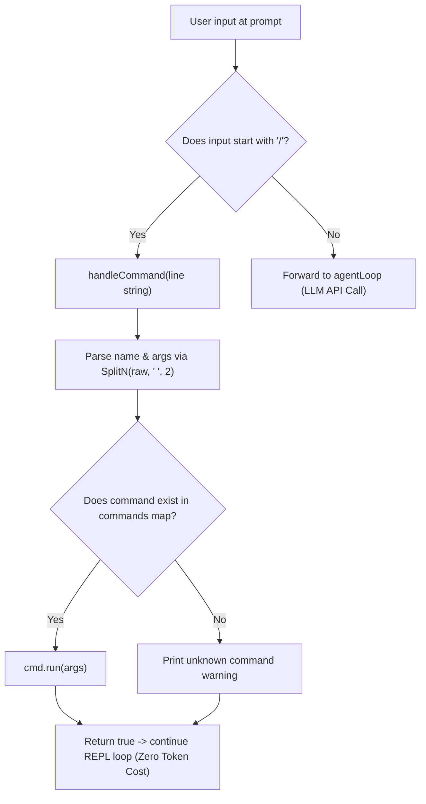

# Step 05: Slash Commands

## 1. Architectural Overview & Motivation

Not every input typed by a developer into the REPL is meant to be forwarded to the LLM. Users require a local, zero-token administrative channel to control the agent harness session—clearing conversation history, inspecting or swapping models, listing active tools, or exiting cleanly.

**Slash Commands** intercept any user input starting with `/` before it reaches the core agent loop:



---

## 2. Evolutionary Architecture: "Concepts > Code"

> [!NOTE] Why `commands.go` Remains in `package main`
> In this milestone, the command registry and handlers live directly inside `package main` in [`commands.go`](../../commands.go).
>
> In Go, slash commands frequently touch almost every runtime capability: inspecting `provider`, clearing `messages`, listing `tools`, or managing compaction.
>
> Moving `commands` into an isolated package prematurely often causes **circular import cycles** (`import cycle not allowed`), because commands would import the runner, which in turn imports commands. Keeping `commands.go` in `main` avoids cycle complexity until [Step 10: Internal Architecture](./10-internal-architecture.md), where clean dependency injection boundaries are established.

---

## 3. What Was Implemented

### A. The Command Registry Pattern (`commands.go`)
In [`commands.go`](../../commands.go):
- **`command` Struct**: Encapsulates metadata (`description`, `usage`) and execution logic (`run func(args string)`).
- **`commands` Map**: Central lookup table populated during package initialization via `init()`.
- **Core Commands**:
  - `/help`: Iterates over sorted command keys and aligns output using `%-22s`.
  - `/model [name]`: Without arguments, displays the active model and suggestions (`knownModels`); with an argument, dynamically reconfigures the active model via `provider.SetModel(args)`.
  - `/clear`: Safely truncates conversational history (`messages = messages[:0]`) without allocating new memory.
  - `/tools`: Lists registered tools (`tools`) and their descriptions.
  - `/exit` & `/quit`: Terminates the CLI session immediately via `os.Exit(0)`.

### B. The Dispatcher Function (`handleCommand`)
- **Prefix Guard**: Quickly exits (`return false`) for standard natural language prompts.
- **`strings.SplitN(raw, " ", 2)`**: Splits the input into exactly two components: the command name and the remainder argument string, preserving all internal spaces within arguments.
- **Comma-Ok Map Lookup**: Safely checks `cmd, exist := commands[name]`, preventing key-missing panics.

### C. REPL Interception (`main.go`)
In [`main.go`](../../main.go):
- Eliminated local variable shadowing by binding `provider` and `messages` directly to package-level variables.
- Inserted `if handleCommand(input) { continue }` directly after user input acquisition, bypassing `agentLoop` completely for local directives.

---

## 4. Verification & Exercises

### Exercise 1: Help Command Listing
Verify local command execution without API roundtrip:
```powershell
powershell -Command "'/help' | go run ."
```
*Expected Interaction & Output*:
- Instantly lists all commands in alphabetical order without API latency:
```text
>  /clear                 clear conversation history
 /exit                  exit the harness
 /help                  show available commands
 /model                 show or change the model
 /quit                  exit the harness (alias to /exit)
 /tools                 list available tools
```

---

### Exercise 2: Clearing Conversation History
Verify that `/clear` purges conversation memory locally:

**Interactive Sequence:**
1. Run `go run .`
2. Send a prompt: `Hello!` (Model responds; conversation now has 2 messages).
3. Type `/clear`.
4. Output verifies: `conversation cleared`.
5. Send another message: `What did I say earlier?`
6. Model confirms it has no prior context, proving memory was wiped locally.

---

### Exercise 3: Inspecting & Switching Models
Verify dynamic runtime model updates:

**A. Querying Current Model & Suggestions:**
```powershell
powershell -Command "'/model' | go run ."
```
*Expected Output*:
```text
> current: claude-haiku-5-5
suggestions:
  claude-opus-4-7
  claude-opus-4-6
  claude-sonnet-4-6
  claude-haiku-4-5
  claude-haiku-5-5
```

**B. Changing Model Dynamically:**
```powershell
powershell -Command "@('/model claude-sonnet-4-6', '/model') | go run ."
```
*Expected Output*:
- Sets model to `claude-sonnet-4-6` and second call confirms `current: claude-sonnet-4-6`.

---

### Exercise 4: Tool Catalog Inspection
Verify that tools defined in the harness are exposed to the user:
```powershell
powershell -Command "'/tools' | go run ."
```
*Expected Output*:
```text
>  bash            Run a shell command and return its combined stdout/stderr.
 read_file       Read the contents of a file at the given path.
 write_file      Write content to a file (creating or overwriting it).
```

---

### Exercise 5: Clean Exit
Verify `/exit` and `/quit` terminate the session cleanly:
```powershell
powershell -Command "'/quit' | go run ."
```
*Expected Output*: Process exits with status code 0 immediately.
