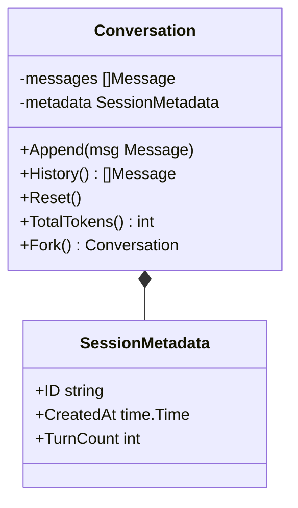

# Step 06: Conversation State

## 1. Architectural Overview

LLM APIs are completely **stateless**. The model does not remember past turns, tool results, or instructions unless the client resends the full conversation history on every API call.

In this step, we formalize how the harness manages the client-side **Conversation State**:

## 2. Key Design Principles

- **Single Source of Truth**: All message mutations (adding user prompts, assistant answers, tool outputs) flow through a centralized `Conversation` manager.
- **Alternating Roles Invariant**: The Anthropic and OpenAI APIs require strict turn order (User -> Assistant -> User -> Assistant). The state manager validates and guarantees that invalid sequences never reach the wire.
- **Metadata Tracking**: Track turn counts, session start timestamps, and token counters.

## 3. Implementation Requirements

1. Encapsulate the raw `[]Message` slice inside a dedicated `Conversation` struct.
2. Provide methods for appending, validating role alternation, and resetting state.
3. Replace direct slice mutations in `agentLoop` with the `Conversation` manager.

## 4. Verification & Exercises

### Test 1: Invariant Validation
Verify that attempting to add two consecutive assistant messages triggers validation before sending to the API.

**Check:**
- State manager automatically groups or normalizes consecutive blocks or throws a handled error before making an invalid API call.

