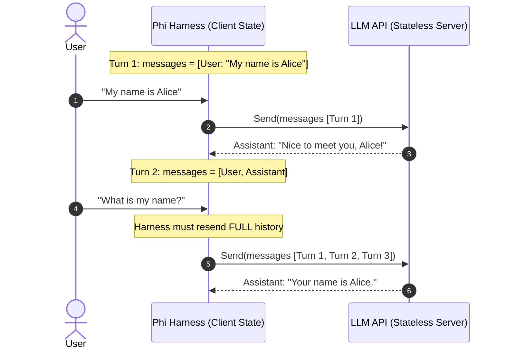

# Step 06: Conversation State

## 1. Architectural Overview & The Stateless API Reality

Frontier Large Language Model APIs (Anthropic, OpenAI, Gemini) are completely **stateless**. The server retains zero memory of past turns, previous tool outputs, or developer instructions between HTTP calls.

To create the illusion of a continuous conversation, **the client harness carries everything**:
- Every single turn, the harness must resend the **entire historical `messages` slice** to the provider.
- If the harness forgets to include a previous turn, the model has immediate amnesia.
- Every session is an isolated island in memory.



---

## 2. Evolutionary Architecture: "Concepts > Code" & Avoiding Premature Abstraction

> [!NOTE] Why There Is No `Conversation` Wrapper Class
> In object-oriented languages, developers often rush to wrap primitive slices in container classes (e.g., `class ConversationManager`).
>
> In Go, idiomatic design favors concrete primitives until abstraction is genuinely required:
> - Go slices (`[]Message`) are already lightweight, first-class reference headers passed efficiently across functions.
> - Downstream milestones—such as [Step 07: Compaction Strategies](./07-compaction-strategies.md), [Step 10: Internal Architecture](./10-internal-architecture.md), and [Step 11: Subagents](./11-subagents-delegation.md)—all accept and return raw `[]Message` slices directly.
>
> Introducing a wrapper struct here would add boilerplate (`conv.GetMessages()`, `conv.SetMessages()`) only to unwrap it in subsequent steps. Following the book's evolutionary philosophy, this milestone is a **conceptual checkpoint**: understanding the lifecycle of the message slice before we learn how to compact it in Step 07.

---

## 3. The Lifecycle of a Conversation Turn

In our harness ([`main.go`](../../main.go)), the conversation state is represented by the package-level slice `var messages []Message`.

Here is the exact progression across a multi-turn tool interaction:

1. **User Turn**:
   ```go
   messages = append(messages, Message{
       Role:    RoleUser,
       Content: []Block{{Type: BlockText, Text: input}},
   })
   ```
2. **Assistant Turn**:
   The model returns content blocks (text or tool calls) and the stop reason:
   ```go
   messages = append(messages, Message{
       Role:    RoleAssistant,
       Content: resp.Content,
   })
   ```
3. **Tool Result Turn (The Role Asymmetry Invariant)**:
   Frontier APIs require strictly alternating roles (`user` $\rightarrow$ `assistant` $\rightarrow$ `user`).
   Therefore, tool results cannot be sent with a custom `"tool"` role at the wire level; they are packaged inside a `RoleUser` message:
   ```go
   messages = append(messages, Message{
       Role:    RoleUser,
       Content: toolResults, // BlockToolResult blocks
   })
   ```

---

## 4. Verification & Exercises

> [!NOTE] Pedagogical Inspection Command (`/dump`)
> The `/dump` command is introduced specifically in this milestone branch for learning and diagnostic inspection. It allows developers to execute the book's canonical JSON dump exercise interactively without manually altering source code.

### Exercise 1: Dumping Raw Conversation JSON (`/dump`)
After a few interaction turns with tool usage, dump the `messages` slice to JSON (`json.MarshalIndent(messages, "", "  ")`) and inspect the wire structure directly.

**Interactive Sequence:**
1. Run `go run .`
2. **Turn 1**:
   ```text
   > Read the first line of go.mod
   ```
   Confirm tool permission: `y`. The model executes `read_file` (or `bash`) and responds with the first line.
3. **Turn 2**:
   ```text
   > /dump
   ```

*Expected Verification & Invariant Confirmation*:
The terminal outputs the raw indented JSON representation of `messages`:
```json
[
  {
    "Role": "user",
    "Content": [
      {
        "Type": "text",
        "Text": "Read the first line of go.mod"
      }
    ]
  },
  {
    "Role": "assistant",
    "Content": [
      {
        "Type": "tool_use",
        "ToolUseID": "toolu_01...",
        "ToolName": "bash",
        "ToolInput": "{\"command\":\"head -n 1 go.mod\"}"
      }
    ]
  },
  {
    "Role": "user",
    "Content": [
      {
        "Type": "tool_result",
        "ToolUseID": "toolu_01...",
        "ToolResult": "module phi-agent-code\n",
        "IsError": false
      }
    ]
  },
  {
    "Role": "assistant",
    "Content": [
      {
        "Type": "text",
        "Text": "The first line of `go.mod` is `module phi-agent-code`."
      }
    ]
  }
]
```

**Key Invariants to Confirm:**
1. **Alternating Roles**: `user` $\rightarrow$ `assistant` $\rightarrow$ `user` $\rightarrow$ `assistant`.
2. **Tool Pairing**: Notice how the `tool_result` in Turn 3 has the exact same `ToolUseID` (`toolu_01...`) that was requested by the assistant in Turn 2, and is packaged inside a `user` turn.

---

### Exercise 2: Multi-Turn Memory Retention
Verify that shipping the full `messages` slice provides seamless multi-turn context:

**Interactive Sequence:**
1. **Turn 1 Prompt**:
   ```text
   > Remember the secret codeword: PHOENIX-99
   ```
   *Expected Response*: Model acknowledges and repeats the codeword.
2. **Turn 2 Prompt**:
   ```text
   > What was the secret codeword I just gave you?
   ```
   *Expected Response*: The model correctly states `PHOENIX-99`.
   *(Proof: The stateless API only knows the codeword because `messages` resent Turn 1).*

---

### Exercise 3: Verifying Statelessness via `/clear`
Verify that resetting the client-side slice causes immediate amnesia in the model:

**Interactive Sequence:**
1. Continuing from Exercise 2, type:
   ```text
   > /clear
   ```
   *Output*: `conversation cleared`
2. Run `/dump` to verify the slice was reset:
   ```text
   > /dump
   [] (conversation history is empty)
   ```
3. **Turn 3 Prompt**:
   ```text
   > What was the secret codeword?
   ```
   *Expected Response*: The model states it does not know or has no prior context, proving the API holds zero server-side memory.
