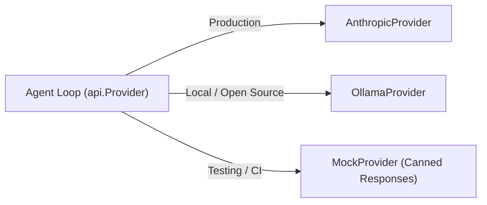

# Step 06: Alternative Providers & Mocks

## 1. Architectural Overview

Once the `Provider` interface is in place, adding a second LLM backend or a deterministic test mock requires zero changes to the agent loop.

In this step, we implement:
1. An alternative provider (such as OpenAI or Ollama).
2. A **`MockProvider`**: an in-memory provider that returns scripted responses without consuming API credits or requiring network connectivity.



## 2. Key Design Principles

- **Deterministic Testing**: `MockProvider` enables verifying multi-turn tool loops, error recovery, and permission gates inside standard unit tests (`go test`).
- **Offline Development**: Work on the harness anywhere, anytime, without API keys.

## 3. Implementation Requirements

1. Implement `MockProvider` with a queue of pre-configured `Response` objects.
2. Verify that `MockProvider.Send` records the input messages and pops the expected response.
3. Add a CLI flag or config setting to select the active provider at startup (`--provider mock` vs `--provider anthropic`).

## 4. Verification & Exercises

### Test 1: Running with MockProvider
Simulate a full tool execution turn without touching external APIs.

**Configuration:**
Initialize harness with `MockProvider` preloaded with:
1. `Response{StopReason: ToolUse, Content: [ToolUse("bash", "echo hello")]}`
2. `Response{StopReason: EndTurn, Content: [Text("Command finished.")]}`

**User Prompt:**
```text
> Run a test command
```

**Expected Interaction & Output:**
```text
[mock provider] Dispatched response 1/2
[tool execute] bash {"command":"echo hello"}
hello
[mock provider] Dispatched response 2/2
Command finished.
```
- No network requests made.
- Test completes in under 10ms.

