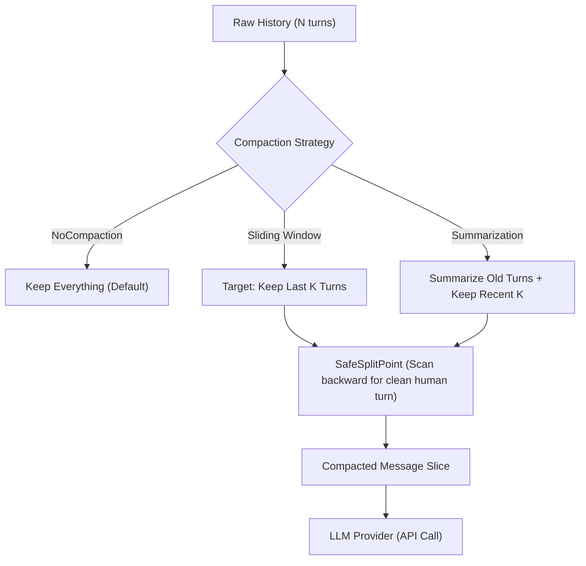
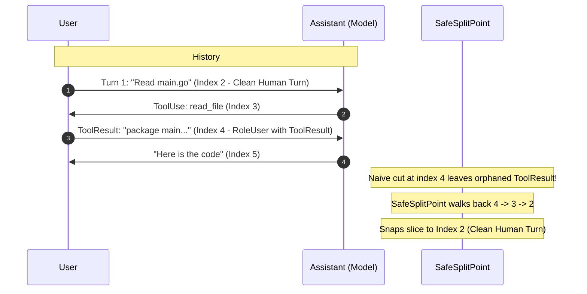

# Step 07: Compaction Strategies

## 1. Architectural Overview & The Context Boundary

As an AI coding agent pairs with a developer across hours of reading files, writing diffs, and executing tests, the conversation transcript grows monotonically. Eventually, it encounters two hard technical boundaries:

1. **Context Window Limits**: Exceeding the maximum token limit of the model (e.g., 200k tokens for Claude) results in catastrophic API failure (`400 Bad Request: prompt is too long`).
2. **Cost & Latency Explosion**: LLM providers bill per input token on *every single request*. Sending 100,000 historical tokens for every minor keystroke or tool iteration causes prohibitive cost inflation and adds seconds of time-to-first-token (TTFT) latency.

**Compaction** solves this by strategically trimming or summarizing past conversation turns while strictly maintaining provider protocol invariants:



---

## 2. Key Design Principles & Invariants

### The Safe Split Invariant
In Anthropic's wire protocol, tool execution outputs are not assigned an independent `"tool"` role; they are returned inside a `RoleUser` message block (`BlockToolResult`). 

Consequently, naive slicing (`messages[len(messages)-K:]`) can easily cut a conversation history right down the middle of a tool transaction:
- An assistant message requesting a tool (`tool_use`) is pruned.
- The next user message returning the tool output (`tool_result`) remains as the new head of the history.

The Anthropic API strictly enforces that **every `tool_result` must be preceded by a matching `tool_use`**. An orphaned tool result causes immediate rejection:
```text
HTTP 400 Bad Request: each tool_result block must correspond to a preceding tool_use block in the previous message
```

Furthermore, conversations must always begin with an authentic human prompt. Therefore, `SafeSplitPoint` walks backward from the desired cut index until it finds a turn satisfying:
$$\text{messages}[i].\text{Role} == \text{RoleUser} \quad \land \quad \neg\text{messages}[i].\text{HasToolResult}()$$



---

### Turn Boundary Compaction vs. Mid-Turn Compaction
An agent interaction turn is an **atomic transaction**:
1. User provides prompt.
2. Model requests tool.
3. Harness executes tool and returns result.
4. Model synthesizes final response (`end_turn`).

Compacting *inside* the inner agent loop between tool executions risks pruning the prompt that defined the active task before it finishes. Therefore, compaction executes at the **turn boundary** in [`main.go`](../../main.go) before delegating to `agentLoop`.

---

### Go Method Sets & Receiver Mechanics
In Go, an interface is satisfied only when a type's method set contains all required signatures:
- For value receiver `func (s SlidingWindow) Compact(...)`: both `SlidingWindow` and `*SlidingWindow` implement `CompactionStrategy`.
- For pointer receiver `func (s *SlidingWindow) Compact(...)`: only `*SlidingWindow` implements `CompactionStrategy`.

When instantiating `SlidingWindow`, pass the pointer (`&SlidingWindow{KeepLast: K}`) to satisfy the interface.

---

## 3. Implementation Details

### 1. Domain Helper on `Message` ([`provider.go`](../../provider.go))
Detects whether a message turn contains any tool execution outputs:
```go
func (m Message) HasToolResult() bool {
	for _, b := range m.Content {
		if b.Type == BlockToolResult {
			return true
		}
	}
	return false
}
```

### 2. Strategy Contract & Implementations ([`compact.go`](../../compact.go))
```go
type CompactionStrategy interface {
	Compact(ctx context.Context, messages []Message) ([]Message, error)
}

func SafeSplitPoint(messages []Message, desired int) int {
	if desired <= 0 {
		return 0
	}
	if desired >= len(messages) {
		return len(messages)
	}
	for i := desired; i > 0; i-- {
		if messages[i].Role == RoleUser && !messages[i].HasToolResult() {
			return i
		}
	}
	return 0
}

type NoCompaction struct{}

func (NoCompaction) Compact(_ context.Context, messages []Message) ([]Message, error) {
	return messages, nil
}

type SlidingWindow struct {
	KeepLast int
}

func (s *SlidingWindow) Compact(_ context.Context, messages []Message) ([]Message, error) {
	if len(messages) <= s.KeepLast {
		return messages, nil
	}
	split := SafeSplitPoint(messages, len(messages)-s.KeepLast)
	return messages[split:], nil
}
```

### 3. Wiring at Turn Boundary ([`main.go`](../../main.go))
```go
var (
	provider  Provider
	messages  []Message
	compactor CompactionStrategy = NoCompaction{}
)

// Inside main() REPL loop:
messages = append(messages, Message{
	Role:    RoleUser,
	Content: []Block{{Type: BlockText, Text: input}},
})

compacted, err := compactor.Compact(ctx, messages)
if err != nil {
	fmt.Printf("compaction error: %v\n", err)
} else {
	messages = compacted
}

messages = agentLoop(ctx, provider, messages)
```

### 4. Interactive Slash Command ([`commands.go`](../../commands.go))
Allows inspecting and triggering compaction interactively:
```go
commands["compact"] = command{description: "compact conversation history", run: cmdCompact}

func cmdCompact(_ string) {
	if len(messages) == 0 {
		fmt.Println("no messages to compact")
		return
	}
	before := len(messages)
	compacted, err := compactor.Compact(context.Background(), messages)
	if err != nil {
		fmt.Printf("compact error: %v\n", err)
		return
	}
	messages = compacted
	fmt.Printf("compacted: %d -> %d messages\n", before, len(messages))
}
```

---

## 4. Verification & Exercises

### Exercise 1: Table-Driven Unit Testing (`compact_test.go`)
Run the test suite to verify boundary conditions, backward scanning, and tool-use atomicity:

```bash
go test -v ./...
```

**Verified Scenarios:**
- Desired index $\le 0$ returns `0`.
- Desired index beyond slice length returns `len(messages)`.
- Cut index falling on `BlockToolUse` or `BlockToolResult` automatically walks back to the preceding clean human message.
- `SlidingWindow` preserves tool call atomicity and ensures history never starts with an orphaned tool result.

### Exercise 2: Interactive Sliding Window Verification
1. Open [`main.go`](../../main.go) and change `compactor` to:
   ```go
   var compactor CompactionStrategy = &SlidingWindow{KeepLast: 4}
   ```
2. Run `go run .`
3. Execute 3 consecutive turns requiring tool use (e.g. read files or run commands).
4. Run `/compact`:
   ```text
   > /compact
   compacted: 8 -> 4 messages
   ```
5. Confirm that the model continues to reply without any HTTP 400 errors.
