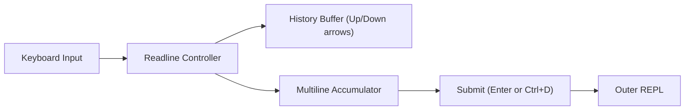

# Step 08: Advanced Input Handling

## 1. Architectural Overview

Standard `bufio.Scanner(os.Stdin)` has significant limitations:
- Arrow keys produce raw escape sequences (`^[[A`, `^[[B`) instead of moving the cursor or browsing command history.
- Paste operations with newlines trigger immediate execution before the user finishes pasting.
- No multiline editing.

In this step, we replace raw standard input with a robust **Readline / Input controller**:

## 2. Key Design Principles

- **History Persistence**: Command history navigation via Up and Down arrow keys.
- **Bracketed Paste**: Detecting pasted blocks so that multiline code snippets paste cleanly into the prompt without prematurely submitting.
- **Graceful Interrupts**: `Ctrl+C` cancels current input buffer instead of abruptly terminating the entire process.

## 3. Implementation Requirements

1. Integrate a Go readline library (e.g., `chzyer/readline` or Bubble Tea text input).
2. Support history navigation.
3. Support multiline prompts (e.g., via triple quotes `"""` or `\` continuation).

## 4. Verification & Exercises

### Test 1: History Navigation
1. Enter `first command`.
2. Enter `second command`.
3. Press `Up Arrow` twice.
4. Verify that `first command` appears in the prompt ready for editing.

