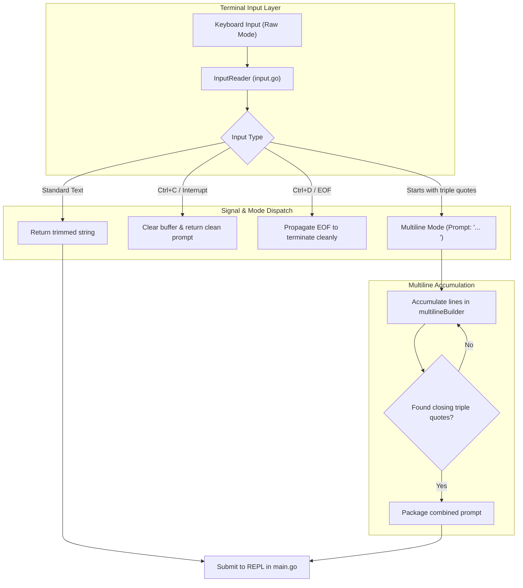

# Step 08: Advanced Input Handling

## 1. Architectural Overview

Standard `bufio.Scanner(os.Stdin)` operates in standard line-buffered canonical mode with significant UX limitations for AI pair programming:
- Arrow keys emit raw escape sequences (`^[[A`, `^[[B`) instead of moving the cursor or browsing command history.
- Paste operations containing newlines trigger premature execution on the very first newline before the user finishes pasting.
- Pressing `Ctrl+C` abruptly kills the agent process instead of discarding the current draft buffer.
- No multiline input editing for complex prompts or multi-line code blocks.

In this step, we replace `bufio.Scanner` with a dedicated **Readline Input Controller** ([`input.go`](../../input.go)) backed by `github.com/chzyer/readline`:



---

## 2. Key Design Principles & Invariants

### 1. Terminal Canonical Mode vs. Raw Mode Lifecycle
In canonical mode, the operating system kernel buffers keystrokes until `Enter` is pressed. To handle arrow keys, cursor repositioning, and inline editing, `InputReader` switches the terminal to **Raw Mode** via `readline.NewEx()`.

**Critical Resource Invariant (`defer inputReader.Close()`):**
When a process sets a terminal to Raw Mode, if it terminates without restoring standard mode, the host terminal remains broken (cursor navigation fails, newline echoes break). Calling `defer inputReader.Close()` right after constructor initialization guarantees terminal restoration regardless of normal exit, `Ctrl+D`, or panics.

### 2. The Single-Line Prompt Invariant
In Raw Mode, `readline` repaints the prompt string on **every single keystroke** (`\r` + `Prompt` + `buffer`). Including newline characters (`\n`) inside the prompt string corrupts terminal coordinate math, causing a blank newline shift on every character typed. Prompt strings must strictly remain single-line (e.g., `"> "` and `"... "`).

### 3. Delimited Multiline Blocks via Triple Quotes (`"""`)
To enable pasting large blocks of code without premature execution:
1. When input starts with `"""`, `ReadPrompt()` switches prompt to `... ` using `reader.readlineInstance.SetPrompt("... ")`.
2. A `defer reader.readlineInstance.SetPrompt("> ")` ensures automatic restoration back to default prompt upon exit.
3. Lines are accumulated into a `multilineBuilder strings.Builder` until a matching closing `"""` delimiter is entered.

### 4. Graceful Signal Interruption (`Ctrl+C`)
Instead of terminating the entire agent process when a user types an erroneous prompt, `readline.ErrInterrupt` is intercepted and returns `"", nil`, giving the user a fresh, clean prompt while preserving conversation state.

---

## 3. Implementation Details

### `InputReader` Struct & Constructor ([`input.go`](../../input.go))
```go
type InputReader struct {
	readlineInstance *readline.Instance
}

func NewInputReader() (*InputReader, error) {
	userHomeDirectory, err := os.UserHomeDir()
	historyFilePath := ".phi_agent_history"
	if err == nil {
		historyFilePath = filepath.Join(userHomeDirectory, historyFilePath)
	}

	readlineConfig := &readline.Config{
		Prompt:          "> ",
		HistoryFile:     historyFilePath,
		InterruptPrompt: "^C",
		EOFPrompt:       "exit",
	}

	instance, err := readline.NewEx(readlineConfig)
	if err != nil {
		return nil, fmt.Errorf("failed to initialize terminal readline: %w", err)
	}

	return &InputReader{readlineInstance: instance}, nil
}
```

### Multiline Reading & Signal Handling ([`input.go`](../../input.go))
```go
func (reader *InputReader) ReadPrompt() (string, error) {
	rawLine, readErr := reader.readlineInstance.Readline()
	if readErr != nil {
		if readErr == readline.ErrInterrupt {
			return "", nil // Ctrl+C cancels current line without killing process
		}
		return "", readErr
	}

	trimmedLine := strings.TrimSpace(rawLine)
	if strings.HasPrefix(trimmedLine, `"""`) {
		// Single-line block: """code"""
		if len(trimmedLine) > 3 && strings.HasSuffix(trimmedLine, `"""`) {
			extractedContent := strings.TrimSuffix(strings.TrimPrefix(trimmedLine, `"""`), `"""`)
			return strings.TrimSpace(extractedContent), nil
		}

		var multilineBuilder strings.Builder
		firstLineWithoutDelimiter := strings.TrimPrefix(rawLine, `"""`)
		if firstLineWithoutDelimiter != "" {
			multilineBuilder.WriteString(firstLineWithoutDelimiter)
			multilineBuilder.WriteString("\n")
		}

		reader.readlineInstance.SetPrompt("... ")
		defer reader.readlineInstance.SetPrompt("> ")

		for {
			nextLine, nextLineErr := reader.readlineInstance.Readline()
			if nextLineErr != nil {
				if nextLineErr == readline.ErrInterrupt {
					return "", nil
				}
				return "", nextLineErr
			}

			if strings.Contains(nextLine, `"""`) {
				closingLineContent := strings.TrimSuffix(nextLine, `"""`)
				multilineBuilder.WriteString(closingLineContent)
				break
			}

			multilineBuilder.WriteString(nextLine)
			multilineBuilder.WriteString("\n")
		}

		return strings.TrimSpace(multilineBuilder.String()), nil
	}

	return trimmedLine, nil
}
```

---

## 4. Verification & Exercises

### Exercise 1: Persistent History Navigation
1. Run `phi-agent.exe`.
2. Enter `first test prompt`.
3. Enter `second test prompt`.
4. Press `Up Arrow` (`↑`) twice.
5. Verify that `first test prompt` appears in the prompt ready for inline editing.
6. Terminate and restart `phi-agent.exe`. Press `Up Arrow` to verify history persisted across sessions from `~/.phi_agent_history`.

### Exercise 2: Graceful Interrupt Handling
1. Type a partial prompt: `this is an accidental prompt`.
2. Press `Ctrl+C`.
3. Verify that the agent process does NOT terminate and presents a clean `> ` prompt.

### Exercise 3: Multiline Block Pasting
1. Type `"""` and press Enter. Observe prompt change to `... `.
2. Enter multiple lines of code or prompt instructions.
3. Close the block with `"""` and press Enter.
4. Verify that the entire multiline block is submitted to the agent loop as a single prompt turn.
