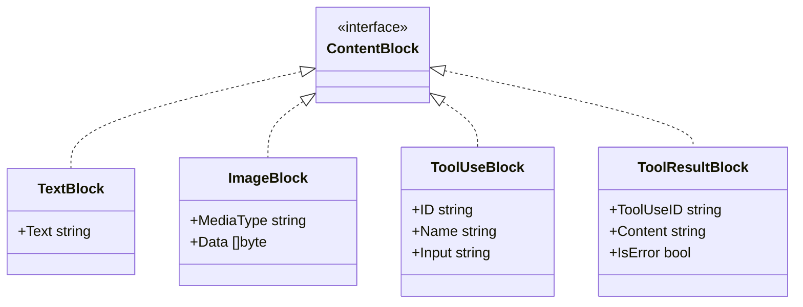

# Step 08: Multimodal & Image Inputs

## 1. Architectural Overview

Modern frontier models (Claude 3.5/3.7, GPT-4o) are natively multimodal. Software engineering agents often need to inspect UI screenshots, architectural mockups, diagrams, or bug reports containing images.

In this step, we enhance our message representation to accept binary image blocks alongside standard text:



## 2. Key Design Principles

- **Automatic Format Detection**: Detect MIME types (`image/png`, `image/jpeg`, `image/webp`) from file extensions or magic bytes.
- **Base64 Encoding**: Normalize local image files into base64 payloads required by LLM APIs.
- **CLI Syntax Support**: Allow users to attach images using special syntax, e.g. `@path/to/diagram.png`.

## 3. Implementation Requirements

1. Add `ImageBlock` to our domain types.
2. Update user input parser to detect `@<filename>` image attachments.
3. Update provider adapters to map `ImageBlock` to provider-specific payloads.

## 4. Verification & Exercises

### Test 1: Image Inspection & Description
Verify that attaching a local image allows the model to reason about visual details.

**User Prompt:**
```text
> Analyze this architecture diagram @assets/architecture.png
```

**Expected Interaction & Output:**
- Harness detects the image path, reads the bytes, and attaches an `ImageBlock`.
- Model describes the diagram components (e.g. database, cache, API gateway) correctly.

