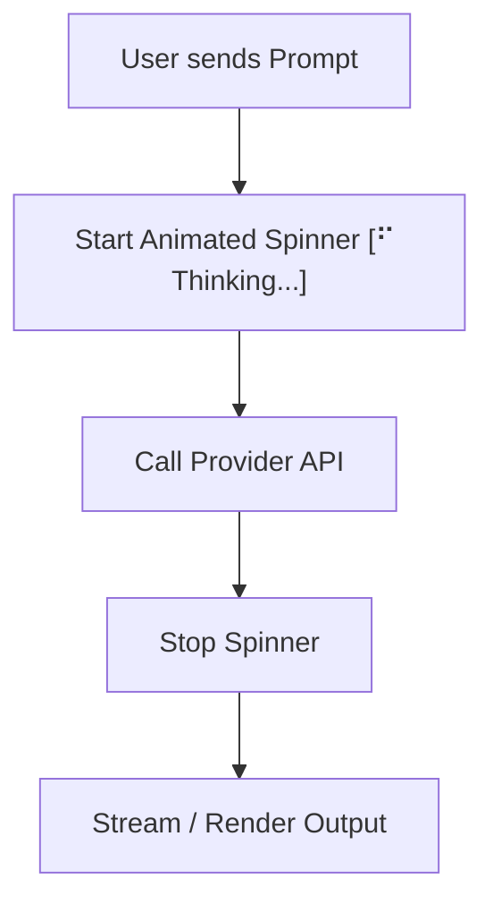

# Step 09: Terminal Polish & UX

## 1. Architectural Overview

Developer experience in the terminal relies heavily on clear visual feedback. When an agent is thinking or executing background I/O, an uncommunicative terminal feels frozen.

This step introduces:
1. **ASCII Banner & Session Info**: Showing the active provider, model name, and working directory.
2. **Terminal Width Adaptation**: Wrapping lines cleanly to avoid ugly terminal wrapping.
3. **Spinner & Progress Indicators**: Communicating when network requests or long-running shell commands are active.



## 2. Key Design Principles

- **Non-Blocking Feedback**: Spinners must run concurrently in a goroutine without delaying or interfering with network I/O or token streams.
- **Terminal Capabilities**: Fallback gracefully when running in CI or non-interactive terminals (no ANSI escape codes).

## 3. Implementation Requirements

1. Implement a lightweight ANSI spinner in Go (`internal/ui/spinner.go`).
2. Add a startup banner displaying version, provider, and active model.
3. Format tool execution calls with distinct colors or prefixes.

## 4. Verification & Exercises

### Test 1: Active Spinner During Latency
Verify that long queries show a smooth animated spinner that cleanly disappears once tokens arrive.

**User Prompt:**
```text
> Analyze this codebase structure
```

**Expected Interaction & Output:**
- `⠋ Thinking...` animates smoothly while waiting for the first token.
- Line clears instantly when the model starts responding.
- No stray cursor or duplicated spinner characters left on the screen.

