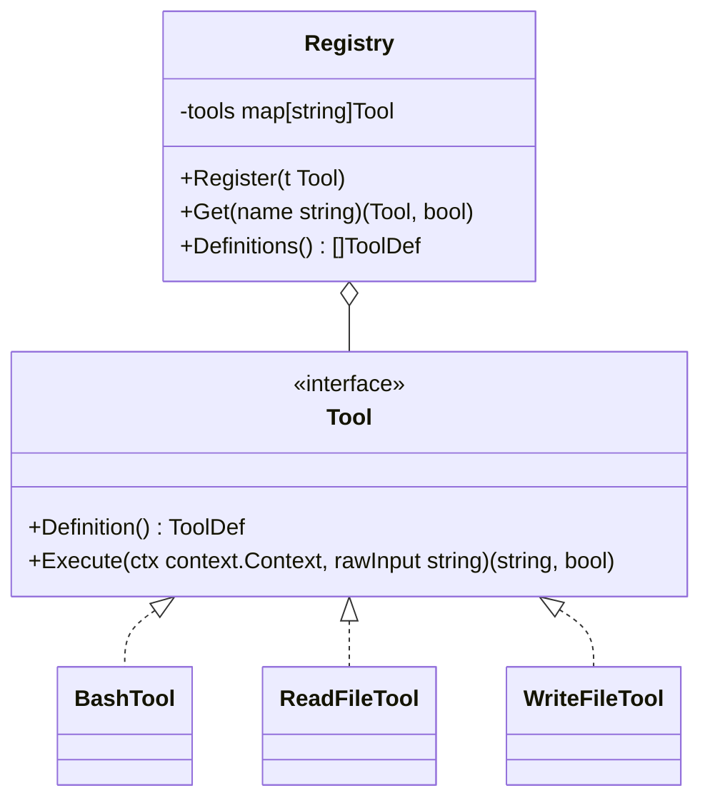

# Step 09: Plug-and-Play Tool Registry

## 1. Architectural Overview

In Step 01, tools were hardcoded in a static JSON slice and dispatched through a giant `switch name { ... }` in `executeTool`. Adding a new tool required modifying multiple places in `main.go`.

**The Plug-and-Play Tool Registry** solves this by establishing a clean `Tool` interface and a dynamic registry where tools self-register via Go's `init()` function:



## 2. Key Design Principles

- **Zero-Touch Addition**: Creating a new tool is as simple as creating `tools/my_tool.go`. It calls `registry.Register(&MyTool{})` in `init()`, and immediately becomes available to the LLM without modifying `main.go`.
- **Self-Contained Schema & Execution**: The tool file contains both its JSON Schema definition and its execution logic.

## 3. Implementation Requirements

1. Define `Tool` interface (`Definition()` and `Execute()`).
2. Implement global `tool.Registry`.
3. Refactor `bash`, `read_file`, and `write_file` into separate files that self-register.
4. Add `/tools` slash command to list all registered tools.

## 4. Verification & Exercises

### Test 1: Registry Discovery
**User Prompt:**
```text
> /tools
```

**Expected Interaction & Output:**
```text
Registered tools (3):
  - bash: Run a shell command and return its combined stdout/stderr.
  - read_file: Read the contents of a file at the given path.
  - write_file: Write content to a file (creating or overwriting it).
```

