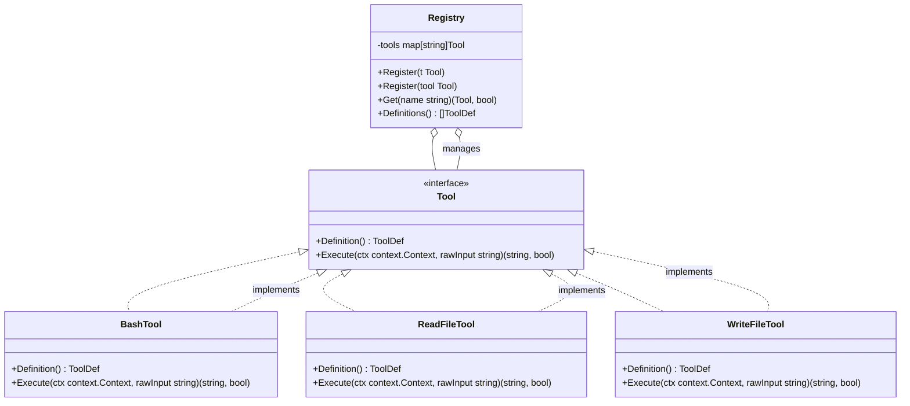

# Step 09: Plug-and-Play Tool Registry

## 1. Architectural Overview

In Step 01, tools were hardcoded in a static JSON slice and dispatched through a giant `switch name { ... }` in `executeTool`. Adding a new tool required modifying multiple places in `main.go`.
In earlier milestones, tools were hardcoded in a static slice (`var tools = []ToolDef{...}`) and dispatched through an unmaintainable monolithic `switch name { ... }` block inside `executeTool`. Adding a new tool required modifying multiple regions across `main.go`, directly violating the **Open/Closed Principle (OCP)** and the **Single Responsibility Principle (SRP)**.

**The Plug-and-Play Tool Registry** solves this by establishing a clean `Tool` interface and a dynamic registry where tools self-register via Go's `init()` function:
**The Plug-and-Play Tool Registry** establishes a decoupled `Tool` interface and a self-registering `Registry` where individual tools encapsulate both their schema and execution logic:



## 2. Key Design Principles
---

- **Zero-Touch Addition**: Creating a new tool is as simple as creating `tools/my_tool.go`. It calls `registry.Register(&MyTool{})` in `init()`, and immediately becomes available to the LLM without modifying `main.go`.
- **Self-Contained Schema & Execution**: The tool file contains both its JSON Schema definition and its execution logic.
## 2. Key Design Principles & Invariants

## 3. Implementation Requirements
### 1. Zero-Touch Tool Addition via `init()` Self-Registration
Creating a new tool is strictly additive. By implementing the `Tool` interface and invoking `defaultToolRegistry.Register(&MyTool{})` inside `init()`, the tool becomes immediately discoverable and executable by both the LLM and the `/tools` CLI command without editing a single line of `main.go`.

1. Define `Tool` interface (`Definition()` and `Execute()`).
2. Implement global `tool.Registry`.
3. Refactor `bash`, `read_file`, and `write_file` into separate files that self-register.
4. Add `/tools` slash command to list all registered tools.
### 2. Polymorphic Dispatch in `main.go`
The monolithic `switch` block in `executeTool` is completely eliminated. The execution pipeline queries `defaultToolRegistry.Get(name)` and delegates execution via the common interface:
```go
tool, exists := defaultToolRegistry.Get(name)
if !exists {
    return fmt.Sprintf("unknown tool: %s", name), true
}
return tool.Execute(ctx, rawInput)
```

### 3. Subprocess Lifecycle Management with `context.Context`
Tools that spawn operating system subprocesses (such as [`bash.go`](../../bash.go)) use `exec.CommandContext(ctx, ...)` instead of `exec.Command(...)`. When a parent context times out or is cancelled, the Go runtime automatically terminates the child operating system process, preventing orphaned zombie processes.

### 4. Errors as Tool Results (Never Panic)
In alignment with our core conventions, errors during tool parsing or execution return `(errorMessage, true)` so the failure is reflected back into the conversation context for LLM self-correction.

---

## 3. Implementation Details

### The Tool Interface and Registry ([`tool.go`](../../tool.go))
```go
type Tool interface {
	Definition() ToolDef
	Execute(ctx context.Context, rawInput string) (string, bool)
}

type Registry struct {
	tools map[string]Tool
}

func NewToolRegistry() *Registry {
	return &Registry{
		tools: make(map[string]Tool),
	}
}

var defaultToolRegistry = NewToolRegistry()

func (r *Registry) Register(tool Tool) {
	r.tools[tool.Definition().Name] = tool
}

func (r *Registry) Get(name string) (Tool, bool) {
	tool, exists := r.tools[name]
	return tool, exists
}

func (r *Registry) Definitions() []ToolDef {
	definitions := make([]ToolDef, 0, len(r.tools))
	for _, tool := range r.tools {
		definitions = append(definitions, tool.Definition())
	}
	return definitions
}
```

### Self-Registering Tools
- **`BashTool`** ([`bash.go`](../../bash.go)): Executes shell commands with cross-platform Git Bash / CMD fallback on Windows, using `exec.CommandContext`.
- **`ReadFileTool`** ([`readfile.go`](../../readfile.go)): Reads file contents using `os.ReadFile`.
- **`WriteFileTool`** ([`writefile.go`](../../writefile.go)): Writes bytes to files using `os.WriteFile`.

---

## 4. Verification & Exercises

### Test 1: Registry Discovery
**User Prompt:**
### Exercise 1: Dynamic Discovery (`/tools`)
Run the agent and execute `/tools`:
```text
> /tools
```

**Expected Interaction & Output:**
```text
Registered tools (3):
  - bash: Run a shell command and return its combined stdout/stderr.
  - read_file: Read the contents of a file at the given path.
  - write_file: Write content to a file (creating or overwriting it).
```

### Exercise 2: Unit Testing the Registry ([`tool_test.go`](../../tool_test.go))
Automated table-driven and mock-based tests verify the registry in complete isolation:
- `TestRegistryRegisterAndGet`: Verifies registration, lookup, and non-existent key failure.
- `TestRegistryDefinitions`: Asserts that `Definitions()` accurately lists registered schemas.
- `TestDefaultRegistryContainsNativeTools`: Verifies that `init()` self-registration populated `bash`, `read_file`, and `write_file`.
- `TestReadFileToolExecution`: Tests valid reading and verified error return on missing files.
- `TestWriteFileToolExecution`: Tests verified file creation and content validation.
