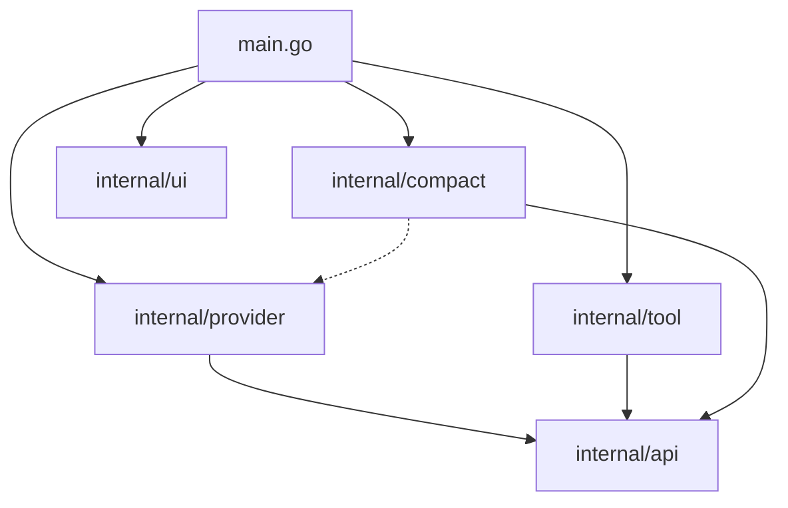

# Step 10: Internal Package Architecture

## 1. Architectural Overview

As our harness expands with providers, tools, compaction strategies, and MCP, putting everything in `main` or top-level packages creates tight coupling and circular dependency risks.

In this step, we refactor the codebase into Go's standard **`internal/` package layout**:

```
.
├── main.go                     # Entry point & dependency injection (Composition Root)
├── commands.go                 # Slash command registry
└── internal/
    ├── api/                    # Shared domain types (Message, ToolDef, Response) - ZERO internal deps
    ├── provider/               # Provider interface + Anthropic adapter
    ├── tool/                   # Tool interface + Registry + concrete tools (bash, read_file, write_file)
    ├── compact/                # Compaction strategies (SlidingWindow, Summarize, WithLogging)
    └── ui/                     # Terminal UI (colors, banner, spinner, readline InputReader)
```

## 2. Key Design Principles

- **Compile-Time Enforcement**: Go's compiler enforces that packages under `internal/` cannot be imported by external modules outside this repository. This encapsulates internal implementation details.
- **Dependency Flow (Inversion of Control)**: Dependencies strictly flow inward toward `internal/api/`. `internal/api` has **zero** internal dependencies, acting as our pure domain layer.
- **Composition Root Pattern**: `main.go` acts solely as the wiring harness. It instantiates the provider, configures the compaction strategy decorator, initializes terminal UI, and starts the REPL loop.



## 3. Package Responsibilities

| Package | Responsibility | Dependencies |
| :--- | :--- | :--- |
| `internal/api` | Vendor-agnostic domain models (`Message`, `Block`, `ToolDef`, `Response`). | None (standard library only) |
| `internal/provider` | Engine contract (`Provider` interface) and wire adapters (`AnthropicProvider`). | `internal/api`, Anthropic SDK |
| `internal/tool` | Self-registering tools (`BashTool`, `ReadFileTool`, `WriteFileTool`) and `Registry`. | `internal/api` |
| `internal/compact` | History management (`SafeSplitPoint`, `SlidingWindow`, `Summarize`, `WithLogging`). | `internal/api`, `internal/provider` |
| `internal/ui` | ANSI color palettes, CLI banner, animated spinner, and readline `InputReader`. | `github.com/chzyer/readline` |

## 4. Verification & Testing

### 1. Static Analysis & Build Cleanliness
```bash
go vet ./...
go build ./...
```
Expected output: Compiles cleanly with zero warnings or package boundary violations.

### 2. Isolated Package Unit Tests
```bash
go test -v ./internal/tool
go test -v ./internal/compact
```
Expected output:
- `internal/tool`: All 5 tests (`TestRegistryRegisterAndGet`, `TestRegistryDefinitions`, `TestDefaultRegistryContainsNativeTools`, `TestReadFileToolExecution`, `TestWriteFileToolExecution`) pass.
- `internal/compact`: All 5 tests (`TestSafeSplitPoint`, `TestNoCompaction`, `TestSlidingWindow`, `TestWithLogging`, `TestSummarize`) pass.
