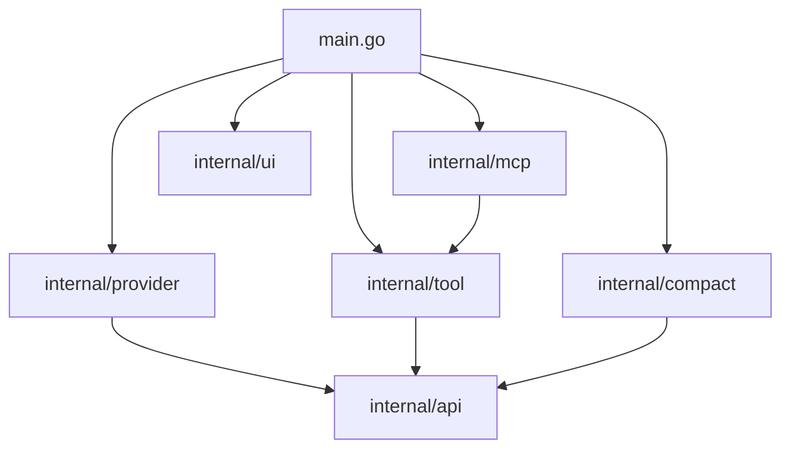

# Step 10: Internal Package Architecture

## 1. Architectural Overview

As our harness expands with providers, tools, compaction strategies, and MCP, putting everything in `main` or top-level packages creates tight coupling and circular dependency risks.

In this step, we refactor the codebase into Go's standard **`internal/` package layout**:

```
.
├── main.go                     # Entry point & wiring
├── commands.go                 # Slash command registry
└── internal/
    ├── api/                    # Shared types (Message, ToolDef, Response) - ZERO internal deps
    ├── provider/               # Provider interface + Anthropic / OpenAI / Mock
    ├── tool/                   # Tool interface + Registry + native tools
    ├── mcp/                    # MCP client adapter
    ├── compact/                # Compaction strategies (Sliding, Summarize, TokenBudget)
    └── ui/                     # UI helpers, spinner, styling
```

## 2. Key Design Principles

- **Compile-Time Enforcement**: Go enforces that packages under `internal/` cannot be imported by external modules. This protects our internal implementation details.
- **Dependency Flow**: The dependency arrows flow inward toward `internal/api/`. `api` depends on nothing inside the project.



## 3. Implementation Requirements

1. Migrate existing structs and interfaces into their respective `internal/` subpackages.
2. Verify that `main.go` acts solely as the dependency injector (wiring everything together).
3. Ensure zero circular dependencies.

## 4. Verification & Exercises

### Test 1: Go Vet & Build Cleanliness
```bash
go vet ./...
go build ./...
```
- Compiles with zero warnings or package boundary violations.

