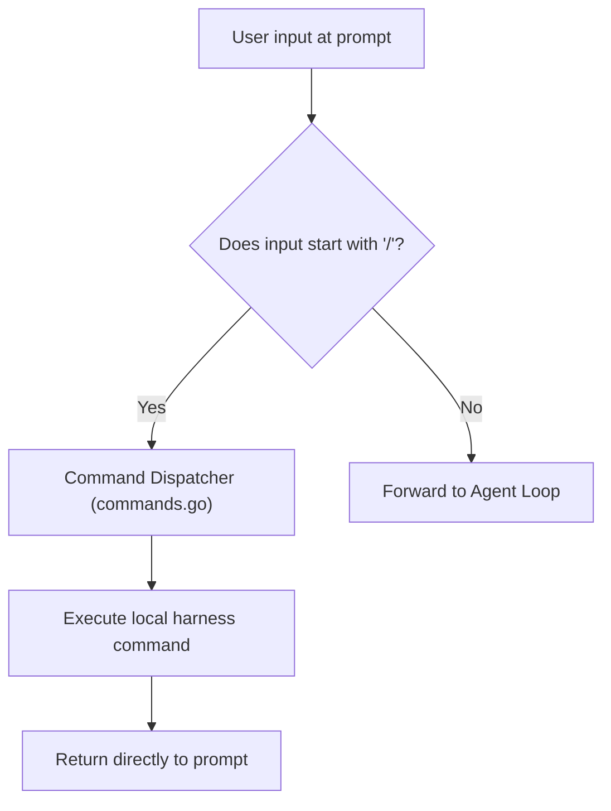

# Step 10: Slash Commands

## 1. Architectural Overview

Not every input typed by the user is meant for the LLM. Users need a direct control channel to manage the harness session itself—clearing history, changing models, inspecting active tools, or exiting.

**Slash Commands** intercept user input starting with `/` before it ever reaches the agent loop:



## 2. Key Design Principles

- **Zero Token Cost**: Local administrative commands execute instantly on the client side without making API calls.
- **Extensible Command Registry**: Commands are registered with descriptions and handlers, making it trivial to add new actions.

## 3. Implementation Requirements

1. Create a `Command` struct (`Name`, `Description`, `Handler func(args []string) error`).
2. Implement core slash commands:
   - `/help`: Lists available commands.
   - `/clear`: Resets current conversation messages slice.
   - `/model [name]`: Shows or changes the current model.
   - `/exit`: Exits the application cleanly.
3. Hook the dispatcher into the outer REPL.

## 4. Verification & Exercises

### Test 1: Help Command Listing
Verify local command execution without API roundtrip.

**User Prompt:**
```text
> /help
```

**Expected Interaction & Output:**
```text
Available commands:
  /help         Show available commands
  /clear        Clear conversation history
  /model [name] View or update active model
  /exit         Exit the agent
```
- No network call logged.
- Instantly returns to `> `.

---

### Test 2: Clearing Context History
Verify that `/clear` purges the conversation messages.

**Sequence:**
1. Type `Hello!` (messages length = 2).
2. Type `/clear`.
3. Output: `Conversation history cleared.`
4. Send another message; log confirms `len(messages)=1`.

