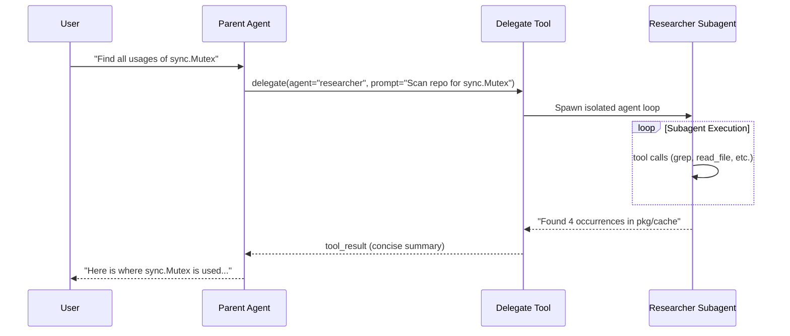

# Step 11: Subagents & Task Delegation

## 1. Architectural Overview

Complex coding tasks (e.g. "Research why the database connection leaks, read 15 source files, and give me a summary") pollute the primary conversation history with dozens of large file reads and tool outputs.

**Subagents** solve this by creating isolated child agent loops:
- The parent agent invokes a `delegate` tool with a specific subtask.
- A child `Agent` is spawned with its own conversation context and specialized toolset.
- The child runs autonomously to completion and returns only a concise summary back to the parent.



## 2. Key Design Principles

- **Context Isolation**: The parent's context remains clean and focused; dozens of child tool calls do not bloat the parent conversation.
- **Role Specialization**: Subagents can be constrained to read-only tools (preventing rogue edits during research tasks).

## 3. Implementation Requirements

1. Refactor `agentLoop` into a reusable `Agent` struct (`Run(ctx, prompt) string`).
2. Implement a `delegate` tool that invokes a subagent.
3. Track active subagents with `/subagents`.

## 4. Verification & Exercises

### Test 1: Delegated Research
**User Prompt:**
```text
> Use the researcher to analyze the internal/api package
```

**Expected Interaction & Output:**
```text
[subagent] spawning researcher subagent...
[researcher] reading internal/api/types.go
[subagent] researcher completed in 3 turns.
Parent receives summary and presents findings to user.
```

