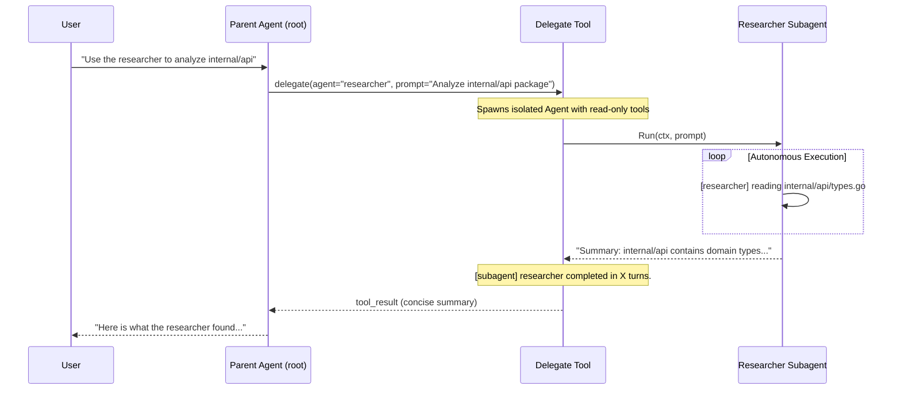

# Step 11: Subagents & Task Delegation

## 1. Architectural Overview

Complex coding tasks (e.g. "Research why the database connection leaks, read 15 source files, and give me a summary") pollute the primary conversation history with dozens of large file reads and tool outputs.

**Subagents** solve this by creating isolated child agent loops:
- The parent agent invokes a `delegate` tool with a specific subtask.
- A child `Agent` is spawned with its own conversation context and specialized toolset.
- The child runs autonomously to completion and returns only a concise summary back to the parent.



## 2. Key Design Principles

- **Context Isolation**: The parent's context remains clean and focused; dozens of child tool calls do not bloat the parent conversation.
- **Role Specialization (Least Privilege)**: Subagents can be constrained to read-only tools (e.g. `researcher` only has `read_file`), preventing rogue edits or arbitrary shell execution during research tasks.
- **Encapsulated Agent Engine**: The procedural `agentLoop` in `main.go` is refactored into `Agent.Run(ctx, prompt)`, making both root agents and delegated subagents share the same tested ReAct loop.

## 3. Implementation Details

### 1. `internal/agent/agent.go`
- `Agent` struct encapsulates identity (`Name`), runtime provider (`Provider`), scoped tools (`Tools`), conversation memory (`messages`), and defensive loop guards (`MaxTurns`).
- `Run(ctx, prompt) (string, error)`: Appends prompt, applies optional compaction, and runs ReAct turns until `stop_reason != "tool_use"`.
- `executeTool`: Evaluates interactive permissions via `Confirm` if configured, logs subagent file access via `logToolCall`, and executes tool via `Tools.Get`.

### 2. `delegate.go`
- Implements `DelegateTool` in `package main` (avoiding circular imports between `tool` and `agent`).
- Self-registers into `tool.DefaultRegistry` via `init()`.
- Declares schema requiring `agent` (`"researcher"`) and `prompt`.
- Spawns an isolated `researcher` subagent with a scoped `tool.NewToolRegistry()` containing only `read_file`.

### 3. `commands.go`
- Updates `/clear` to invoke `rootAgent.Clear()`.
- Adds `/subagents` command to describe available subagent profiles and their capabilities.

## 4. The Complete Real-Time Request Lifecycle

When a user submits: `> Use the researcher to analyze the internal/api package`, the harness executes the following end-to-end flow:

1. **User Input at the REPL (`main.go`)**:
   The interactive terminal captures the prompt and dispatches it directly into `rootAgent.Run(ctx, userInput)`.
2. **Root Agent Ingestion**:
   `rootAgent` records the prompt into its private `messages` history and calls the LLM provider with its registered tools (`bash`, `read_file`, `write_file`, `delegate`).
3. **Parent LLM Decision**:
   Recognizing an exploratory codebase analysis task, the parent model emits a tool call: `delegate(agent="researcher", prompt="Analyze internal/api package")`.
4. **Delegation Bridge Activation (`delegate.go`)**:
   - `DelegateTool.Execute` logs `[subagent] spawning researcher subagent...`.
   - **Role Specialization**: It instantiates an isolated `tool.NewToolRegistry()` containing strictly `read_file` (excluding `write_file` and `bash`).
   - **Context Isolation**: It constructs `researcherSubagent := agent.New(...)` with `Verbose: false`. Its private `messages` slice starts completely empty.
5. **Subagent Autonomous ReAct Loop (`internal/agent/agent.go`)**:
   - `researcherSubagent.Run(ctx, prompt)` begins its private inner loop.
   - The child model requests `read_file("internal/api/types.go")`.
   - `logToolCall` prints: `[researcher] reading internal/api/types.go`.
   - `executeTool` reads the file from disk and feeds the file contents back to the child model.
6. **Child Synthesis & Termination**:
   - The child model analyzes the types, determines the task is complete, synthesizes a concise overview, and emits `stop_reason: "end_turn"`.
   - The subagent prints: `[subagent] researcher completed in 2 turns.`.
   - `researcherSubagent.Run` terminates and returns the final synthesis string to `delegate.go`.
7. **Parent Context Delivery**:
   - `delegate.go` passes the synthesis string back to `rootAgent` as the `tool_result` of the original `delegate` invocation.
   - **Crucial Benefit**: The parent conversation history contains **only 2 clean turns** (the user prompt and the researcher's summary). The raw file contents never polluted the parent context.
8. **Final User Presentation**:
   - The parent model uses the researcher's synthesis to deliver a clean, comprehensive response to the user in the terminal.

## 5. Verification & Exercises

### 1. Static Analysis & Build Cleanliness
```bash
go vet ./...
go build ./...
```
Expected output: Compiles cleanly with zero errors or package cycle violations.

### 2. Delegated Research Verification
```text
> /subagents
Available subagent profiles (1):
  - researcher: Read-only codebase explorer. Inspects files without write/bash access.

> Use the researcher to analyze the internal/api package
[subagent] spawning researcher subagent...
[researcher] reading internal/api/types.go
[subagent] researcher completed in 2 turns.
The internal/api package defines the core domain types...
```
