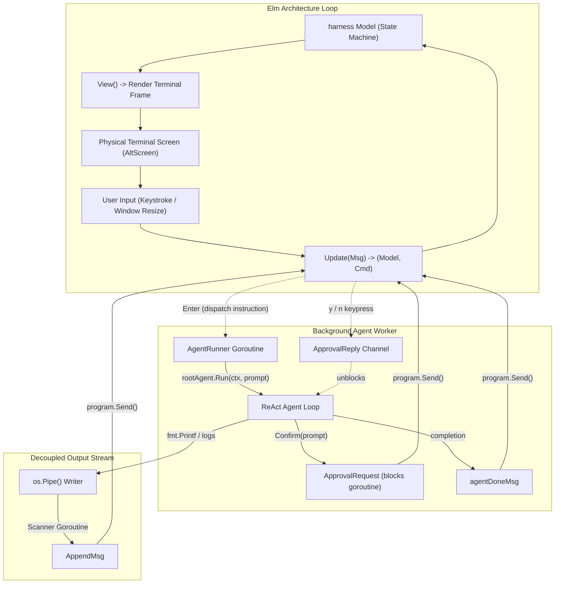

# Step 12: Full Terminal UI (TUI)

## 1. Architectural Overview

Basic terminal printing with `fmt.Println` breaks down when handling long responses, modal confirmation dialogues, live spinners, and scrollable history.

In this step, we elevate the entire user interface to a **full Terminal User Interface (TUI)** built with Charm's **Bubble Tea** (the Elm architecture in Go):

```
┌───────────────────────────────────────────────────────────────┐
│ [User] How many tests are passing?                            │
│                                                               │
│ [Assistant] Running go test ./...                             │
│ ✓ internal/api (0.02s)                                        │
│ ✓ internal/tool (0.04s)                                       │
│ All 34 tests passing.                                         │
│                                                               │
├───────────────────────────────────────────────────────────────┤
│ ⠋ Thinking...                                                 │
│ ┌───────────────────────────────────────────────────────────┐ │
│ │ > [Type your prompt here...                             ] │ │
│ └───────────────────────────────────────────────────────────┘ │
│ enter: send · pgup/pgdn: scroll · ctrl-c: clear · ctrl-d: exit│
└───────────────────────────────────────────────────────────────┘
```



---

## 2. Key Design Principles

### 1. The Elm Architecture (`Model - View - Update`)
Bubble Tea enforces pure unidirectional data flow:
* **`Model`**: The single source of truth (`harness`), holding the scrollback viewport, text input, spinner, and state machine.
* **`Update`**: A pure state transition function responding to typed messages (`tea.WindowSizeMsg`, `tea.KeyMsg`, `AppendMsg`, `ApprovalRequest`).
* **`View`**: Composes the layout vertically (`h.viewport.View()` and `h.inputArea()`) using Lipgloss styles.

### 2. The "Pipe Trick" (Zero-Refactor Decoupling)
Rewriting every `fmt.Println` across the agent loop, subagents, slash commands, and tools to push explicit UI messages would tightly couple core logic to the TUI framework.
Instead, [`internal/ui/program.go`](file:///c:/Users/anton/Documents/dev/projects/phi-code-agent/internal/ui/program.go) redirects `os.Stdout` to an operating system pipe (`os.Pipe()`). A background scanner reads incoming lines and pushes them into the Bubble Tea event loop via `AppendMsg`.
Bubble Tea itself renders directly to the physical terminal through `tea.WithOutput(originalStdout)` and `tea.WithAltScreen()`.

### 3. Asynchronous Permission Flow via Channels
When the agent executes a sensitive tool (`bash`), it invokes `agent.Confirm(prompt)`. In a TUI, blocking inside the UI thread would freeze the entire terminal.
Instead:
1. `Confirm` wraps the prompt and a response channel (`chan bool`) into an `ApprovalRequest` and dispatches it via `p.teaProgram.Send(...)`.
2. The agent goroutine blocks waiting on `<-reply`.
3. The TUI intercepts `ApprovalRequest`, transitions the state machine to `stateAwaitingApproval`, and renders an inline yellow-bordered prompt.
4. When the user presses `y` or `n`, the TUI writes the decision to the channel, unblocking the background agent immediately.

### 4. Layout Stability (Height Budgeting)
Dynamic swapping between the normal text input, the animated spinner, and the approval modal can cause vertical layout jitter.
`inputArea()` reserves a fixed vertical height (5 lines) and uses `tea.WindowSizeMsg` to compute exact viewport dimensions:
`viewport.Height = msg.Height - 5`.

---

## 3. Implementation Details

### 1. `internal/ui/program.go`
* **`harness`**: Encapsulates `viewport.Model`, `textinput.Model`, `spinner.Model`, and the state machine (`stateIdle`, `stateRunning`, `stateAwaitingApproval`).
* **`Program`**: Encapsulates the Bubble Tea lifecycle, OS pipe redirection, and interactive confirmations.
* **`NewProgram`**: Factory that configures subcomponents, hijacks stdout to the pipe, launches the scanner goroutine, and prepares alternate screen mode.
* **`Confirm`**: Thread-safe permission hook satisfying `rootAgent.Confirm`.
* **`Run`**: Runs the Bubble Tea program and guarantees restoration of `os.Stdout` upon exit via `defer`.

### 2. `main.go`
* Refactored into a clean composition root:
  * Wires Anthropic provider, sliding-window compactor, and `rootAgent`.
  * Instantiates `app, err := ui.NewProgram(runner)`.
  * Renders `ui.PrintBanner(prov.Model())` into the redirected viewport.
  * Connects `rootAgent.Confirm = app.Confirm`.
  * Runs `app.Run()`.

### 3. `internal/agent/agent.go`
* **Decoupling from Presentation (`internal/ui`)**: Removed the legacy Step 4 CLI spinner (`ui.StartSpinner`) that emitted raw carriage returns (`\r`) into `os.Stdout`. Bubble Tea now owns the spinner natively in `harness`.
* **Clean Architecture**: `internal/agent` no longer imports or depends on `internal/ui`.

### 4. Debugging via `.vscode/launch.json`
* Preconfigured for Antigravity IDE and VS Code using Delve (`dlv`).
* Configured with `"console": "integratedTerminal"` so the TUI executes with full raw mode and alt-screen support during interactive debugging sessions.

---

## 4. Verification & Automated Tests

### 1. Automated Unit Tests
Run unit tests verifying TUI state transitions, window budgeting, approval flow, error surfacing, and output appending:
```bash
go test -v ./internal/ui/
```
All 10 unit test suites pass cleanly:
* `TestHarnessInit`: Confirms cursor blink and spinner ticks start.
* `TestHarnessWindowSizeMsg`: Confirms 5-line height budgeting and clamping.
* `TestHarnessAppendMsg`: Confirms stdout stream appending and auto-scroll.
* `TestHarnessApprovalFlow`: Confirms channel resolution on `y` (allow) and `n` (deny).
* `TestHarnessViewRendering`: Confirms UI text rendering across both states.
* `TestHarnessAgentDoneMsgError`: Confirms runner errors are formatted and surfaced in the viewport.
* `TestHarnessPromptSubmission`: Confirms enter key submits prompt, resets input, and dispatches runner batch.
* `TestHarnessKeyShortcuts`: Confirms `ctrl+c` clears input and `ctrl+d` triggers graceful exit.
* `TestHarnessScrollback`: Confirms `pgup`/`pgdown` navigation and automatic `followBottom` toggling.
* `TestHarnessSpinnerTick`: Confirms spinner animation frames tick only during active agent execution.

Total repository test suite:
```bash
go test ./...
```
All 34 tests passing across all packages (`agent`, `compact`, `provider`, `tool`, `ui`).

### 2. Manual Verification
Run the interactive harness:
```bash
go run .
```
Verify:
1. **Scrollback Viewport**: Initial ASCII logo and session details appear in the scrollable viewport. Mouse wheel and `PgUp` / `PgDn` scroll cleanly.
2. **Prompt Execution**: Type a prompt (e.g. `What tools are available?`) and press Enter. The status transitions to `Running` with an animated braille spinner.
3. **Approval Modal**: When a sensitive tool runs, an approval box prompts `[y/N]`. Pressing `y` allows execution; pressing `n` denies it.
4. **Clean Exit**: Press `Ctrl+D` or type `/exit`. The terminal restores its original screen buffer without leftover artifacts.
