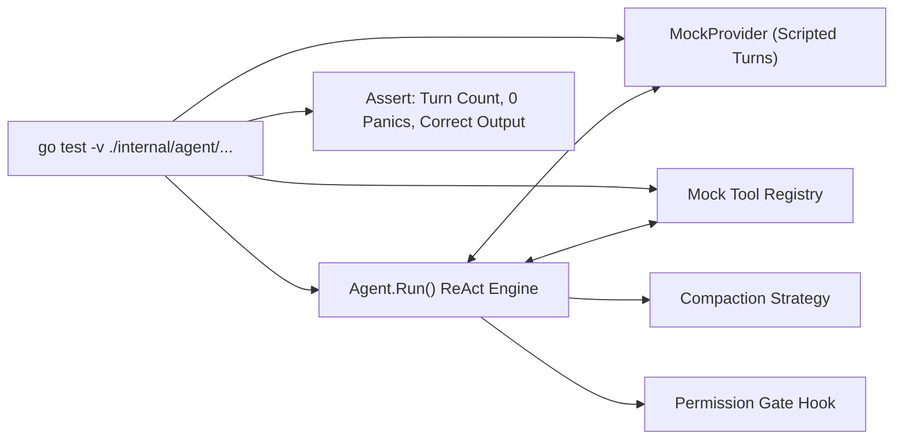

# Step 13: Harness End-to-End Testing

## 1. Architectural Overview

The true test of clean architecture is **testability**. A well-architected harness must be completely testable without internet access, without an Anthropic API key, and without creating real side effects on the developer's computer.

In this milestone, we build an **automated end-to-end test suite** that exercises the complete agent loop using `mockProvider` and mock tools:



## 2. Key Design Principles

- **Zero Network Flakiness**: Tests run entirely in-memory and execute in milliseconds.
- **Contract Verification**: Verify that tools receive proper arguments, errors trigger self-correction turns, and conversation history preserves alternating roles and tool use/result pairing.
- **Resilience Under Pressure**: Ensure the harness never panics when facing unregistered tools, runaway recursive loops, or provider transport failures.

## 3. Implementation Requirements

Write and maintain `internal/agent/agent_test.go` covering the complete spectrum of agent loop states:

### A. Core ReAct Loop Scenarios
1. **Simple Response** (`TestAgentLoop_SimpleResponse`):
   - Single-turn text response from the model (`StopReason: "end_turn"`).
   - Validates that the history contains exactly 2 messages (User prompt + Assistant response).
2. **Tool Execution** (`TestAgentLoop_ToolExecution`):
   - Two-turn sequence: Model requests a tool (`StopReason: "tool_use"`), the harness executes it and records a `BlockToolResult`, and the model synthesizes the final response.
   - Validates that the history contains exactly 4 messages in alternating sequence.
3. **Autonomous Self-Correction** (`TestAgentLoop_SelfCorrection`):
   - Three-turn sequence: Model calls a tool with invalid input, receiving `(errorMsg, true)`. The model observes `IsError: true`, corrects its input on turn 2, and produces final synthesis on turn 3.
   - Validates that errors travel through the message stack rather than crashing the harness.
4. **Permission Gate Rejection** (`TestPermissionGate_Rejection`):
   - Interactive permission hook (`Confirm`) returns `false`.
   - Validates that tool execution returns `"Permission denied by user"` with `IsError: true`, allowing graceful recovery.
5. **Context Compaction Trigger** (`TestAgentLoop_CompactionTrigger`):
   - Configures a compactor and executes multi-turn conversations.
   - Validates that `Compactor.Compact()` is invoked and history is truncated according to strategy.
6. **Maximum Turns Guardrail** (`TestAgentMaxTurnsLimit`):
   - Model perpetually requests tool use.
   - Validates that `MaxTurns` halts execution safely with a descriptive error instead of hanging indefinitely.

### B. Production Edge-Case Scenarios
7. **Parallel Tool Execution** (`TestAgentLoop_ParallelToolExecution`):
   - Model issues multiple `BlockToolUse` blocks within a single assistant turn.
   - Validates that all tools execute in sequence, their `ToolUseID` values match, and all results are bundled into a single user message.
8. **Unknown Tool Hallucination** (`TestAgentLoop_UnknownTool`):
   - Model hallucinates or requests a tool not registered in `tool.Registry`.
   - Validates that the harness safely returns `("unknown tool: ...", true)` without panic, enabling the LLM to recover.
9. **Provider Transport Error** (`TestAgentLoop_ProviderError`):
   - Simulates network dropouts, rate limits, or 503 errors from `Provider.Send`.
   - Validates that errors propagate immediately and cleanly up the call stack.

## 4. Verification & Exercises

### Test 1: Running the Automated Test Suite

Execute the full agent test suite with verbose reporting:

```bash
go test -v ./internal/agent/...
```

**Expected Interaction & Output:**
```text
=== RUN   TestAgentLoop_SimpleResponse
--- PASS: TestAgentLoop_SimpleResponse (0.00s)
=== RUN   TestAgentLoop_ToolExecution
--- PASS: TestAgentLoop_ToolExecution (0.00s)
=== RUN   TestAgentLoop_SelfCorrection
--- PASS: TestAgentLoop_SelfCorrection (0.00s)
=== RUN   TestPermissionGate_Rejection
--- PASS: TestPermissionGate_Rejection (0.00s)
=== RUN   TestAgentLoop_CompactionTrigger
--- PASS: TestAgentLoop_CompactionTrigger (0.00s)
=== RUN   TestAgentMaxTurnsLimit
--- PASS: TestAgentMaxTurnsLimit (0.00s)
=== RUN   TestAgentLoop_ParallelToolExecution
--- PASS: TestAgentLoop_ParallelToolExecution (0.00s)
=== RUN   TestAgentLoop_UnknownTool
--- PASS: TestAgentLoop_UnknownTool (0.00s)
=== RUN   TestAgentLoop_ProviderError
--- PASS: TestAgentLoop_ProviderError (0.00s)
PASS
ok      phi-agent-code/internal/agent       0.04s
```

### Test 2: Full Repository Verification

Verify that all packages across the repository compile, pass tests, and satisfy static analysis:

```bash
go test ./...
go vet ./...
```
