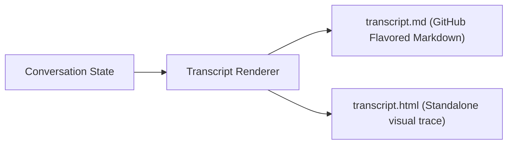

# Step 13: Transcript Renderer

## 1. Architectural Overview

Debugging an agent or auditing what it did during a complex multi-step coding task requires inspecting the raw transcript.

The **Transcript Renderer** exports the full conversation history (user messages, model reasoning, tool invocations, inputs, and outputs) into clean, readable formats (Markdown or HTML):



## 2. Key Design Principles

- **Complete Traceability**: Every tool call, its parameters, and the raw exit code/stdout are rendered in collapsible or fenced blocks.
- **Redaction of Sensitive Secrets**: Automatically mask API keys or environment secrets before writing transcripts to disk.

## 3. Implementation Requirements

1. Create a `RenderTranscript(conv *Conversation, format string) (string, error)` function.
2. Add a `/transcript` or `/export` slash command to write `session-transcript.md` on demand.

## 4. Verification & Exercises

### Test 1: Exporting Session History
**Sequence:**
1. Run a tool that reads a file.
2. Run a command that writes a file.
3. Execute:
   ```text
   > /transcript
   ```
4. Output: `Transcript written to transcript-<timestamp>.md`.
5. Open the file: verify markdown contains code blocks with the exact tool commands and outputs.

