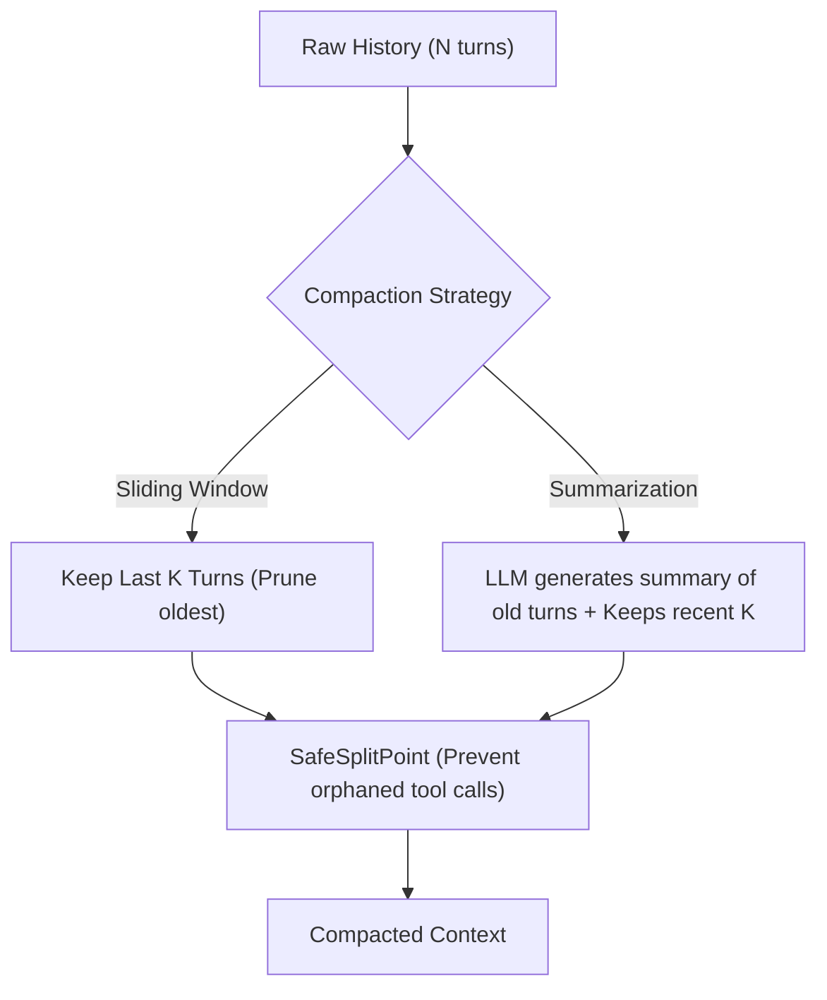

# Step 14: Compaction Strategies

## 1. Architectural Overview

As an agent edits code and runs tests over hours of pair-programming, the conversation history grows indefinitely. Eventually, it hits two critical boundaries:
1. **Context Window Limits**: Exceeding the maximum token limit of the model causes API errors (HTTP 400).
2. **Cost & Latency Explosion**: Since LLMs are billed per input token on every turn, sending 100,000 tokens on each keystroke becomes extremely slow and expensive.

**Compaction** prunes or condenses past turns while preserving the critical context:



## 2. Key Design Principles

- **The Safe Split Invariant**: You can NEVER cut a conversation between a `tool_use` block and its corresponding `tool_result` block. The Anthropic API strictly requires that every `tool_use` must be immediately followed by its `tool_result`. If split blindly, the API returns a 400 Bad Request.
- **Pluggable Strategies**:
  - `NoCompaction`: Default (preserves everything).
  - `SlidingWindow`: Drops messages older than `KeepLast: N`.
  - `Summarize`: Uses an LLM call to summarize the first half of the conversation, replacing them with a single summary message.

## 3. Implementation Requirements

1. Define `CompactionStrategy` interface:
   ```go
   type CompactionStrategy interface {
       Compact(ctx context.Context, messages []Message) ([]Message, error)
   }
   ```
2. Implement `SafeSplitPoint` helper.
3. Implement `SlidingWindow` and `Summarize` strategies.
4. Hook compaction into the agent loop before sending requests.

## 4. Verification & Exercises

### Test 1: Sliding Window Pruning
Configure `SlidingWindow{KeepLast: 4}` and run 6 turns.

**Expected Interaction & Output:**
- `len(messages)` never grows beyond 4.
- SafeSplit ensures no orphaned tool blocks exist.

