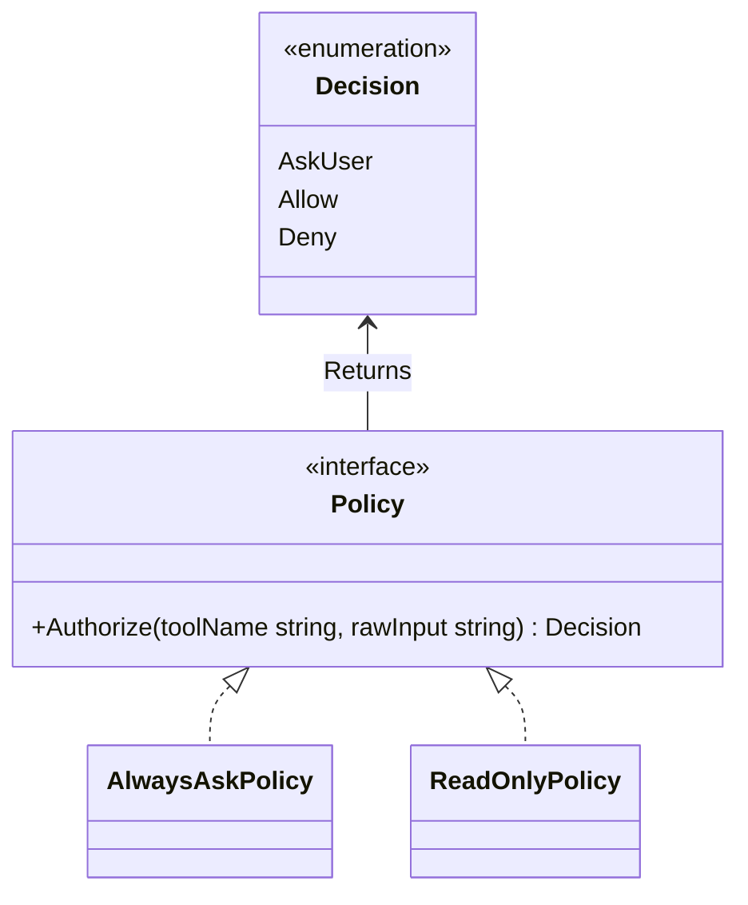

# Step 14: Permission Policies

## 1. Architectural Overview

Prompting the user for every single command (including read-only actions like `read_file` or inspecting directories) creates alert fatigue. Users start pressing `y` without inspecting the commands, completely defeating the purpose of the security gate.

In this step, we decouple the permission check from a hardcoded `confirm()` call into a pluggable **Permission Policy Engine** in `internal/permission/`:



## 2. Key Design Principles

- **Separation of Concerns**: The agent loop queries a policy whether an action is permitted. The loop does not know or care *how* that decision is determined.
- **Fail-Safe Defaults (Zero-Value Safety)**: In Go, `AskUser` is defined as `iota = 0`. An uninitialized `Decision` always defaults to safely asking the user rather than silently executing side-effecting commands.
- **Granular Decisions**:
  - `Allow`: Executes immediately without prompting (e.g., non-destructive read operations).
  - `AskUser`: Prompts the user with `[y/N]` via the interactive TUI.
  - `Deny`: Rejects immediately with `(error, true)` without bothering the user.
- **Defensibility Against Alert Fatigue**: Automatically approving non-destructive queries reserves human attention for write, delete, and shell operations.

## 3. Implementation Requirements

1. Create `internal/permission/policy.go` defining the `Policy` interface and `Decision` enum with `fmt.Stringer`.
2. Implement `ReadOnlyPolicy`:
   - `read_file` -> `Allow`
   - `write_file` / `bash` -> `AskUser`
3. Implement `AlwaysAskPolicy` (returns `AskUser` for all tools) for fail-safe default fallback.
4. Wire `Policy` into `Agent` struct with defensive initialization in `agent.New()`.
5. Update `main.go` to configure `rootAgent` with `permission.ReadOnlyPolicy{}`.

## 4. Verification & Exercises

### Test 1: Silent Execution of Read-Only Operations
Verify that safe tools run without interrupting the user.

**User Prompt:**
```text
> Read the first 5 lines of README.md
```

**Expected Interaction & Output:**
- No confirmation prompt appears.
- Model reads the file and displays the lines immediately.

---

### Test 2: Gated Execution for Side-Effecting Operations
Verify that writing or running shell commands still triggers the confirmation prompt.

**User Prompt:**
```text
> Create a note called ideas.txt with 'build an agent'
```

**Expected Interaction & Output:**
- The prompt halts and presents the styled approval gate in the TUI:
  ```text
  Allow execution of write_file {"content":"build an agent","path":"ideas.txt"}? [y/N]
  ```
- Approving executes the write; denying aborts safely.
