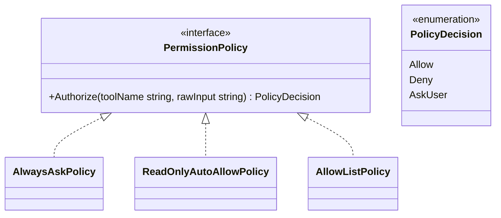

# Step 14: Permission Policies

## 1. Architectural Overview

Prompting the user for every single command (including read-only actions like `read_file` or `cat`) creates alert fatigue. Users start pressing `y` without inspecting the commands, completely defeating the purpose of the security gate.

In this step, we decouple the permission check from a hardcoded `confirm()` call into a pluggable **Permission Policy Engine**:



## 2. Key Design Principles

- **Separation of Concerns**: The agent loop asks a policy whether an action is permitted. The loop does not know or care *how* that decision is made.
- **Granular Decisions**:
  - `Allow`: Executes immediately without prompting (e.g., safe read operations).
  - `AskUser`: Prompts the user with `[y/N]`.
  - `Deny`: Rejects immediately without bothering the user (e.g., blacklisted paths or commands like `rm -rf /`).
- **Defensibility Against Alert Fatigue**: By automatically approving non-destructive queries, the user's attention is reserved for write, delete, and shell operations.

## 3. Implementation Requirements

1. Define the `PermissionPolicy` interface and `PolicyDecision` type.
2. Implement `ReadOnlyAutoAllowPolicy`:
   - `read_file` -> `Allow`
   - `bash` / `write_file` -> `AskUser`
3. Wire the active policy into the harness configuration.

## 4. Verification & Exercises

### Test 1: Silent Execution of Read-Only Operations
Verify that safe tools run without interrupting the user.

**User Prompt:**
```text
> Read the first 5 lines of README.md
```

**Expected Interaction & Output:**
- No confirmation prompt appears.
- `[policy] Auto-allowing read_file tool.`
- Model reads the file and displays the lines immediately.

---

### Test 2: Gated Execution for Side-Effecting Operations
Verify that writing or running shell commands still triggers the confirmation prompt.

**User Prompt:**
```text
> Create a note called ideas.txt with 'build an agent'
```

**Expected Interaction & Output:**
- The prompt halts and asks:
  ```text
  [permission required] write_file {"path":"ideas.txt","content":"build an agent"}
  Allow execution? [y/N]:
  ```
- Denying or approving works as configured in Step 02.

