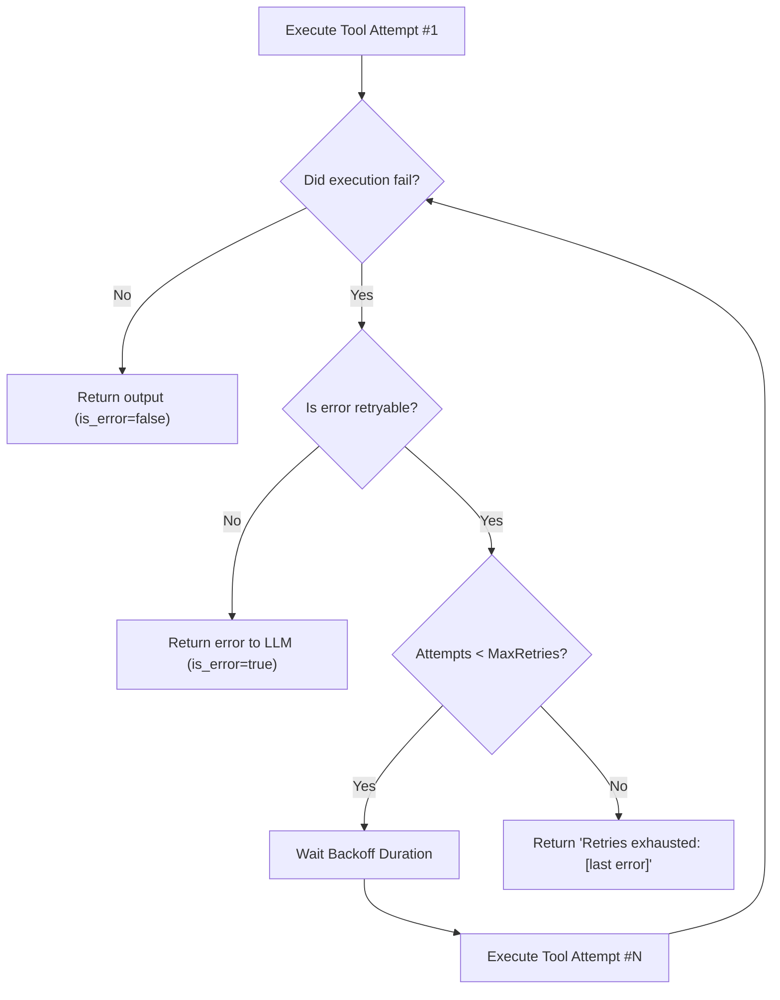

# Step 15: Tool Error Retry

## 1. Architectural Overview

Not all tool failures are permanent. In real-world environments, operations frequently fail due to **transient conditions**:
- Network blips during API calls or git fetches.
- File locks or I/O contention (very common on Windows).
- Shell commands timing out under temporary load.

Instead of burning an entire LLM inference round-trip when an operation fails for a transient reason, the harness can perform an **internal retry policy** before reporting back to the model:



## 2. Key Design Principles

- **Classifying Failure Types**: Distinguish between logical errors (e.g. `unknown flag --foo`, file does not exist) which the LLM must fix, vs environmental transient failures (e.g. process lock, network timeout) which the harness can retry.
- **Configurable Backoff**: Avoid hammering the resource; use a simple exponential or linear backoff delay.
- **Transparent Logging**: Provide terminal feedback (`[retry 2/3] retrying bash due to temporary lock...`) so the user knows why execution paused.

## 3. Implementation Requirements

1. Introduce a retry wrapper around `executeTool`.
2. Configure `MaxRetries` (default: 2 or 3) and `RetryDelay`.
3. Check error strings or exit codes to determine if a retry should be attempted.

## 4. Verification & Exercises

### Test 1: Simulating Transient Command Recovery
Verify that a command that succeeds after retry is transparently handled.

**User Prompt:**
```text
> Check system status
```

**Expected Interaction & Output:**
- If the first attempt encounters a lock or transient failure:
  ```text
  [tool retry] bash failed with transient error. Retrying in 500ms (attempt 1/2)...
  [tool execute] bash succeeded on attempt 2.
  ```
- The model receives only the final successful output without wasting tokens on an intermediate error turn.

