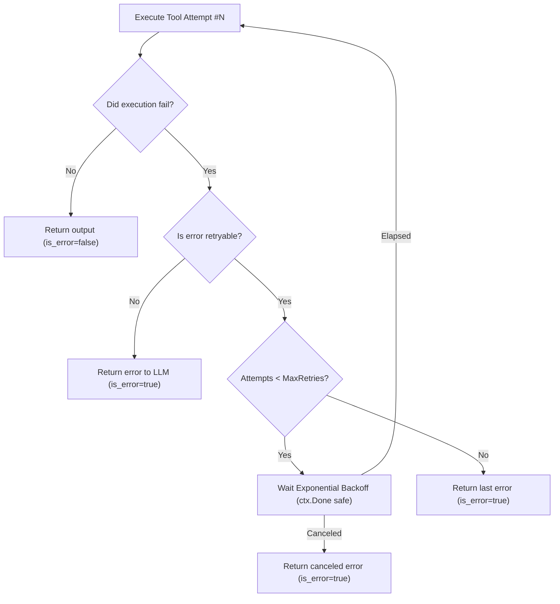

# Step 15: Tool Error Retry

## 1. Architectural Overview

Not all tool failures are permanent. In real-world environments, operations frequently fail due to **transient conditions**:
- Network blips during API calls or git fetches.
- File locks or I/O contention (especially common on Windows).
- Shell commands timing out under temporary load.

Instead of burning an entire LLM inference round-trip when an operation fails for a transient reason, the harness can perform an **internal retry policy** before reporting back to the model:



## 2. Key Design Principles

- **Decorator Pattern (Open/Closed Principle)**: Rather than polluting the core `Agent.Run` engine or hardcoding retry logic inside `executeTool`, implement a reusable `RetryDecorator` wrapping the `tool.Tool` interface in `internal/tool/retry.go`.
- **Classifying Failure Types**: Distinguish between logical errors (e.g. `unknown flag --foo`, file does not exist) which the LLM must fix, vs environmental transient failures (e.g. process lock, network timeout, exit code 124) matched via `DefaultIsRetryable` or an injected `IsRetryable` hook.
- **Context-Aware Capped Exponential Backoff**: Avoid hammering the resource with `base * 2^attempt` delays (defaulting to `100ms` when unset and capped at `10s` with signed-integer overflow guards), using `select` on `ctx.Done()` so user cancellations abort immediately without freezing the terminal.
- **Fail-Safe Nil & Bounds Guards**: Nil `RetryDecorator` receivers, unset inner `Tool` fields, or negative `MaxRetries` never panic; errors travel back as `(errorMessage, true)`.

## 3. Implementation Requirements

1. Create `internal/tool/retry.go` implementing `Tool`:
   ```go
   type RetryDecorator struct {
       Tool        Tool
       MaxRetries  int
       BaseDelay   time.Duration
       IsRetryable func(output string, isError bool) bool
   }
   ```
2. Configure `MaxRetries` (normalized to `0` if negative) and `BaseDelay` (default `100ms`, exponential backoff `1 << attempt` capped at `10s`).
3. Implement `DefaultIsRetryable` over a table of transient patterns (`defaultTransientPatterns`), while allowing callers to inject custom dynamic classifiers via `IsRetryable`.
4. Add `registry.RegisterWithRetry(t Tool, maxRetries int)` in `internal/tool/tool.go` (ignoring `nil` tools safely) and wrap leaf OS/I/O tools (`bash`, `read_file`, `write_file`) in their `init()` hooks.

## 4. Verification & Exercises

### Test 1: Automated Unit Verification (`internal/tool`)
Run `go test -v ./internal/tool` to verify `retry_test.go` and `tool_test.go`:
- **First-attempt success**: Returns immediately with zero backoff delay.
- **Transient failure recovery**: Retries up to `MaxRetries` with exponential backoff and returns the successful output transparently (`isError=false`).
- **Logical/permanent failure**: Bypassed immediately without retries so the LLM can self-correct without wasted latency.
- **Exhausted retries & negative limits**: Stops cleanly after `1 + MaxRetries` attempts, normalizing negative `MaxRetries` to `0`.
- **Nil safety & overflow capping**: Unset `Tool` / nil receivers return safe tool errors without panicking, and large exponents/delays cap cleanly at `10s`.
- **Context cancellation & custom classifiers**: Aborts immediately when `ctx.Done()` fires during backoff, and respects injected `IsRetryable` hooks alongside `DefaultIsRetryable` pattern matching.
- **Registry wrapping (`RegisterWithRetry`)**: Ignores `nil` tools and stores valid tools inside `*RetryDecorator` preserving schema metadata.

### Test 2: Interactive Behavior
**User Prompt:**
```text
> Check system status
```

**Expected Interaction & Output:**
- If a transient lock occurs and resolves on retry, the model receives only the final successful output without wasting tokens on an intermediate error turn.
