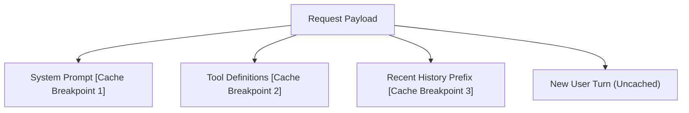

# Step 16: Prompt Caching

## 1. Architectural Overview

Frontier models like Anthropic Claude offer **Prompt Caching**, which caches repeated context (system prompt, tool definitions, and historical conversation prefix) on their servers for 5 minutes.
- Cached tokens cost up to **90% less**.
- Time-to-first-token latency drops significantly (often from 3s to 300ms).

In this step, we configure prompt caching breakpoints in our provider adapter:

## 2. Key Design Principles

- **Cache Breakpoints Placement**: Place breakpoints on stable prefixes (System prompt and tool definitions) that do not change from turn to turn.
- **Cache Invalidation Awareness**: Any mutation in the text before a cache point invalidates all downstream caches.

## 3. Implementation Requirements

1. Add `CacheControl` parameters to Anthropic adapter blocks (`type: "ephemeral"`).
2. Measure cache hits via `usage.cache_read_input_tokens` in `/tokens`.

## 4. Verification & Exercises

### Test 1: Verifying Cache Hits
1. Send first prompt: `Hello`.
2. Inspect `/tokens`: `Cache write tokens: ~2,500, Cache read tokens: 0`.
3. Send second prompt immediately: `How are you?`.
4. Inspect `/tokens`: `Cache read tokens: ~2,500` (confirming cache hit and ~90% cost savings).

