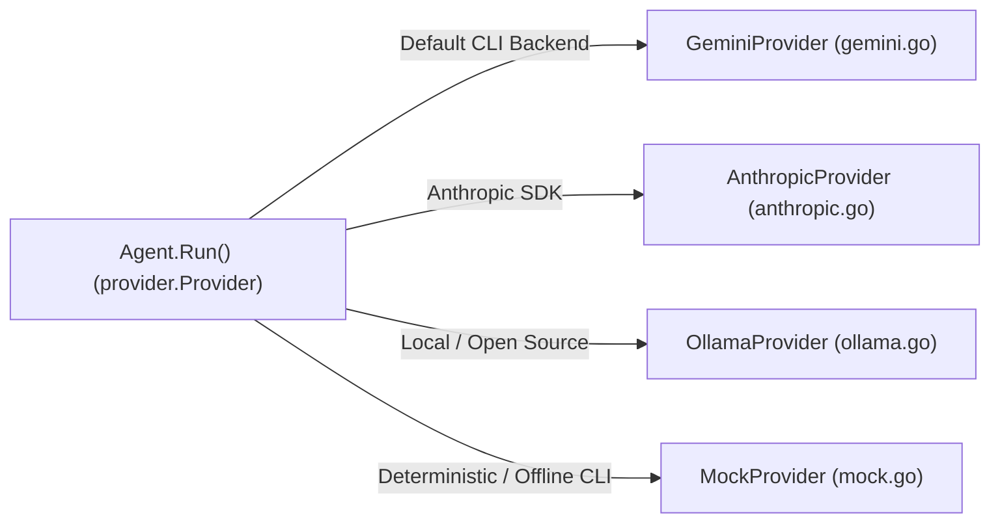

# Step 16: Alternative Providers & Mocks

## 1. Architectural Overview

Once the `Provider` interface is in place, adding a second LLM backend or an offline testing provider requires zero modifications to the core agent loop.

In Step 13, an internal mock was introduced within test suites. In this milestone, we isolate the abstract contract and expand our backend adapters:
1. Extract `AnthropicProvider` into `internal/provider/anthropic.go` so `internal/provider/provider.go` contains solely the vendor-agnostic `Provider` interface.
2. Alternative concrete adapters: `GeminiProvider` (`internal/provider/gemini.go` via Google GenAI SDK) and `OllamaProvider` (`internal/provider/ollama.go` via stdlib HTTP for local open-weight models).
3. An exported **`MockProvider`** in `internal/provider/mock.go`: an in-memory provider that serves pre-scripted responses without consuming API credits or requiring network connectivity, consolidating duplicated test mocks across packages.
4. A CLI selector (`--provider gemini | anthropic | ollama | mock` + `--model`) with symmetric fail-fast API key validation and backend-aware `/model` suggestions.



## 2. Key Design Principles

- **Pure Contract Isolation**: `internal/provider/provider.go` holds zero vendor-specific types or SDK imports—only the `Provider` interface. Every concrete backend (`anthropic.go`, `gemini.go`, `ollama.go`, `mock.go`) lives in its own adapter file.
- **Deterministic Testing & Demos**: `MockProvider` enables verifying multi-turn tool loops, scripted demos, and continuous integration without requiring active network access or secret credentials.
- **DRY & Test Consolidation**: Exporting `provider.MockProvider` eliminates duplicated local queue mocks across packages (`internal/agent/agent_test.go` and `internal/compact/compact_test.go`), while keeping specialized single-purpose error/infinite-loop stubs where clearer.
- **Immutable History Snapshots & Safe Fallback**: `MockProvider.Send` clones incoming message slices (`slices.Clone`) before storing them in `History` so later mutations never corrupt earlier turn records, and returns a default `"end_turn"` text response if `Responses` is exhausted so interactive `--provider mock` sessions never crash.
- **Pragmatic Adapter Strategy (Stdlib HTTP vs. Vendor SDKs)**: Each concrete backend chooses the right boundary for its surface area:
  - **`OllamaProvider` (Stdlib `net/http` + Wire DTOs)**: Targets Ollama's `/api/chat` endpoint (defaulting to `http://localhost:11434`). Running locally does *not* eliminate the HTTP boundary—Ollama runs as a REST+JSON daemon, and even official SDKs wrap `http.Client` calls underneath. For a single stable endpoint, explicit wire structs (`ollamaChatRequest`, `ollamaMessage`, `ollamaChatResponse`) avoid heavy dependency trees, expose wire asymmetries clearly (`stream: false`, `role: "system"` / `role: "tool"`), and make `httptest.NewServer` testing trivial.
  - **`GeminiProvider` (Official `google.golang.org/genai` SDK)**: Uses Google's official Go SDK just as `AnthropicProvider` uses `anthropic-sdk-go`, passing JSON schemas via `FunctionDeclaration.ParametersJsonSchema`, standard `GEMINI_API_KEY` / `GOOGLE_API_KEY` handling, readiness for future streaming/multimodal milestones, and configurable `HTTPOptions.BaseURL` for deterministic `httptest.NewServer` testing.
- **Composition Root Defaults (Never Inside Adapters)**: Neither `AnthropicProvider` nor `GeminiProvider` hardcodes a model ID internally; `main.go` injects the active model following `--model` → environment variable (`GEMINI_MODEL`, `ANTHROPIC_MODEL`, `OLLAMA_MODEL`) → fallback default (`gemini-4-hydrogen`, `claude-haiku-5-5`, `llama3.2`), while `/model` suggests compatible models for the active provider.

## 3. Provider Comparison & Selection Guide

| Provider | Implementation | Pros | Cons / Tradeoffs | Best Used When |
|---|---|---|---|---|
| **Gemini** (`gemini.go`) | Official SDK (`google.golang.org/genai`) | Fast/frontier tiers (`gemini-4-hydrogen`), ready for upcoming streaming & multimodal steps, zero manual JSON schema mapping (`ParametersJsonSchema`). | Adds Google Cloud auth/SDK dependencies to `go.mod`; requires `GEMINI_API_KEY` or `GOOGLE_API_KEY`. | Default interactive coding & tool-use sessions (`go run .`). |
| **Anthropic** (`anthropic.go`) | Official SDK (`anthropic-sdk-go`) | Battle-tested retries (`429`/`529`), SSE `NewStreaming` ready for Step 17, typed Claude 5.5 models (`opus`, `sonnet`, `haiku`). | Requires `ANTHROPIC_API_KEY`; SDK abstracts away raw HTTP wire visibility. | High-reliability coding workflows & Step 17+ streaming milestones. |
| **Ollama** (`ollama.go`) | Pure stdlib `net/http` + `encoding/json` | **€0 cost**, 100% private local inference, zero extra dependencies, full wire transparency (`stream: false`, `role: "tool"`). | Requires running local `ollama serve` + tool-capable models (`llama3.2`, `qwen3-coder`); hardware/VRAM bound. | Offline/free local development and inspecting raw LLM HTTP payloads. |
| **Mock** (`mock.go`) | Pure Go in-memory queue (`slices.Clone`) | Zero latency, zero cost, deterministic multi-turn history verification across `provider`, `agent`, and `compact`. | Static scripted or fallback replies (`"mock default response"`); no real reasoning. | Automated `go test ./...` CI suites and offline TUI UI demos (`--provider mock`). |

## 4. Implementation Requirements

1. Separate the contract from the Anthropic SDK in `internal/provider/`:
   - Keep `internal/provider/provider.go` strictly limited to the `Provider` interface (importing only `context` and `phi-agent-code/internal/api`).
   - Move `AnthropicProvider`, `NewAnthropicProvider`, and its wire translation helpers into `internal/provider/anthropic.go`.
2. Create `internal/provider/mock.go` exporting `MockProvider` implementing `Provider`:
   ```go
   type MockProvider struct {
       Responses []api.Response
       CallIndex int
       History   [][]api.Message
       model     string
   }
   ```
   - `Send` records a cloned snapshot of `messages` into `History`, pops `Responses[CallIndex]` sequentially, and falls back to a default `"end_turn"` response when `CallIndex >= len(Responses)`.
   - `Model` defaults to `"mock"` when unset; `SetModel` updates it dynamically.
3. Refactor `internal/agent/agent_test.go` (`mockProvider`) and `internal/compact/compact_test.go` (`mockSummaryProvider`) to reuse `provider.MockProvider`.
4. Create `internal/provider/ollama.go` implementing `OllamaProvider` (`NewOllamaProvider`) against Ollama's `/api/chat` endpoint with full message and tool-call mapping.
5. Create `internal/provider/gemini.go` implementing `GeminiProvider` (`NewGeminiProvider`) via Google's official `google.golang.org/genai` SDK, translating domain messages and `ToolDef` schemas into `genai.Content`, `genai.Tool`, `FunctionCall`, and `FunctionResponse`.
6. Add unit tests (`mock_test.go`, `anthropic_test.go`, `ollama_test.go`, `gemini_test.go` with `httptest.NewServer`) plus opt-in `//go:build e2e` smoke tests in `internal/provider/live_test.go` for Anthropic, Ollama, and Gemini.
7. Add `--provider` (`gemini` default | `anthropic` | `ollama` | `mock`) and `--model` CLI flags in `main.go` with symmetric fail-fast API key validation, and update `/model` in `commands.go` to suggest current models per active backend.

## 5. Verification & Exercises

### Test 1: Automated Unit & Integration Verification (Offline)
Run `go test -v ./internal/provider ./internal/agent ./internal/compact` to verify:
- `MockProvider` records immutable turn snapshots in `History`, pops scripted responses sequentially, falls back safely when exhausted, and updates `Model`/`SetModel`.
- `OllamaProvider` and `GeminiProvider` serialize messages/tools and parse text + tool-call responses accurately against `httptest.NewServer` without external network calls.
- Consolidated tests in `agent` and `compact` pass cleanly using `provider.MockProvider`.

### Test 2: Offline Interactive TUI (`--provider mock`)
Launch the harness offline (no API keys or network required):
```bash
go run . --provider mock
```

**Expected Interaction & Output:**
- The Bubble Tea banner displays `mock`.
- Submitting any prompt receives a deterministic mock response cleanly without network errors.

### Test 3: Local Zero-Cost Inference with Ollama (`--provider ollama`)
1. Install Ollama in the same environment where you run the Go binary (for example, inside Ubuntu WSL2 if running tests/CLI there, because WSL2 `127.0.0.1` is isolated from Windows unless configured otherwise):
   ```bash
   curl -fsSL https://ollama.com/install.sh | sh
   ```
2. Start the daemon and pull a tool-calling model:
   ```bash
   ollama serve &
   ollama pull llama3.2      # or: ollama pull qwen3-coder
   ```
3. Launch the harness or run the E2E smoke test:
   ```bash
   go run . --provider ollama
   OLLAMA_MODEL=llama3.2 go test -v -tags e2e ./internal/provider -run TestLiveOllamaSmoke
   ```

> **Next Extension (Step 16.2)**: Static defaults and `/model` suggestions eventually drift as vendors deprecate models. See [Step 16.2: On-Demand Dynamic Model Discovery](16_2-dynamic-model-discovery.md) for adding an optional `ModelLister` capability interface and live `/models` discovery on a dedicated feature branch.
