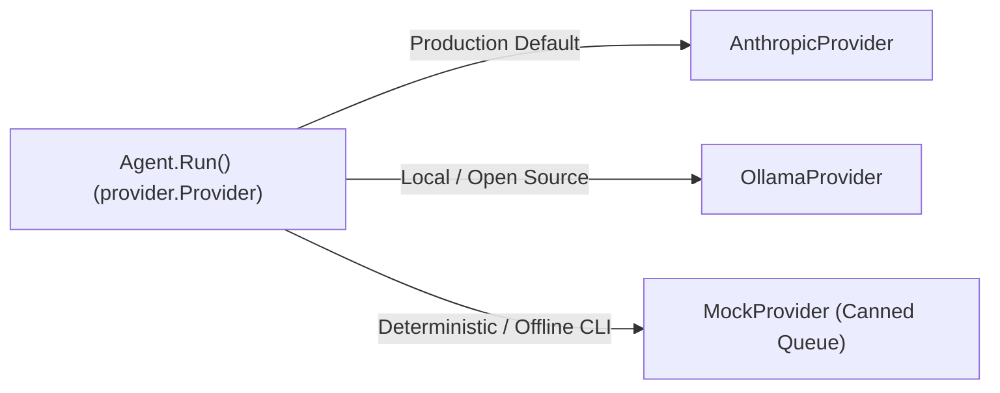

# Step 16: Alternative Providers & Mocks

## 1. Architectural Overview

Once the `Provider` interface is in place, adding a second LLM backend or an offline testing provider requires zero modifications to the core agent loop.

In Step 13, an internal mock was introduced within test suites. In this milestone, we formalize this into a first-class, exported component:
1. An alternative provider (such as OpenAI or local Ollama).
2. An exported **`MockProvider`** in `internal/provider/mock.go`: an in-memory provider that serves pre-scripted responses without consuming API credits or requiring network connectivity.
3. A CLI selector (`--provider mock` vs `--provider anthropic` vs `--provider ollama`).



## 2. Key Design Principles

- **Deterministic Testing & Demos**: `MockProvider` enables verifying multi-turn tool loops, scripted demos, and continuous integration without requiring active network access or secret credentials.
- **Offline Development**: Work on the harness anywhere, anytime, without incurring API expenses or latency.
- **Pluggable Architecture**: High-level orchestrators (`main.go`, `Agent`) interact strictly with `provider.Provider`, keeping model providers completely interchangeable.

## 3. Implementation Requirements

1. Export `MockProvider` in `internal/provider/mock.go`:
   ```go
   type MockProvider struct {
       Responses []api.Response
       CallIndex int
       History   [][]api.Message
   }
   ```
2. Verify that `MockProvider.Send` records input messages and pops responses sequentially from its queue.
3. Add a CLI flag in `main.go` to select the active provider at startup (`--provider mock` vs `--provider anthropic`).
4. Implement an alternative provider adapter (e.g. `OllamaProvider` connecting to `localhost:11434` or `OpenAIProvider`).

## 4. Verification & Exercises

### Test 1: Running with MockProvider
Simulate a full tool execution turn without touching external APIs.

**Configuration:**
Initialize harness with `MockProvider` preloaded with:
1. `Response{StopReason: "tool_use", Content: []Block{{Type: BlockToolUse, ToolName: "bash", ToolInput: `{"command":"echo hello"}`}}}`
2. `Response{StopReason: "end_turn", Content: []Block{{Type: BlockText, Text: "Command finished."}}}`

**User Prompt:**
```text
> Run a test command
```

**Expected Interaction & Output:**
```text
[mock provider] Dispatched response 1/2
[tool execute] bash {"command":"echo hello"}
hello
[mock provider] Dispatched response 2/2
Command finished.
```
- No network requests made.
- Test completes in under 10ms.
