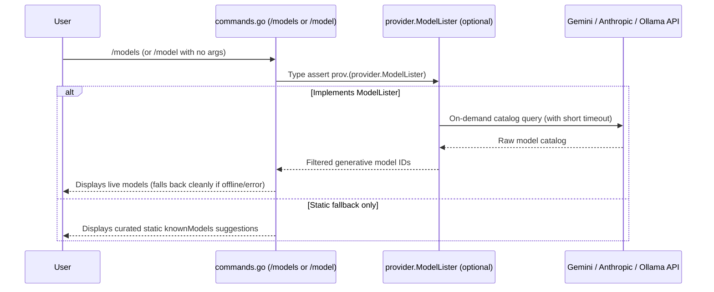

# Step 16.2: On-Demand Dynamic Model Discovery

## 1. Architectural Overview

Hardcoded model lists (`knownModels` in `commands.go`) and static CLI defaults inevitably drift as LLM vendors deprecate older releases (`404 model not found`) or when local Ollama installations pull new open-weight tags.

Rather than querying provider APIs eagerly at startup—which adds network latency, breaks offline usage, and returns non-chat models such as embeddings—this extension introduces **on-demand model discovery** via an optional capability interface (`ModelLister`) and interactive `/models` support (plus dynamic `/model` suggestions):



## 2. Key Design Principles

- **Interface Segregation Principle (ISP)**: Do **not** bloat the core `provider.Provider` interface with `ListModels`. High-level agent loops (`Agent.Run`, `compact.Summarize`, `delegate`) only need `Send`, `Model`, and `SetModel`. Model listing lives in a separate optional interface (`provider.ModelLister`) checked via Go type assertion (`prov.(provider.ModelLister)`).
- **On-Demand Only (Zero Startup Penalty)**: Discovery runs exclusively when explicitly requested by the user (`/models` or `/model` without arguments, or via a future `--list-models` CLI flag)—never inside `New...Provider` constructors or `buildProvider`.
- **Capability Filtering**: Catalog endpoints return embeddings, TTS, image-only, or batch models alongside chat models. Each adapter filters or normalizes its catalog before returning IDs:
  - **Gemini**: Filters `Model.SupportedActions` for `"generateContent"` and strips the `"models/"` resource prefix (e.g. `"models/gemini-4-hydrogen"` → `"gemini-4-hydrogen"`).
  - **Anthropic**: Calls `client.Models.List` and returns `ModelInfo.ID` values in catalog order.
  - **Ollama**: Calls `GET {baseURL}/api/tags` and extracts installed model names (`models[].name`).
  - **Mock**: Optionally implements `ModelLister` returning configurable `Models []string` (or curated mock IDs) for deterministic tests without network access.
- **Graceful Degradation (Static Fallback)**: If a live discovery request fails (offline environment, expired key, stopped Ollama daemon, or timeout), `/model` prints a clear warning and gracefully falls back to the static `knownModels` suggestions instead of crashing the REPL/TUI.
- **Branch Discipline (`step/*` vs. `feat/*`)**: Because `scripts/step.ps1` strictly manages milestones `01`–`27`, this follow-up is developed on an isolated feature branch (`feat/dynamic-model-discovery`) branched from `master` after Step 16, before starting Step 17.

## 3. Implementation Requirements

1. Define the optional capability interface and shared value type in `internal/provider/provider.go`:
   ```go
   // ModelLister is an optional capability implemented by providers that can
   // enumerate available models from their backend API on demand.
   type ModelLister interface {
       ListModels(ctx context.Context) ([]string, error)
   }
   ```
   *(Optionally return a small `ModelInfo` struct if descriptions/display names are desired, keeping the contract vendor-agnostic.)*
2. Implement `ListModels(ctx context.Context) ([]string, error)` on concrete adapters:
   - `internal/provider/gemini.go`: Query `p.client.Models.List(ctx, &genai.ListModelsConfig{})`, filter items supporting `"generateContent"`, and trim the `"models/"` prefix.
   - `internal/provider/anthropic.go`: Query `p.client.Models.List(ctx, anthropic.ModelListParams{})` and collect `m.ID`.
   - `internal/provider/ollama.go`: Execute `GET {p.baseURL}/api/tags` using `p.client` + `http.NewRequestWithContext`, decode `models[].name`, and normalize HTTP/JSON errors symmetrically with `Send`.
   - `internal/provider/mock.go`: Optional `AvailableModels []string` slice returned by `ListModels` for deterministic CLI and command testing.
3. Update `commands.go`:
   - Add `/models` slash command (`cmdModels`) to query `prov.(provider.ModelLister)` with a bounded context timeout (e.g. `5s`–`10s`) and print live available models for the active provider.
   - Update `cmdModel` (when invoked with no arguments) to display live discovered models when available, gracefully falling back to `knownModels[key]` if discovery fails or `ModelLister` is not implemented.
   - *(Optional)* Add a `--list-models` flag in `main.go` that prints discovered models for `--provider` and exits cleanly.
4. Add unit tests using `httptest.NewServer` and `MockProvider`:
   - `gemini_test.go`: Verify `models/` prefix stripping and `SupportedActions` filtering (`"generateContent"` vs `"embedContent"`).
   - `anthropic_test.go`: Verify `ListModels` error/pagination handling via SDK HTTP base URL override or unit tests.
   - `ollama_test.go`: Verify `GET /api/tags` parsing, empty tag lists, and HTTP errors against `httptest.NewServer`.
   - `mock_test.go`: Verify `MockProvider.ListModels` satisfies `provider.ModelLister` (`var _ ModelLister = (*MockProvider)(nil)`).

## 4. Verification & Exercises

### Test 1: Offline Automated Verification
Run `go test -v ./internal/provider ./...` to verify:
- All `ListModels` adapters parse catalog payloads and filter non-chat entries accurately via `httptest.NewServer`.
- `Provider` interface remains untouched—no mock or agent test requires breaking signature updates.

### Test 2: Live Interactive Discovery (`/models` & `/model`)
1. Launch with Gemini or Ollama:
   ```bash
   go run . --provider gemini
   # or locally:
   go run . --provider ollama
   ```
2. Run `/models` inside the TUI to verify the harness lists currently active models from your API key or local `ollama` daemon without restarting or editing Go source files.
3. Switch immediately with `/model <discovered-id>` and verify the next turn uses the newly selected model.

