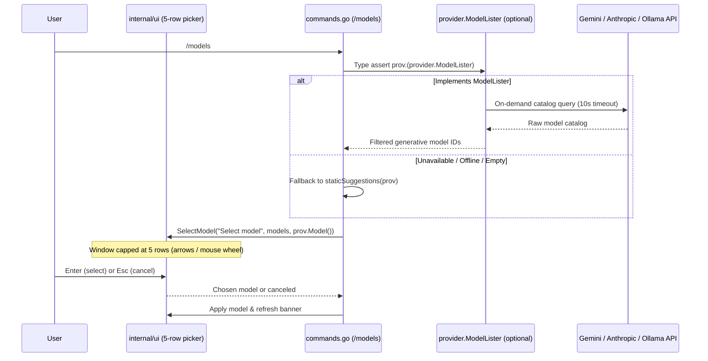

# Step 16.2: On-Demand Dynamic Model Discovery

## 1. Architectural Overview

Hardcoded model lists (`knownModels` in `commands.go`) and static CLI defaults inevitably drift as LLM vendors deprecate older releases (`404 model not found`) or when local Ollama installations pull new open-weight tags.

Rather than querying provider APIs eagerly at startup—which adds network latency, breaks offline usage, and returns non-chat models such as embeddings—this extension introduces **on-demand model discovery** via an optional capability interface (`ModelLister`), an interactive **5-row scrollable TUI picker** for `/models`, mouse-wheel viewport scrolling, and a focused `/model` command:



## 2. Key Design Principles

- **Interface Segregation Principle (ISP)**: Do **not** bloat the core `provider.Provider` interface with `ListModels`. High-level agent loops (`Agent.Run`, `compact.Summarize`, `delegate`) only need `Send`, `Model`, and `SetModel`. Model listing lives in a separate optional interface (`provider.ModelLister`) checked via Go type assertion (`prov.(provider.ModelLister)`).
- **On-Demand Only (Zero Startup Penalty)**: Discovery runs exclusively when explicitly requested via `/models` or `/model <name>`—never inside `New...Provider` constructors, `buildProvider`, or bare `/model`.
- **Single-Responsibility Commands & Catalog Validation (`/model` vs. `/models`)**:
  - `/model` (no args): displays only `current: <model>` and a short hint (zero network I/O, zero stdout flood).
  - `/model <name>`: validates `<name>` against the active provider's live `ModelLister` catalog (falling back to curated `knownModels` when offline/unsupported). Rejects unknown or cross-provider models with a clear diagnostic error instead of mutating state; switches valid models via `applyModel` (`prov.SetModel` + banner refresh).
  - `/models`: fetches live models (or curated fallback suggestions) and opens the bounded TUI picker.
- **Bounded 5-Row Picker & Viewport Mouse Scroll**: In an alternate-screen Bubble Tea TUI with `tea.WithMouseCellMotion()`, dumping 40+ model IDs to stdout overflows short terminals unless scrollback and modal navigation work smoothly:
  - `harness.Update` handles `tea.MouseMsg` (`MouseButtonWheelUp` / `MouseButtonWheelDown`) alongside `pgup` / `pgdown`.
  - `/models` reuses the same synchronous channel-reply pattern as `Confirm` (`SelectRequest` / `Program.SelectModel`) to render a **5-row sliding window** (`maxVisibleSelectOptions = 5`) with `↑`/`↓` arrows, mouse wheel scrolling, `Enter` to confirm, and `Esc` to cancel.
- **Capability Filtering**: Catalog endpoints return embeddings, TTS, image-only, or batch models alongside chat models. Each adapter filters or normalizes its catalog before returning IDs:
  - **Gemini**: Filters `Model.SupportedActions` for `"generateContent"` and strips the `"models/"` resource prefix (e.g. `"models/gemini-4-hydrogen"` → `"gemini-4-hydrogen"`).
  - **Anthropic**: Calls `client.Models.List`, skips retired models (`ModelInfoLifecycleRetired`), and returns `ModelInfo.ID` values in catalog order.
  - **Ollama**: Calls `GET {baseURL}/api/tags` and extracts installed model names (`models[].name`).
  - **Mock**: Implements `ModelLister` returning configurable `AvailableModels []string` (or `[]string{m.Model()}` when unset) for deterministic tests without network access.
- **Graceful Degradation (Static Fallback)**: If a live discovery request fails (offline environment, expired key, stopped Ollama daemon, or timeout), `/models` prints a clear notice and falls back to `staticSuggestions(prov)` instead of crashing the REPL/TUI.
- **Branch Discipline (`step/*` vs. `feat/*`)**: Because `scripts/step.ps1` strictly manages milestones `01`–`27`, this follow-up is developed on an isolated feature branch (`feat/dynamic-model-discovery`) branched from `master` after Step 16, before starting Step 17.

## 3. Implementation Requirements

1. Define the optional capability interface in `internal/provider/provider.go`:
   ```go
   // ModelLister is an optional capability interface (Interface Segregation Principle) implemented
   // by providers that can enumerate available models from their backend catalog on demand.
   type ModelLister interface {
       ListModels(ctx context.Context) ([]string, error)
   }
   ```
2. Implement `ListModels(ctx context.Context) ([]string, error)` on concrete adapters:
   - `internal/provider/gemini.go`: Paginate `p.client.Models.List(ctx, &genai.ListModelsConfig{})` (`page.Next`), filter items supporting `"generateContent"`, and strip the `"models/"` prefix.
   - `internal/provider/anthropic.go`: Paginate `p.client.Models.List(ctx, anthropic.ModelListParams{})` (`page.GetNextPage`), skip models whose lifecycle is `"retired"` (`anthropic.ModelInfoLifecycleRetired`), and collect `m.ID`.
   - `internal/provider/ollama.go`: Execute `GET {p.baseURL}/api/tags` using `p.client` + `http.NewRequestWithContext`, decode `models[].name`, and normalize HTTP/JSON errors symmetrically with `Send`.
   - `internal/provider/mock.go`: Optional `AvailableModels []string` slice returned via `slices.Clone` (falling back to `[]string{m.Model()}` when unset) so offline runs and tests satisfy `ModelLister`.
3. Enhance `internal/ui/program.go` and wire hooks in `main.go`:
   - Handle `tea.MouseMsg` (`MouseButtonWheelUp` / `MouseButtonWheelDown`) to scroll `h.viewport` when browsing output or move the picker cursor when selecting a model.
   - Add `stateSelectingModel`, `SelectRequest`, `modelUpdateMsg`, `Program.SelectModel`, and `Program.SetModel` to render a bounded 5-row windowed picker with viewport height compensation and automatic banner refresh.
   - Wire `selectModel = app.SelectModel` and `onModelSet = app.SetModel` in `main.go` alongside `rootAgent.Confirm = app.Confirm`, and initialize `--provider mock` with realistic selectable `AvailableModels`.
4. Update `commands.go`:
   - Share `resolveModels` across `/models` and `/model <name>` so live discovery (10s timeout) and curated static fallback use one single resolution path.
   - Simplify `cmdModel("")` to print only `current: <model>` and a concise usage hint; validate `cmdModel <name>` via `validateModel` before calling `applyModel` (rejecting unknown or cross-provider model names with explicit diagnostics).
   - Implement `cmdModels` using `resolveModels` and interactive selection via `selectModel` when running in the TUI (or plain printing when headless).
5. Add documented unit tests:
   - `internal/provider/gemini_test.go`: Verify pagination, `models/` prefix stripping, `SupportedActions` filtering, and nil guards (`TestGeminiProvider_ListModels_WithHTTPTest`).
   - `internal/provider/anthropic_test.go`: Verify pagination, retired lifecycle filtering, and nil guards via `option.WithBaseURL` (`TestAnthropicProvider_ListModels_WithHTTPTest`).
   - `internal/provider/ollama_test.go`: Verify `GET /api/tags` parsing, empty tag lists, HTTP errors, and nil/context guards (`TestOllamaProvider_ListModels_WithHTTPTest`).
   - `internal/provider/mock_test.go`: Verify `MockProvider.ListModels` fallback, defensive cloning, and nil/context guards (`TestMockProvider_ListModels`).
   - `internal/ui/program_test.go`: Verify mouse-wheel chat scrollback (`TestHarnessMouseWheelScroll`), 5-row picker windowing/navigation/enter/esc/empty guards (`TestHarnessSelectFlow`), and runtime banner refresh (`TestHarnessModelUpdate`).
   - `commands_test.go`: Verify `/model` active-only output, valid switches, rejection of unknown/cross-provider/non-lister models, offline fallback validation (`TestCmdModel`), and `/models` interactive selection, cancellation, and headless fallback (`TestCmdModelsInteractiveAndFallback`).

## 4. Verification & Exercises

### Test 1: Offline Automated Verification
Run `go test -v ./...` to verify:
- All `ListModels` adapters parse catalog payloads and filter non-chat entries accurately via `httptest.NewServer`.
- `Provider` interface remains untouched—no mock or agent test requires breaking signature updates.
- TUI 5-row picker windowing, mouse-wheel scroll, and slash command contracts pass deterministically.

### Test 2: Live Interactive Discovery (`/models` & `/model`)
1. Launch with Gemini, Anthropic, or Ollama:
   ```bash
   go run . --provider gemini
   # or locally:
   go run . --provider ollama
   ```
2. Run `/model` to verify it prints only your currently active model, then try `/model nonexistent-model` and verify it is rejected with an error while keeping the active model intact.
3. Run `/models` inside the TUI to open the 5-row scrollable picker: scroll with `↑`/`↓` or the mouse wheel, press `Enter` to switch live (verifying the top banner updates too), or `Esc` to cancel.
4. Scroll the main chat viewport with your mouse wheel or `PgUp`/`PgDn` to verify scrollback history navigation.

