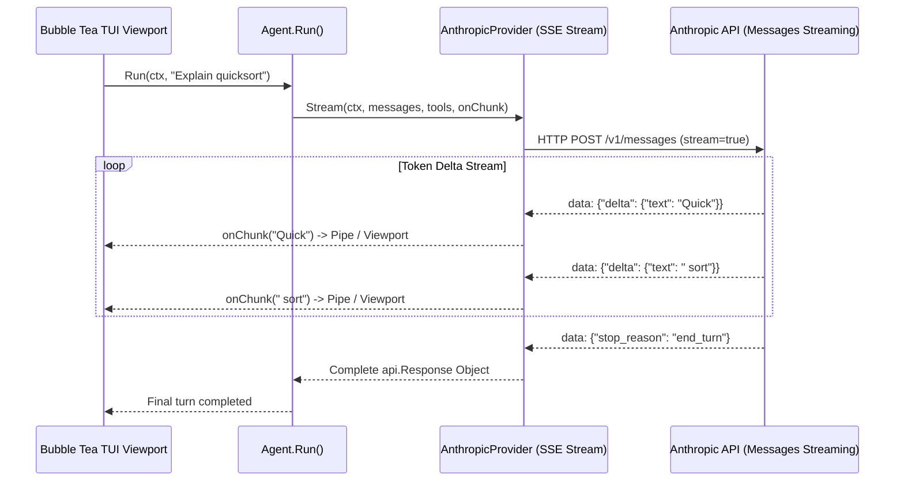

# Step 17: Streaming Responses

## 1. Architectural Overview

Waiting 5 to 15 seconds for a complete LLM response causes a sluggish user experience. In commercial coding agents like Claude Code, tokens are streamed via Server-Sent Events (SSE) and rendered to the terminal as they are generated.

In this step, we extend the `provider.Provider` contract to support token delta streaming:



## 2. Key Design Principles

- **Decoupled Callbacks**: The streaming mechanism reports text chunks via an event callback (`func(chunk string)`) while building the aggregated `api.Response` internally for conversational memory.
- **TUI & Stdout Pipe Integration**: Because the harness runs inside a Bubble Tea alternate screen buffer (Step 12), token deltas written to `os.Stdout` are captured by the pipe reader goroutine and appended directly into the scrollback viewport (`AppendMsg`), preventing screen flickering or ANSI corruption.
- **Handling Tool Calls in Streams**: When the model streams a tool call, the tool input JSON arrives in partial chunks (`input_json_delta`). The provider must accumulate and buffer the JSON fragments into a single complete `BlockToolUse` before returning.

## 3. Implementation Requirements

1. Add streaming method to `provider.Provider`:
   ```go
   Stream(ctx context.Context, messages []api.Message, tools []api.ToolDef, onChunk func(string)) (api.Response, error)
   ```
2. Implement SSE parsing in `AnthropicProvider` using the official SDK streaming client (`client.Messages.NewStreaming`).
3. Update `Agent.Run` to accept or configure a streaming chunk handler, streaming tokens in real time to the active presentation layer.

## 4. Verification & Exercises

### Test 1: Real-Time Typing Verification
Verify that long text outputs appear progressively in the viewport.

**User Prompt:**
```text
> Write a 4-paragraph essay explaining how garbage collection works in Go.
```

**Expected Interaction & Output:**
- Words appear progressively on screen with minimal time-to-first-token latency (< 500ms).
- Viewport auto-scrolls smoothly as new tokens stream in.
- The complete assembled response is appended to the agent's private `messages` slice for subsequent turns.
