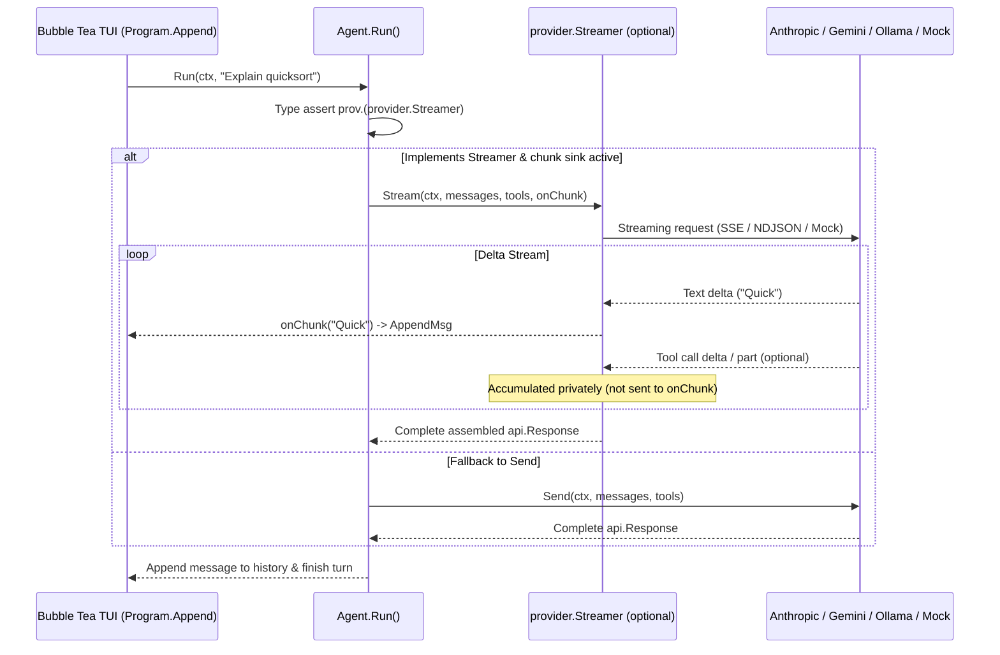

# Step 17: Streaming Responses

## 1. Architectural Overview

Waiting 5 to 15 seconds for a complete LLM response causes a sluggish user experience. In commercial coding agents like Claude Code, tokens are streamed via Server-Sent Events (SSE) and rendered to the terminal as they are generated.

Following the same **Interface Segregation Principle (ISP)** used in Step 16.2 (`ModelLister`), this step introduces an optional **`provider.Streamer`** capability interface alongside `provider.Provider`, wiring real-time token deltas from SSE/chunked adapters through `Agent.Run` into the Bubble Tea TUI without breaking non-streaming providers, subagents, or compaction helpers:



## 2. Key Design Principles

- **Interface Segregation Principle (ISP) & Graceful Fallback**: Keeping `Stream(...)` in a dedicated `provider.Streamer` interface preserves `provider.Provider` cleanly for non-streaming consumers (`compact.Summarize`, silent `delegate` subagents, minimal test stubs). Inside `Agent.Run`, any adapter implementing `Streamer` streams when a chunk sink (`Agent.OnChunk` or `Agent.Verbose`) is active; otherwise `Agent.Run` falls back transparently to `Send`.
- **Dual Responsibility (UX Deltas vs. Memory Integrity)**: `onChunk` emits only incremental user-facing text chunks in real time, while each adapter accumulates every chunk into a single cohesive `api.Response`:
  - **Anthropic (SSE)**: `anthropic.Message.Accumulate` reassembles `text_delta` and fragmented `input_json_delta` tool inputs.
  - **Gemini (SSE iterator)**: `GenerateContentStream` yields incremental `*genai.GenerateContentResponse` items; `Thought` parts are filtered out while text chunks accumulate into one `BlockText` alongside any `BlockToolUse` parts.
  - **Ollama (NDJSON)**: `/api/chat` with `"stream": true` yields newline-delimited JSON objects decoded line-by-line via `bufio.Scanner`, accumulating `message.content` and `message.tool_calls`.
  - **Mock (UTF-8 runes)**: `MockProvider.Stream` reuses `Send` and splits `BlockText` along UTF-8 `[]rune` boundaries (`StreamChunkSize`, defaulting to 4 runes) with optional cancellation-aware `StreamDelay`.
- **Unbuffered TUI & Pipe Delivery**: Line-buffered scanners (`bufio.Scanner`) stall partial tokens until a trailing `\n` arrives. `internal/ui/program.go` both exposes `Program.Append(chunk)` (wired to `rootAgent.OnChunk` in `main.go`) to push tokens directly as `AppendMsg`, and reads `os.Stdout` pipe chunks via raw `r.Read(buf)` so partial prints render immediately without waiting for newlines.

## 3. Implementation Details

1. **Optional capability contract (`internal/provider/provider.go`)**:
   ```go
   type Streamer interface {
       Stream(ctx context.Context, messages []api.Message, tools []api.ToolDef, onChunk func(chunk string)) (api.Response, error)
   }
   ```
2. **Anthropic SSE Adapter (`internal/provider/anthropic.go`)**:
   - Extract `validate`, `buildParams` (omitting `System` when `strings.TrimSpace(p.system) == ""` so blank system blocks do not fail live validation), and `buildAnthropicResponse` helpers shared symmetrically by `Send` and `Stream`.
   - Implement `(*AnthropicProvider).Stream` via `p.client.Messages.NewStreaming`, `defer stream.Close()`, `anthropic.Message.Accumulate`, nil-safe `onChunk` dispatch on `anthropic.TextDelta`, `stream.Err()` propagation, and compile-time `_ Streamer = (*AnthropicProvider)(nil)`.
3. **Gemini SSE Adapter (`internal/provider/gemini.go`)**:
   - Extract `validate`, `buildParams`, `collectGeminiParts` (surfacing `PromptFeedback.BlockReason` and abnormal `FinishReason` errors, and preserving `ThoughtSignature` on tool calls via `api.Block`), and `buildGeminiResponse` helpers shared symmetrically by `Send` and `Stream`.
   - Implement `(*GeminiProvider).Stream` iterating `p.client.Models.GenerateContentStream(...)`, skipping `part.Thought`, forwarding non-empty `part.Text` to `onChunk`, consolidating all text into one `BlockText` alongside `FunctionCall` blocks, and asserting `_ Streamer = (*GeminiProvider)(nil)`.
4. **Ollama NDJSON Adapter (`internal/provider/ollama.go`)**:
   - Extract `validate`, `buildParams`, `doChatRequest` (shared HTTP request + non-2xx error parsing), and `buildOllamaResponse` (shared `api.Response` builder) used by both `Send` and `Stream`.
   - Configure `NewOllamaProvider` with transport-level `DialContext` (`10s`) and `ResponseHeaderTimeout` (`2m`) while leaving `http.Client.Timeout = 0` so long active streams are not aborted mid-body.
   - Implement `(*OllamaProvider).Stream` with `stream: true`, `bufio.NewScanner` over `resp.Body` (4 MiB max line buffer), embedded `chunk.Error` checks, incremental `onChunk` dispatch, `tool_calls` collection, and `_ Streamer = (*OllamaProvider)(nil)`.
5. **Mock Adapter (`internal/provider/mock.go`) & CLI Demo (`main.go`)**:
   - Implement `(*MockProvider).Stream` with UTF-8 rune chunking (`StreamChunkSize`) and optional `ctx`-aware `StreamDelay`.
   - Configure `--provider mock` in `main.go` with `StreamChunkSize: 4` and `StreamDelay: 15 * time.Millisecond`, and wire `rootAgent.OnChunk = app.Append`.
6. **Agent Loop (`internal/agent/agent.go`) & TUI (`internal/ui/program.go`)**:
   - Add `Agent.OnChunk`, route turns through `provider.Streamer` when present and a sink is configured, suppress duplicate `fmt.Println` output after streamed text, and log verbose root tool invocations (`[root] reading ...`).
   - Replace `bufio.NewScanner` in `internal/ui/program.go` with raw byte reads, expose `Program.Append(chunk)`, resume `spinner.Tick` after approval/model-picker modals, and wrap viewport contents dynamically (`syncViewportContent`) so long messages and errors never clip horizontally.

## 4. Verification & Exercises

### Test 1: Automated Unit Tests (Offline)
Run `go test -v ./...` to verify:
- `internal/provider/mock_test.go`: `TestMockProvider_Stream` verifies UTF-8 multi-byte chunking, `BlockToolUse` preservation, and `nil`-callback safety.
- `internal/provider/anthropic_test.go`: `TestAnthropicProvider_Stream_WithHTTPTest` verifies `"stream": true` on `/v1/messages`, `text_delta` callback delivery, fragmented `input_json_delta` tool-input reassembly, `nil` callback safety, HTTP 500 error propagation, and `nil`-receiver/client guards; `TestAnthropicProvider_OmitsEmptySystem` verifies blank system prompts are omitted.
- `internal/provider/gemini_test.go`: `TestGeminiProvider_Stream_WithHTTPTest` and `TestGeminiProvider_ExhaustiveEdgeCases` verify `:streamGenerateContent?alt=sse`, `Thought` filtering, multi-turn `ThoughtSignature` round-trips, empty tool schema safety, `PromptFeedback` / abnormal `FinishReason` errors, and context cancellation.
- `internal/provider/ollama_test.go`: `TestNewOllamaProvider_DefaultsAndAccessors` verifies `Client.Timeout == 0` with transport header timeout; `TestOllamaProvider_Stream_WithHTTPTest` verifies `POST /api/chat` with `stream=true`, NDJSON incremental chunk emission, `tool_calls` normalization, `nil` callback safety, embedded stream error / HTTP 500 propagation, and nil/canceled-context guards.
- `internal/agent/agent_test.go`: `TestAgentLoop_Streaming` verifies `OnChunk` delta order + trailing newline, complete history persistence, and transparent `Send` fallback for non-`Streamer` providers.
- `internal/ui/program_test.go`: `TestHarnessStreamingChunks`, `TestHarnessSpinnerResumesAfterApproval`, and `TestHarnessViewportWrapping` verify unbuffered chunk rendering, spinner tick recovery after tool approval, and multi-line wrapping of long errors/messages.
- `internal/provider/live_test.go` (`-tags e2e`): `runLivePingSmoke` now tests both `Send()` and `Streamer.Stream()` against live Anthropic, Gemini, and Ollama endpoints.

### Test 2: Interactive Streaming Verification (`--provider mock` & Live Backends)
Launch offline with `--provider mock` (or live with `--provider gemini`, `--provider anthropic`, `--provider ollama`):

```bash
go run . --provider mock
```

**Expected Interaction & Output:**
- Tokens appear progressively on screen without waiting for newlines or turn completion.
- Viewport auto-scrolls smoothly (`followBottom`) as new `AppendMsg` deltas arrive.
- Complete assembled turns (and tool calls) are appended cleanly to `Agent.Messages()`.
