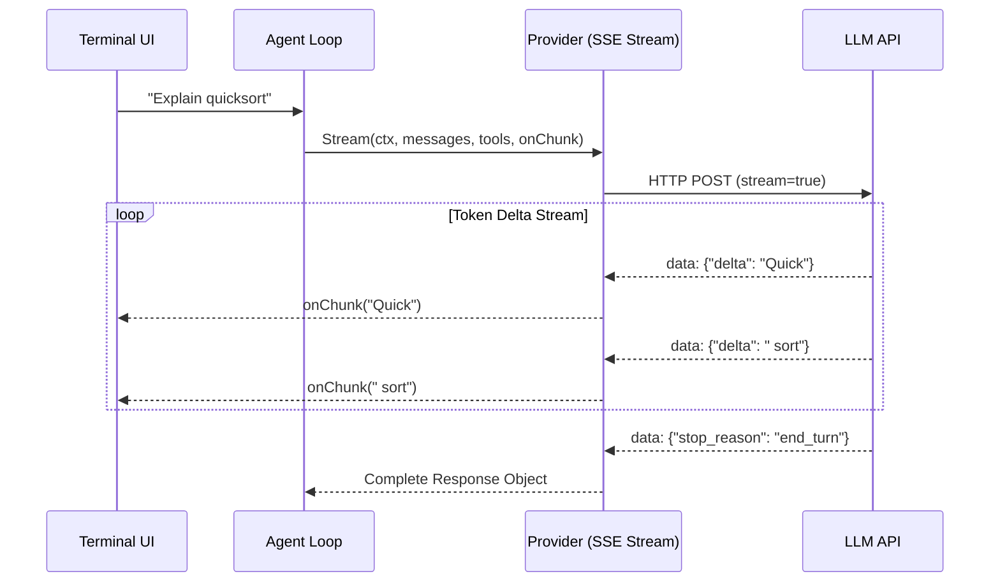

# Step 17: Streaming Responses

## 1. Architectural Overview

Waiting 5 to 15 seconds for a complete LLM response causes a sluggish user experience. In commercial coding agents like Claude Code, tokens are streamed via Server-Sent Events (SSE) and rendered to the terminal as they are generated.

In this step, we extend the `Provider` contract to support streaming deltas:



## 2. Key Design Principles

- **Decoupled Callbacks**: The streaming mechanism reports text chunks via an event callback (`func(chunk string)`) while building the aggregated `Response` internally for conversation history.
- **Handling Tool Calls in Streams**: When the model streams a tool call, the tool input JSON arrives in partial chunks. The harness must buffer and assemble the JSON before dispatching `executeTool`.

## 3. Implementation Requirements

1. Add streaming method to `Provider`:
   ```go
   Stream(ctx context.Context, messages []Message, tools []ToolDef, onChunk func(string)) (Response, error)
   ```
2. Implement SSE parsing in `AnthropicProvider`.
3. Update `agentLoop` to display tokens in real time.

## 4. Verification & Exercises

### Test 1: Real-Time Typing Verification
Verify that long text outputs appear progressively.

**User Prompt:**
```text
> Write a 4-paragraph essay explaining how garbage collection works in Go.
```

**Expected Interaction & Output:**
- Words appear immediately on screen with zero initial pause.
- No buffering delay until the end.
- Full response is stored in conversation history for the next turn.

