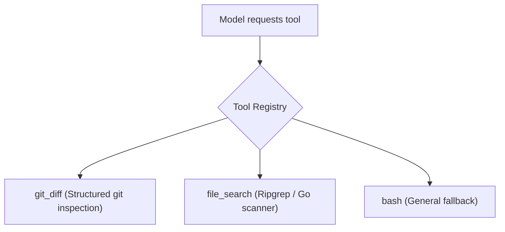

# Step 18: Custom Tools Suite

## 1. Architectural Overview

With the dynamic `Tool` registry established in Step 17, expanding the agent's capabilities becomes effortless.

In this step, we add specialized engineering tools that make the agent much more efficient than using raw `bash`:
1. **`git_diff`**: Shows uncommitted changes in the repository without running arbitrary shell scripts.
2. **`file_search` / `grep`**: Performs fast regex search across files in the project.



## 2. Key Design Principles

- **Specialized Over General**: Dedicated tools provide tighter input validation, cleaner error reporting, and safer execution boundaries than raw bash commands.
- **Fast Search**: Using native file-walking or ripgrep is faster and safer than arbitrary bash pipes.

## 3. Implementation Requirements

1. Create `internal/tool/gitdiff.go`.
2. Create `internal/tool/grep.go`.
3. Register both in `init()`.

## 4. Verification & Exercises

### Test 1: Git Diff Execution
**User Prompt:**
```text
> Show me what files have been modified in git
```

**Expected Interaction & Output:**
- Model invokes `git_diff` (instead of running `bash {"command": "git diff"}`).
- Tool executes `git diff` and returns the diff cleanly.
- Model summarizes the changes.

