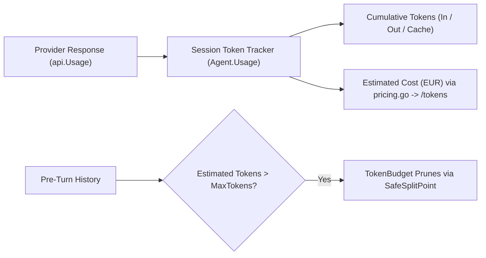

# Step 18: Token Budgeting & Cost Tracking

## 1. Architectural Overview

Counting turns (e.g. `KeepLast: 10`) is a blunt instrument: a single turn that reads a 5,000-line file contains far more tokens than twenty conversational turns.

In this step, we implement:
1. **Normalized Token Usage (`api.Usage`)**: Capturing input, output, cache-read, and cache-write tokens uniformly across Anthropic, Gemini, Ollama, and Mock (for both `Send` and `Stream`).
2. **`TokenBudget` Compactor**: Pruning oldest messages safely (`SafeSplitPoint`) based on an exact pre-call token budget (e.g. keep under 40,000 tokens).
3. **Session Cost Tracker (EUR), Live TUI Status Bar & `/tokens` Command**: Accumulating turn usage in `Agent` (including delegated subagents via `RecordUsage`), calculating estimated `EUR` cost using per-model pricing rates (`LookupPricing` / `EstimateCostEUR`), and surfacing a live summary line above the TUI input alongside the detailed `/tokens` breakdown.



## 2. Key Design Principles

- **Accurate Vendor Accounting (Normalized Semantics)**: Each provider reports token metadata in its own wire fields and with slightly different semantics, which each adapter normalizes into `api.Usage`:

| Provider | Wire / SDK Source | Normalized Fields & Subtle Semantics |
|---|---|---|
| **Anthropic** (`anthropic.go`) | `resp.Usage` / `acc.Usage` (`input_tokens`, `output_tokens`, `cache_read_input_tokens`, `cache_creation_input_tokens`) | `InputTokens` **excludes** cached tokens; `OutputTokens` already includes thinking tokens. `acc.Accumulate(event)` merges `message_start` and `message_delta` automatically. |
| **Gemini** (`gemini.go`) | `resp.UsageMetadata` (`promptTokenCount`, `toolUsePromptTokenCount`, `candidatesTokenCount`, `thoughtsTokenCount`, `cachedContentTokenCount`) | `PromptTokenCount` **includes** cached tokens (`UncachedInput = max(0, Prompt + ToolUsePrompt - CachedContent)`); `ThoughtsTokenCount` is billed as output alongside `CandidatesTokenCount`. Streams **overwrite (`=`)** with the latest non-nil `UsageMetadata` (even on trailing chunks with `len(Candidates) == 0`), never sum (`+=`). |
| **Ollama** (`ollama.go`) | `/api/chat` JSON (`prompt_eval_count`, `eval_count`) | Mapped to `InputTokens` and `OutputTokens`; emitted only on the final `"done": true` NDJSON chunk during streaming. Cache tokens and `EUR` cost are `0` (local inference). |
| **Mock** (`mock.go`) | `Response.Usage` on scripted turns | Returned verbatim by `Send` and `Stream` (or estimated fallback when unset) for deterministic tests. |

- **Overwrite (`=`), Never Sum (`+=`) Across Stream Chunks**: Unlike text deltas (`Part.Text`), streaming `UsageMetadata` / `MessageDeltaUsage` chunks carry **running cumulative totals for the entire request so far**, not per-chunk deltas. Overwriting the snapshot on every chunk with metadata avoids inflating input/cost by the chunk count.
- **Pre-Call Budgeting vs. Post-Call Billing**: `Compactor.Compact` runs **before** calling the provider, and API `Usage` only reports a single aggregate input count for the whole request. `TokenBudget` therefore uses a deterministic per-message token estimator (`EstimateMessageTokens`: `4 + (chars + 3) / 4` across `Text`, `ToolUse`, and `ToolResult` blocks) combined with clean boundary snapping (`isCleanSplitBoundary`, shared with `SafeSplitPoint`) to decide in $O(n)$ via suffix sums (`suffixTokens`) the earliest user turn that brings `messages[i:]` under `MaxTokens`—always preserving at least the newest clean turn (`lastClean`) even if an oversized single turn exceeds `MaxTokens` on its own.
- **Session Cost Transparency in EUR (`internal/provider/pricing.go` & `Agent.Usage`)**: `Agent` accumulates `api.Usage` per turn (`Usage.Add`) and preserves session totals across `Clear()` (because spent tokens remain billed); `DelegateTool` rolls subagent totals into `rootAgent.RecordUsage`. `LookupPricing` / `EstimateCostEUR` map model ID prefixes to published rates expressed in `EUR` (`usdToEUR = 0.92`), explicitly returning `0.00 EUR` (`known=true`) for local/mock models and `(0, false)` for unknown custom models.

## 3. Implementation Requirements

1. Add `Usage` (`Add`, `Total`) and `Response.Usage` field to `internal/api/types.go` (`InputTokens`, `OutputTokens`, `CacheCreationTokens`, `CacheReadTokens`).
2. Extract and normalize usage metadata in `AnthropicProvider`, `GeminiProvider`, `OllamaProvider`, and `MockProvider` across both `Send` and `Stream`.
3. Implement `EstimateMessageTokens`, `EstimateMessagesTokens`, shared `isCleanSplitBoundary`, and `TokenBudget` compaction strategy in `internal/compact/compact.go` (preserving `NoCompaction`, `SlidingWindow`, `Summarize`, and `WithLogging`), and wire Option 5 (`WithLogging` wrapping `&compact.TokenBudget{MaxTokens: 40000}`) in `main.go` while keeping Options 1–4 intact.
4. Add EUR pricing lookup (`internal/provider/pricing.go`: `ModelPricing`, `LookupPricing`, `EstimateCostEUR`), track cumulative `Usage` in `Agent` (`Usage()`, `RecordUsage()`) plus subagent rollup in `delegate.go`.
5. Implement the `/tokens` slash command in `commands.go` (`cmdTokens`, `formatIntWithCommas`, `activeTokenBudget`) displaying the cumulative token breakdown, active context estimate vs. budget, and estimated EUR cost, plus the persistent live TUI status bar above the input box (`Program.SetUsageStatus` in `internal/ui/program.go` fed by `formatUsageStatus` in `main.go` after `rootAgent.Run` and `/model` switches).

## 4. Verification & Exercises

### Test 1: Automated Token Estimation, Budgeting, Agent Accounting, Pricing, TUI Bar & `/tokens`
Run `go test -v . ./internal/api ./internal/compact ./internal/provider ./internal/agent ./internal/ui` to verify:
- `internal/api/types_test.go`: `TestUsageAccounting` validates `Usage.Add`, `Usage.Total`, and nil-receiver guards.
- `internal/provider/pricing_test.go`: `TestLookupPricingAndEstimateCostEUR` validates Claude/Gemini EUR tiers with caching multipliers, local Ollama/Mock zero-cost models, and unknown model `(0, false)` fallback.
- `internal/agent/agent_test.go`: `TestAgentUsageAccounting` validates multi-turn + streaming usage accumulation, `Clear()` preservation of session totals, and `RecordUsage` rollups.
- `internal/compact/compact_test.go`: `TestEstimateTokens` and `TestTokenBudget` validate estimation, pruning, tool atomicity, active-turn preservation, and `WithLogging`.
- `commands_test.go`: `TestFormatIntWithCommas`, `TestCmdTokens`, and `TestFormatUsageStatus` validate comma formatting, token/budget/EUR rendering, live status line formatting, unknown model notice, and nil-global safety.
- `internal/ui/program_test.go`: `TestHarnessUsageStatus` validates idle status rendering above the input box, `Thinking...` spinner priority while running, and nil-safe `SetUsageStatus`.

### Test 2: Inspecting Session Cost
**User Prompt:**
```text
> /tokens
```

**Expected Interaction & Output:**
```text
Session Token Usage:
  Input tokens:          12,450
  Output tokens:            820
  Cache write:                0
  Cache read:             8,100
  Total tokens:          21,370
  Context budget:    ~12 / 40,000 tokens
  Estimated cost:    €0.0479 EUR (claude-sonnet-4-5-20250929)
```

