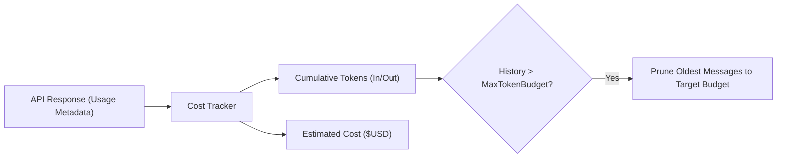

# Step 18: Token Budgeting & Cost Tracking

## 1. Architectural Overview

Counting turns (e.g. `KeepLast: 10`) is a blunt instrument: a single turn that reads a 5,000-line file contains far more tokens than twenty conversational turns.

In this step, we implement:
1. **Token Counting**: Tracking input/output tokens used in each API response.
2. **TokenBudget Compactor**: Pruning messages based on an exact token budget (e.g. keep under 40,000 tokens).
3. **Session Cost Tracker**: Calculating cumulative dollar cost using the model's pricing rates.



## 2. Key Design Principles

- **Accurate Accounting**: Extract usage fields (`input_tokens`, `output_tokens`, `cache_read_tokens`) directly from API responses.
- **Cost Transparency**: Give developers immediate visibility into what their session is costing.

## 3. Implementation Requirements

1. Add token usage fields to internal `Response`.
2. Implement `TokenBudget` compaction strategy.
3. Implement `/tokens` command displaying token breakdown and estimated cost.

## 4. Verification & Exercises

### Test 1: Inspecting Session Cost
**User Prompt:**
```text
> /tokens
```

**Expected Interaction & Output:**
```text
Session Token Usage:
  Input tokens:     12,450
  Output tokens:       820
  Cache read:        8,100
  Total tokens:     21,370
  Estimated cost:   $0.042 USD
```

