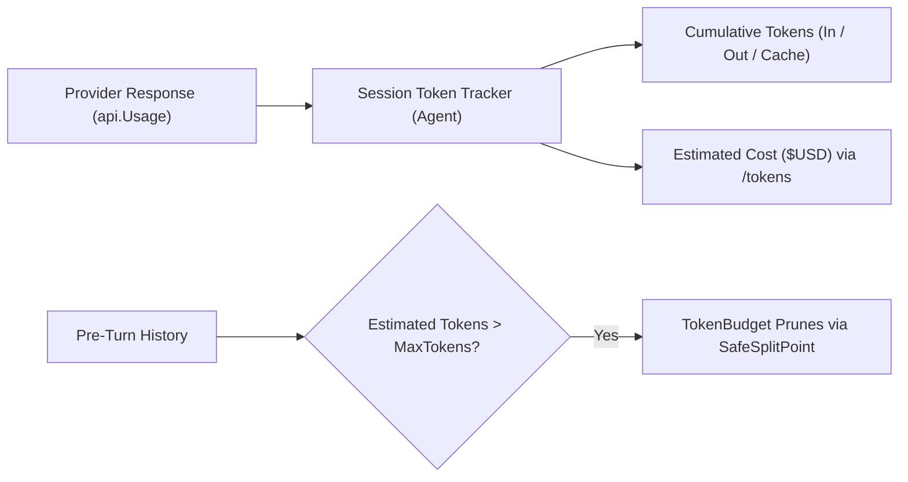

# Step 18: Token Budgeting & Cost Tracking

## 1. Architectural Overview

Counting turns (e.g. `KeepLast: 10`) is a blunt instrument: a single turn that reads a 5,000-line file contains far more tokens than twenty conversational turns.

In this step, we implement:
1. **Normalized Token Usage (`api.Usage`)**: Capturing input, output, cache-read, and cache-write tokens uniformly across Anthropic, Gemini, Ollama, and Mock (for both `Send` and `Stream`).
2. **`TokenBudget` Compactor**: Pruning oldest messages safely (`SafeSplitPoint`) based on an exact pre-call token budget (e.g. keep under 40,000 tokens).
3. **Session Cost Tracker & `/tokens` Command**: Accumulating turn usage in the agent and calculating estimated `$USD` cost using per-model pricing rates.



## 2. Key Design Principles

- **Accurate Vendor Accounting (Normalized Semantics)**: Each provider reports token metadata in its own wire fields and with slightly different semantics, which each adapter normalizes into `api.Usage`:

| Provider | Wire / SDK Source | Normalized Fields & Subtle Semantics |
|---|---|---|
| **Anthropic** (`anthropic.go`) | `resp.Usage` / `acc.Usage` (`input_tokens`, `output_tokens`, `cache_read_input_tokens`, `cache_creation_input_tokens`) | `InputTokens` **excludes** cached tokens; `OutputTokens` already includes thinking tokens. `acc.Accumulate(event)` merges `message_start` and `message_delta` automatically. |
| **Gemini** (`gemini.go`) | `resp.UsageMetadata` (`promptTokenCount`, `toolUsePromptTokenCount`, `candidatesTokenCount`, `thoughtsTokenCount`, `cachedContentTokenCount`) | `PromptTokenCount` **includes** cached tokens (`UncachedInput = max(0, Prompt + ToolUsePrompt - CachedContent)`); `ThoughtsTokenCount` is billed as output alongside `CandidatesTokenCount`. Streams **overwrite (`=`)** with the latest non-nil `UsageMetadata` (even on trailing chunks with `len(Candidates) == 0`), never sum (`+=`). |
| **Ollama** (`ollama.go`) | `/api/chat` JSON (`prompt_eval_count`, `eval_count`) | Mapped to `InputTokens` and `OutputTokens`; emitted only on the final `"done": true` NDJSON chunk during streaming. Cache tokens and `$USD` cost are `0` (local inference). |
| **Mock** (`mock.go`) | `Response.Usage` on scripted turns | Returned verbatim by `Send` and `Stream` (or estimated fallback when unset) for deterministic tests. |

- **Overwrite (`=`), Never Sum (`+=`) Across Stream Chunks**: Unlike text deltas (`Part.Text`), streaming `UsageMetadata` / `MessageDeltaUsage` chunks carry **running cumulative totals for the entire request so far**, not per-chunk deltas. Overwriting the snapshot on every chunk with metadata avoids inflating input/cost by the chunk count.
- **Pre-Call Budgeting vs. Post-Call Billing**: `Compactor.Compact` runs **before** calling the provider, and API `Usage` only reports a single aggregate input count for the whole request. `TokenBudget` therefore uses a deterministic per-message token estimator (`EstimateMessagesTokens` / rune heuristic) combined with `SafeSplitPoint` to decide how many oldest turns to prune before inference.
- **Cost Transparency**: Give developers immediate visibility into session token breakdown (prepared for Step 19 Prompt Caching) and estimated USD cost without coupling pricing logic inside adapters.

## 3. Implementation Requirements

1. Add `Usage` struct and `Response.Usage` field to `internal/api/types.go` (`InputTokens`, `OutputTokens`, `CacheCreationTokens`, `CacheReadTokens`).
2. Extract and normalize usage metadata in `AnthropicProvider`, `GeminiProvider`, `OllamaProvider`, and `MockProvider` across both `Send` and `Stream`.
3. Implement `TokenBudget` compaction strategy in `internal/compact/compact.go` using per-message token estimation + `SafeSplitPoint`.
4. Track cumulative `Usage` in `Agent`, add model pricing lookup, and implement the `/tokens` slash command displaying the token breakdown and estimated USD cost.

## 4. Verification & Exercises

### Test 1: Inspecting Session Cost
**User Prompt:**
```text
> /tokens
```

**Expected Interaction & Output:**
```text
Session Token Usage:
  Input tokens:     12,450
  Output tokens:       820
  Cache write:           0
  Cache read:        8,100
  Total tokens:     21,370
  Estimated cost:   $0.042 USD
```

