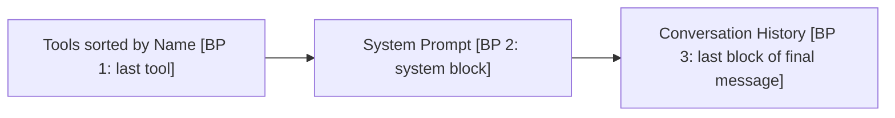

# Step 19: Prompt Caching

## 1. Architectural Overview

Frontier models like Anthropic Claude offer **Prompt Caching**, which persists the server-side KV-cache for repeated request prefixes across a 5-minute ephemeral TTL:
- Cache reads cost up to **90% less** (`CacheReadTokens`) after a one-time initial write (`CacheCreationTokens`).
- Time-to-first-token (TTFT) latency drops sharply on long tool outputs and multi-turn histories.

Anthropic evaluates cache prefixes in **strict byte-exact order**: **`Tools -> System -> Messages`**. In this step, we stabilize tool serialization and configure 3 explicit `cache_control: {"type": "ephemeral"}` breakpoints shared symmetrically by `Send` and `Stream`:



## 2. Key Design Principles

- **Deterministic Prefix Stability (`internal/tool/tool.go`)**: Go intentionally randomizes `map` iteration order (`Registry.tools`). Because `Tools` sits at the very start of Anthropic's prefix (`Tools -> System -> Messages`), an unsorted `Registry.Definitions()` slice would silently invalidate 100% of downstream caches on almost every turn. Sorting `definitions` alphabetically by `Name` (`slices.SortFunc` + `cmp.Compare`) guarantees a deterministic prefix across all providers (`Anthropic`, `Gemini`, and `Ollama`).
- **Cumulative Multi-Layer Breakpoints (`internal/provider/anthropic.go`)**: Anthropic allows up to 4 cache breakpoints per request and caches cumulatively from the start of the request up to each marker:
  - **BP 1 (Last Tool in `toAnthropicTools`)**: One marker on the trailing `ToolParam` freezes all tool schemas together without wasting per-tool breakpoints.
  - **BP 2 (`System` in `buildParams`)**: Isolates the system prompt so history compaction (`TokenBudget`) or dynamic turns do not invalidate `Tools + System`.
  - **BP 3 (Final Block of Last Message in `toAnthropicMessages`)**: Moves forward every turn via `applyCacheControl` (`OfText`, `OfToolUse`, `OfToolResult`) so large `tool_result` payloads (e.g. `read_file` outputs) are written on turn $N$ and read at a 90% discount on turn $N+1$.
- **Minimum Token Thresholds & Multi-Provider Context**:
  - Anthropic silently skips caching (`CacheReadTokens == 0`, no error) when the prefix before a breakpoint falls below model minimums (~1,024+ tokens on recent Claude models).
  - **Gemini** relies on automatic implicit caching for modern models (with `CachedContentTokenCount` already normalized in `gemini.go`) rather than heavyweight stateful `CachedContent` objects; **Ollama** reuses `llama.cpp` KV prefixes automatically when sorted tool schemas keep prefixes identical.

## 3. Implementation Requirements

1. Sort `Registry.Definitions()` deterministically by `Name` in `internal/tool/tool.go`.
2. Add `CacheControl: anthropic.NewCacheControlEphemeralParam()` in `internal/provider/anthropic.go`:
   - On `params.System[0]` inside `buildParams` (BP 2).
   - On the final element of `toAnthropicTools` when non-empty (BP 1).
   - On the final content block of the last `MessageParam` in `toAnthropicMessages` via `applyCacheControl` covering `OfText`, `OfToolUse`, and `OfToolResult` (BP 3).
3. Verify deterministic ordering and emitted `cache_control` JSON fields in `internal/tool/tool_test.go` and `internal/provider/anthropic_test.go`.

## 4. Verification & Exercises

### Test 1: Automated Prefix Determinism & JSON Breakpoint Tests
Run `go test -v ./internal/tool ./internal/provider` to verify:
- `internal/tool/tool_test.go`: `TestRegistryDefinitions_DeterministicOrder` validates identical `["bash", "delegate", "read_file", "write_file"]` order across 25 calls.
- `internal/provider/anthropic_test.go`: `TestAnthropicProvider_PromptCachingBreakpoints` marshals `buildParams(...)` and asserts `cache_control: {"type": "ephemeral"}` appears strictly on the last tool (BP1), `system[0]` (BP2), and the trailing content block (`text`, `tool_use`, or `tool_result`) of the last message (BP3), alongside empty/nil guards.

### Test 2: Offline (€0) — Proving Go Map Randomization Breaks Prefix Caching
1. Temporarily comment out the `slices.SortFunc(...)` block in `internal/tool/tool.go` (`Registry.Definitions()`).
2. Run `go test -v -run TestRegistryDefinitions_DeterministicOrder ./internal/tool` — it fails intermittently as Go shuffles the `tools` map iteration order across iterations, which would silently invalidate `BP 1` (`Tools`) on every turn.
3. Restore `slices.SortFunc(...)` and confirm the test passes reliably.

### Test 3: Live (Anthropic) — Observing the Minimum Token Threshold
Launch explicitly with Anthropic (`go run .` without `--provider` defaults to `gemini`, whose implicit cache never emits `Cache write`):
```bash
go run . --provider anthropic --model claude-sonnet-4-5-20250929
```
1. Send a tiny prompt: `Hello`.
2. Inspect `/tokens`: `Cache write` and `Cache read` both remain `0` because `Tools` + the short `systemPrompt` + `"Hello"` stay below Anthropic's minimum cacheable token threshold (~1,024+ tokens), so the server silently ignores the breakpoints without raising an error.

### Test 4: Live (Anthropic) — Triggering Real Cache Writes & Hits via BP 3
In the same Anthropic session:
1. Ask the agent to read a large repository file so the trailing `tool_result` (marked with `BP 3`) exceeds the threshold:
   ```text
   Read internal/ui/program.go and summarize inputArea in 2 lines
   ```
2. Inspect `/tokens` (and the live TUI status line): **`Cache write`** increases with the cached prefix + file payload.
3. Within 5 minutes, send a short follow-up prompt (e.g., `Which struct field holds the usage string there?`).
4. Inspect `/tokens`: **`Cache read`** jumps to reuse the prior prefix while `Input tokens` rises only slightly, dropping incremental EUR cost by ~90% on cached input tokens. *(Running `/clear` or waiting >5 minutes resets the active history prefix from `BP 3`).*

