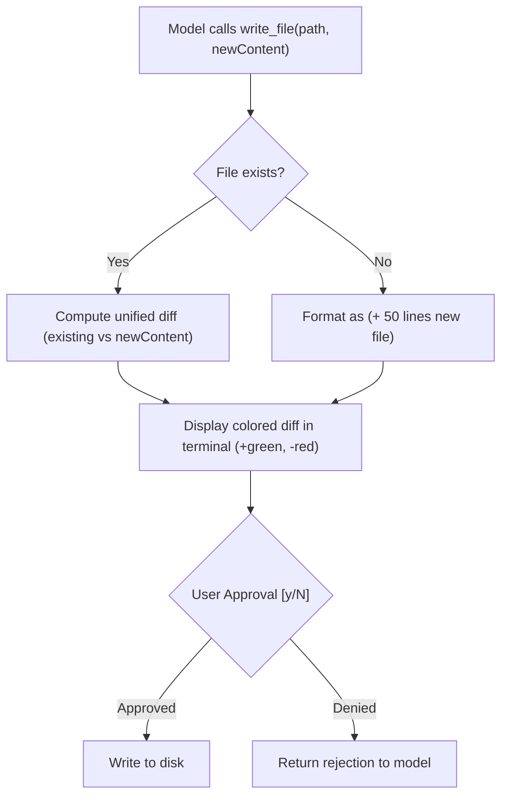

# Step 20: Diff Approval for File Writes

## 1. Architectural Overview

Asking `Allow execution of write_file {"path": "main.go", "content": "..."}? [y/N]` forces the user to read raw JSON with escaped newlines (`\n`). This makes it nearly impossible to review what is actually changing in a file.

In this step, we enhance the permission gate for `write_file` to compute and render a **unified Git-style colored diff** before touching disk:



## 2. Key Design Principles

- **Readable Code Reviews**: The user should review agent file changes the exact same way they review a GitHub PR.
- **Safety Previews**: Never write bytes to disk until the diff has been explicitly vetted.

## 3. Implementation Requirements

1. Integrate a diff library (e.g. `pmezard/go-difflib` or standard unified diff generator).
2. Intercept `write_file` in the permission gate to display red/green diff lines.
3. Prompt for confirmation after displaying the diff.

## 4. Verification & Exercises

### Test 1: Modifying an Existing File
**User Prompt:**
```text
> Add a comment '// Version 2.0' to line 1 of README.md
```

**Expected Interaction & Output:**
```text
[write_file diff] README.md
--- README.md (existing)
+++ README.md (proposed)
@@ -1,3 +1,4 @@
+// Version 2.0
 # Phi Agent Code

Apply changes? [y/N]:
```

