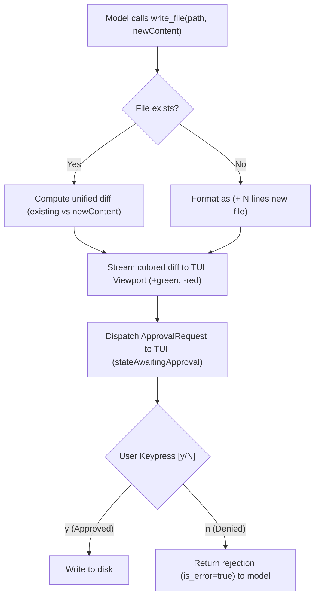

# Step 20: Diff Approval for File Writes

## 1. Architectural Overview

Asking `Allow execution of write_file {"path": "main.go", "content": "..."}? [y/N]` forces the user to read raw JSON with escaped newlines (`\n`). This makes it nearly impossible to review what is actually changing in a file.

In this step, we enhance the permission gate for `write_file` to compute and render a **unified Git-style colored diff** before touching disk:



## 2. Key Design Principles

- **Readable Code Reviews**: The user reviews agent file changes the exact same way they review a GitHub PR.
- **Safety Previews**: Never write bytes to disk until the diff has been explicitly inspected and confirmed.
- **Optional `Previewer` Capability (`ISP`) & Decorator Forwarding**: Rather than hardcoding `write_file` JSON parsing inside `internal/agent`, `internal/tool/tool.go` defines an optional `Previewer` interface (`Preview(rawInput) (previewText, confirmPrompt, hasPreview)`). `RetryDecorator` (`internal/tool/retry.go`) forwards `Preview` to wrapped tools so `Agent.confirmToolExecution` and `buildConfirmationPrompt` (`internal/agent/agent.go`) remain cleanly decoupled from filesystem details.
- **Zero-Dependency Standard Library Diffing**: Rather than pulling in an external dependency, `internal/tool/diff.go` implements a pure Go unified diff engine built on prefix/suffix trimming and Longest Common Subsequence (LCS) dynamic programming.
- **Bubble Tea TUI Integration**: The colored diff lines are written to standard output, captured by the stdout pipe redirect, and smoothly rendered into the scrollable viewport. The confirmation then seamlessly activates the TUI's amber approval box (`stateAwaitingApproval`).

---

## 3. How the Unified Diff Algorithm Works (`internal/tool/diff.go`)

Computing a Git-style diff from scratch splits cleanly into two decoupled layers: **finding the minimal line edits** (`computeDiffLines`) and **formatting compact context hunks** (`UnifiedDiff` + `writeHunk`).

### Line Normalization (`splitLines`)
- Empty files return `nil` (`0` lines) so new files render cleanly against `0` prior lines.
- `\r\n` is normalized to `\n` before splitting; otherwise comparing a CRLF file on Windows against an LF payload from the LLM would falsely flag every single line as deleted and re-added.
- A single trailing `\n` is trimmed before `strings.Split` so `"A\nB\n"` yields `["A", "B"]` without a phantom trailing blank line.

### Prefix/Suffix Trimming + LCS Dynamic Programming (`computeDiffLines`)

Before building an $O(old \times new)$ dynamic programming grid, we strip identical lines from both ends in linear time:
- **`prefixLen`**: scans forward while `oldLines[prefixLen] == newLines[prefixLen]`.
- **`suffixLen`**: scans backward while lines match without crossing `prefixLen`.

If a 2-line edit happens inside a 4,000-line file, trimming shrinks the DP problem from 16,000,000 cells to a tiny center slice (`oldChanged` vs. `newChanged`).

#### Concrete Example Walkthrough
Suppose we compare:
- `oldLines = ["A", "B", "C", "E"]`
- `newLines = ["A", "X", "B", "Y", "E"]`

1. **Trim ends**: `prefixLen = 1` (`"A"`), `suffixLen = 1` (`"E"`). Only the changed center runs through DP:
   - `oldChanged = ["B", "C"]` (`oldChangedLen = 2`)
   - `newChanged = ["X", "B", "Y"]` (`newChangedLen = 3`)
2. **Build the `lcs` matrix bottom-up** (`oldIdx` from `1` down to `0`, `newIdx` from `2` down to `0`):
   `lcs[oldIdx][newIdx]` answers: *"How many common lines exist in `oldChanged[oldIdx:]` and `newChanged[newIdx:]`?"*
   - If `oldChanged[oldIdx] == newChanged[newIdx]`: keep the match (`1 + lcs[oldIdx+1][newIdx+1]`).
   - Otherwise: inherit `max(lcs[oldIdx+1][newIdx], lcs[oldIdx][newIdx+1])`.

   ```text
                X(0)   B(1)   Y(2)   end(3)
   B(0)   ->     1      1      0      0
   C(1)   ->     0      0      0      0
   end(2) ->     0      0      0      0
   ```

3. **Backtrack forward from `(0, 0)` to build `operations`**:
   - `(oldIdx=0 "B", newIdx=0 "X")`: mismatch. Check `lcs[1][0] (0) >= lcs[0][1] (1)` -> false, because keeping `"B"` yields `1` future match in `newChanged`. Emit **`Insert("X")`**, advance `newIdx = 1`.
   - `(oldIdx=0 "B", newIdx=1 "B")`: match -> emit **`Equal("B")`**, advance both (`oldIdx=1, newIdx=2`).
   - `(oldIdx=1 "C", newIdx=2 "Y")`: mismatch (`lcs[2][2]=0 >= lcs[1][3]=0` -> true). Using **`>=`** intentionally prefers **deletions (`-`) before insertions (`+`)** on ties, matching `git diff` style -> emit **`Delete("C")`**.
   - Flush remaining tail of `newChanged` -> emit **`Insert("Y")`**, then append trailing suffix -> **`Equal("E")`**.

Final edit script: `[Equal("A"), Insert("X"), Equal("B"), Delete("C"), Insert("Y"), Equal("E")]`.

### Coordinate Indexing & Context Hunk Merging (`UnifiedDiff`, `writeHunk`)
1. **1-Based Coordinates (`oldLineAt`, `newLineAt`)**: A single pass over `operations` records the 1-based old/new line number at each index and collects `changePositions` (every `Delete`/`Insert` index). If `len(changePositions) == 0`, the texts match logically and `UnifiedDiff` returns `""`.
   - `diffEqual` increments both `currentOldLine` and `currentNewLine`.
   - `diffDelete` increments only `currentOldLine`.
   - `diffInsert` increments only `currentNewLine`.
2. **Context Windows (`defaultDiffContextLines = 3`) & Merging**: Each change wants `[opIdx - 3, opIdx + 3 + 1)`. If the next change's window starts inside or adjacent to the current hunk (`nextStartIdx <= hunkEndIdx`), both changes merge into one continuous hunk instead of repeating context lines; distant changes emit separate `@@ ... @@` hunks skipping untouched middle lines.
3. **Zero-Line Side Convention (`@@ -0,0 +1,N @@`)**: Coordinates start at `1`, so when a hunk contains `0` lines from the old file (e.g., creating a brand-new file) or `0` lines from the new file (deleting a file), `writeHunk` decrements `start` by `1` to produce the standard `git diff` header `@@ -0,0 +1,N @@`.

### Terminal Coloring (`ColorizeDiff`)
Keeping `UnifiedDiff` pure text keeps unit testing trivial and keeps presentation decoupled. `ColorizeDiff` splits the plain diff line by line and wraps each line in ANSI escape codes (`bold` for `--- `/`+++ ` headers, `cyan` for `@@ ` hunk ranges, `green` for `+` additions, and `red` for `-` deletions), checking the 4-character file headers **before** single-character `+`/`-` prefixes so `--- existing` is never miscolored as a deleted line.

---

## 4. Implementation Requirements

1. Pure Go unified diff engine + ANSI colorizer (`internal/tool/diff.go`: `UnifiedDiff`, `ColorizeDiff`).
2. Optional `tool.Previewer` contract (`internal/tool/tool.go`), forwarded by `RetryDecorator` (`internal/tool/retry.go`) and implemented by `WriteFileTool.Preview` (`internal/tool/writefile.go`).
3. Hook `buildConfirmationPrompt` / `confirmToolExecution` inside `Agent.executeTool` (`internal/agent/agent.go`) so `AskUser` decisions print the colored diff preview and display a concise prompt (`Apply changes to <path>?` / `Create <path>?`) instead of raw escaped JSON.
4. Add unit tests (`internal/tool/diff_test.go`, `internal/agent/agent_test.go`) covering LCS edge cases, hunk merging, new/identical files, ANSI coloring, decorator forwarding, and approval/denial behavior.

## 5. Verification & Exercises

### Automated Unit Tests
Run `go test -v ./internal/tool ./internal/agent` to verify:
- `internal/tool/diff_test.go`:
  - `TestUnifiedDiff`: validates `-` before `+` tie-breaking, CRLF-to-LF normalization, identical-content `""`, `@@ -0,0` new-file headers, distant hunk splitting, and nearby hunk merging.
  - `TestColorizeDiff`: validates bold file headers, cyan hunk ranges, red deletions, green additions, and ensures `---`/`+++` headers are not miscolored.
  - `TestWriteFilePreview_AndDecoratorForwarding`: validates `WriteFileTool.Preview` through `RetryDecorator` for new, modified, unchanged, and invalid inputs.
- `internal/agent/agent_test.go`:
  - `TestAgentLoop_WriteFileDiffApproval`: verifies `AskUser` sends clean path prompts (`Apply changes to ...?`, `Create ...?`) rather than escaped JSON, writing on approval and leaving disk untouched with `Permission denied by user` on denial.

### Test 1: Modifying an Existing File
**User Prompt:**
```text
> Add a comment '// Version 2.0' to line 1 of README.md
```

**Expected Interaction & Output:**
```text
[write_file diff] README.md
--- README.md (existing)
+++ README.md (proposed)
@@ -1,3 +1,4 @@
+// Version 2.0
 # Phi Agent Code
```
And the TUI amber approval box displays:
```text
Apply changes to README.md? [y/N]
```
- Approving (`y`) writes the change to disk and returns success.
- Denying (`n`) preserves the original file and returns `"Permission denied by user"`.

### Test 2: Creating a New File
**User Prompt:**
```text
> Create notes.txt with "hello\nworld"
```

**Expected Interaction & Output:**
- Viewport renders `[write_file diff] notes.txt (new file)` with `--- /dev/null`, `+++ notes.txt (new file)`, `@@ -0,0 +1,2 @@`, and green `+` lines.
- Approval box prompts: `Create notes.txt? [y/N]`.
