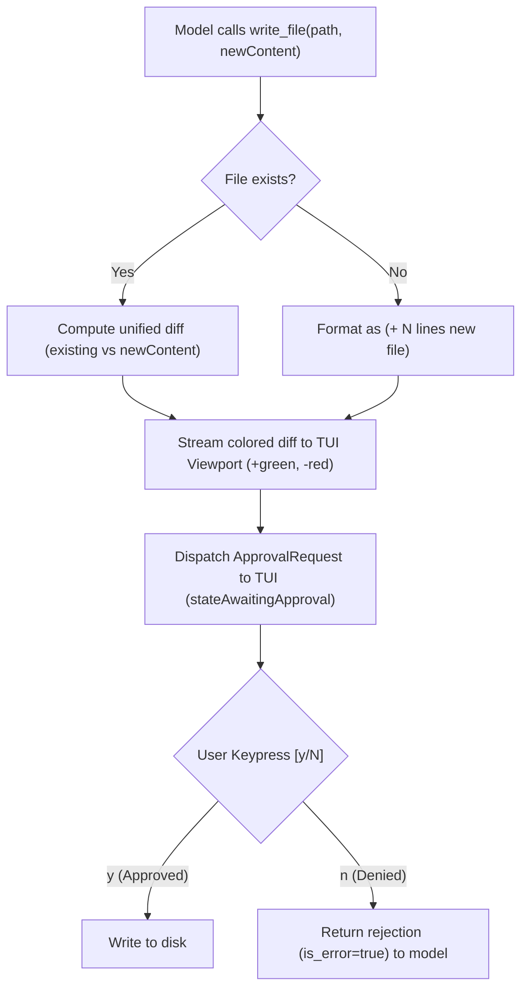

# Step 20: Diff Approval for File Writes

## 1. Architectural Overview

Asking `Allow execution of write_file {"path": "main.go", "content": "..."}? [y/N]` forces the user to read raw JSON with escaped newlines (`\n`). This makes it nearly impossible to review what is actually changing in a file.

In this step, we enhance the permission gate for `write_file` to compute and render a **unified Git-style colored diff** before touching disk:



## 2. Key Design Principles

- **Readable Code Reviews**: The user reviews agent file changes the exact same way they review a GitHub PR.
- **Safety Previews**: Never write bytes to disk until the diff has been explicitly inspected and confirmed.
- **Bubble Tea TUI Integration**: The colored diff lines are written to standard output, captured by the stdout pipe redirect, and smoothly rendered into the scrollable viewport. The confirmation then seamlessly activates the TUI's amber approval box (`stateAwaitingApproval`).

## 3. Implementation Requirements

1. Integrate a diff computation helper in `internal/tool/` or `internal/ui/` (e.g. using `pmezard/go-difflib` or standard unified diff algorithm).
2. Intercept `write_file` in the permission policy or tool execution layer to generate red/green diff text.
3. Deliver the confirmation prompt through the harness `Confirm` / `ApprovalRequest` mechanism.

## 4. Verification & Exercises

### Test 1: Modifying an Existing File
**User Prompt:**
```text
> Add a comment '// Version 2.0' to line 1 of README.md
```

**Expected Interaction & Output:**
```text
[write_file diff] README.md
--- README.md (existing)
+++ README.md (proposed)
@@ -1,3 +1,4 @@
+// Version 2.0
 # Phi Agent Code

[permission required] Apply changes to README.md? [y/N]
```
- Approving writes the change to disk and returns success.
- Denying preserves the original file and returns `"Permission denied by user"`.
