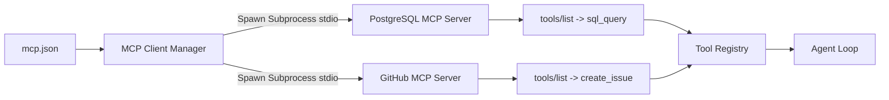

# Step 20: Model Context Protocol (MCP)

## 1. Architectural Overview

Instead of writing every tool locally in Go, Anthropic's **Model Context Protocol (MCP)** provides an open standard for connecting AI agents to external tool servers (databases, GitHub, Slack, local file servers, browser automation) over stdio or SSE.

In this step, we add an **MCP Client Manager** that connects to external MCP servers defined in an `mcp.json` configuration file, dynamically loading their tools into our harness registry:



## 2. Key Design Principles

- **Dynamic Adapter**: Each remote MCP tool is wrapped inside our local `Tool` interface. To the agent loop, a remote tool is completely indistinguishable from a native Go tool.
- **Process Management**: The harness manages the lifecycle (spawning, stdio JSON-RPC communication, graceful shutdown) of external server processes.

## 3. Implementation Requirements

1. Parse `mcp.json` (server command, args, environment).
2. Implement MCP JSON-RPC 2.0 handshake (`initialize`, `tools/list`, `tools/call`).
3. Register external tools dynamically into the `tool.Registry`.

## 4. Verification & Exercises

### Test 1: Discovering MCP Tools
Configure an MCP server in `mcp.json`. Run `/tools`.

**Expected Interaction & Output:**
```text
Registered tools (5):
  - bash: (native)
  - read_file: (native)
  - write_file: (native)
  - mcp__postgres__query: Execute a read-only SQL query against Postgres.
  - mcp__github__create_issue: Create an issue on GitHub.
```

