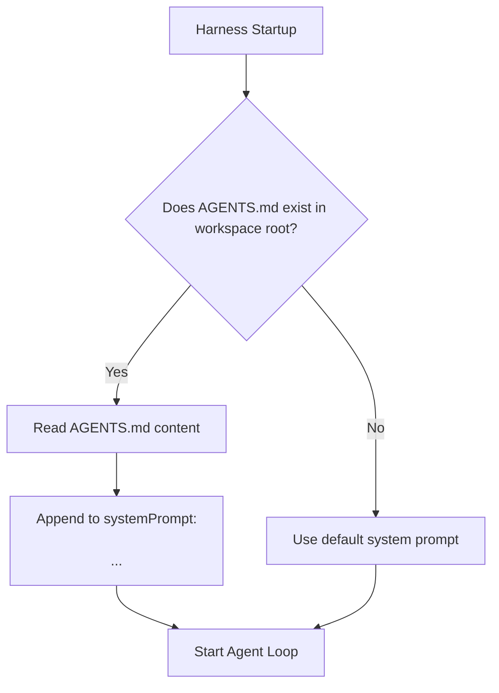

# Step 22: Project Context via AGENTS.md

## 1. Architectural Overview

Coding agents need to know the conventions, tech stack, and testing commands of the specific repository they are operating on. Without this, the model guesses (e.g. running `npm test` on a Go repo or using incompatible styles).

In this step, we implement automatic discovery of `AGENTS.md` (or `CLAUDE.md`), injecting its content directly into the model's system prompt at startup:



## 2. Key Design Principles

- **Convention Over Configuration**: Simply placing an `AGENTS.md` file in any project root automatically customizes the agent's behavior.
- **Dynamic Context Sizing**: Truncate or warn if `AGENTS.md` is excessively large to avoid crowding out conversation context.

## 3. Implementation Requirements

1. Implement `loadProjectContext(cwd string) string`.
2. Format context inside XML tags (`<project_context>...</project_context>`).
3. Append to system prompt before starting the session.

## 4. Verification & Exercises

### Test 1: Adherence to Project Guidelines
Create an `AGENTS.md` in the repo with:
```markdown
Always write commit messages with lowercase prefixes and end replies with '🚀'.
```

**User Prompt:**
```text
> Are there any guidelines for this repo?
```

**Expected Interaction & Output:**
- The model cites the guidelines from `AGENTS.md` and ends its message with `🚀`.

