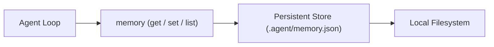

# Step 23: Persistent Agent Memory

## 1. Architectural Overview

Every time you restart the agent process, its working context resets to zero. Past architectural decisions, user preferences (e.g. "I prefer table-driven tests in Go"), and discovered project gotchas are forgotten.

In this step, we implement a **Persistent Memory Store** that saves and loads key-value facts across sessions:



## 2. Key Design Principles

- **Explicit Recall & Save**: The model is given a `memory` tool with operations:
  - `save(key, value)`
  - `recall(key)`
  - `list()`
- **Transparent Persistence**: Stored as human-readable JSON or Markdown in `.agent/memory.json`.

## 3. Implementation Requirements

1. Implement `MemoryStore` interface and JSON file implementation.
2. Create and register the `memory` tool.
3. Inject recalled facts into system prompt or allow model-driven retrieval.

## 4. Verification & Exercises

### Test 1: Cross-Session Retention
1. Session 1:
   ```text
   > Remember that my favorite test library is testify
   ```
   Harness logs: `[tool execute] memory save key='pref:test_lib' value='testify'`.
2. Terminate and restart the program.
3. Session 2:
   ```text
   > What is my preferred testing library?
   ```
   Model recalls `testify` from persistent memory.

