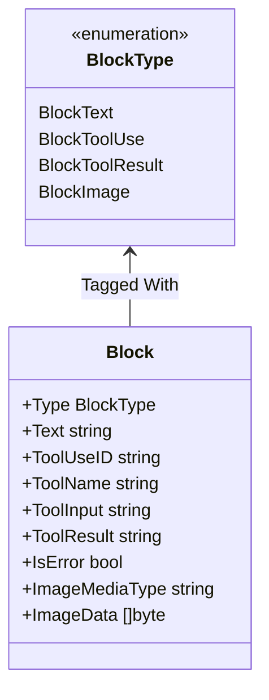

# Step 24: Multimodal & Image Inputs

## 1. Architectural Overview

Modern frontier models (Claude 3.5/3.7, GPT-4o) are natively multimodal. Software engineering agents often need to inspect UI screenshots, architectural mockups, diagrams, or bug reports containing images.

In this step, we enhance our tagged struct message representation in `internal/api/types.go` to accept binary image blocks alongside standard text:



## 2. Key Design Principles

- **Tagged Struct Invariant**: Rather than introducing an interface hierarchy that requires complex type-assertions throughout the codebase, we maintain the vendor-agnostic **Tagged Struct pattern** established in `internal/api/types.go` by adding `BlockImage`, `ImageMediaType`, and `ImageData`.
- **Automatic Format Detection**: Detect MIME types (`image/png`, `image/jpeg`, `image/webp`, `image/gif`) from file extensions or magic bytes.
- **Base64 Encoding**: Normalize local image files into base64 payloads required by LLM wire formats inside `internal/provider/anthropic.go`.
- **CLI Syntax Support**: Allow users to attach images using concise syntax, e.g. `@path/to/diagram.png`.

## 3. Implementation Requirements

1. Extend `internal/api/types.go`:
   - Add `BlockImage BlockType = "image"`.
   - Add `ImageMediaType string` and `ImageData []byte` to `api.Block`.
2. Update user input parser in `internal/ui/` to detect `@<filename>` image attachments and read file bytes.
3. Update `internal/provider/anthropic.go` to map `BlockImage` into `anthropic.ImageBlockParam`.

## 4. Verification & Exercises

### Test 1: Image Inspection & Description
Verify that attaching a local image allows the model to reason about visual details.

**User Prompt:**
```text
> Analyze this architecture diagram @assets/architecture.png
```

**Expected Interaction & Output:**
- Harness detects the image path, reads the bytes, and attaches a `BlockImage`.
- Model describes the diagram components (e.g. database, cache, API gateway) correctly.
