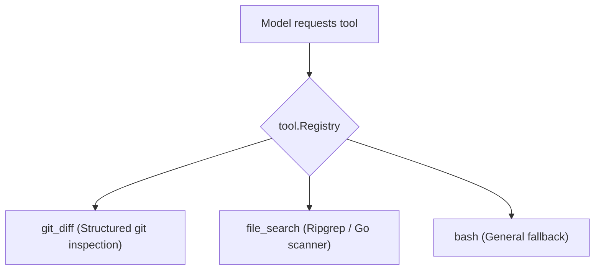

# Step 25: Custom Tools Suite

## 1. Architectural Overview

With the plug-and-play `tool.Registry` established in [Step 09: Plug-and-Play Tool Registry](./09-tool-registry.md), expanding the agent's capabilities becomes effortless.

In this step, we add specialized engineering tools that make the agent significantly faster, safer, and more token-efficient than relying on raw `bash`:
1. **`git_diff`**: Shows uncommitted changes in the repository without running arbitrary shell scripts.
2. **`file_search` / `grep`**: Performs fast regex search across files in the project.



## 2. Key Design Principles

- **Specialized Over General**: Dedicated tools provide tighter input validation, cleaner error reporting, and safer execution boundaries than raw shell invocations.
- **Fast Search**: Using native file-walking or ripgrep is faster, cross-platform, and safer than arbitrary bash pipes.

## 3. Implementation Requirements

1. Create `internal/tool/gitdiff.go` implementing `Tool`.
2. Create `internal/tool/grep.go` implementing `Tool`.
3. Register both in `init()` into `tool.DefaultRegistry`.

## 4. Verification & Exercises

### Test 1: Git Diff Execution
**User Prompt:**
```text
> Show me what files have been modified in git
```

**Expected Interaction & Output:**
- Model invokes `git_diff` (instead of running `bash {"command": "git diff"}`).
- Tool executes `git diff` and returns the diff cleanly.
- Model summarizes the changes.
